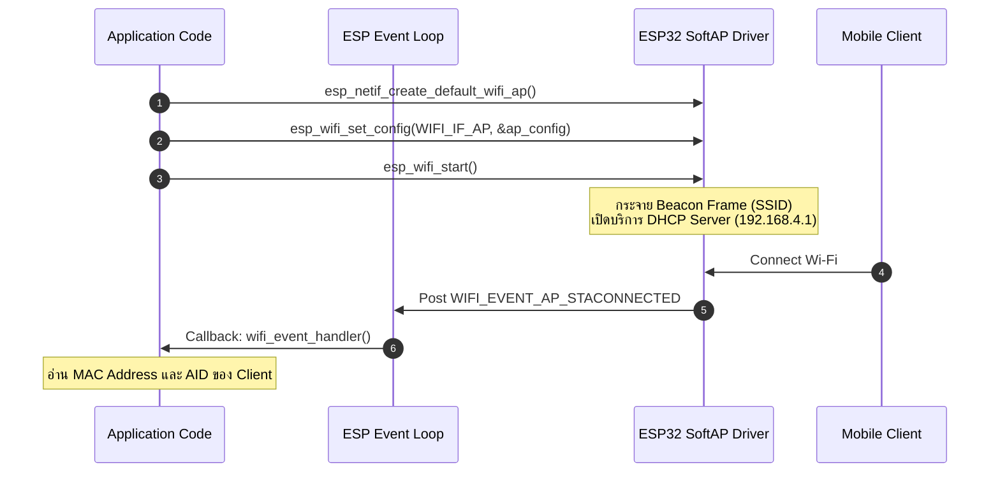
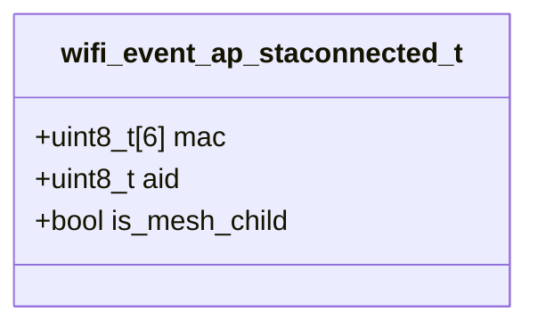

# ใบงานที่ 6.1: การคอนฟิก ESP32 SoftAP และการสกัด Forensic Log ข้อมูล Client (Wi-Fi Access Point Mode)

## 0. กล่าวนำ (Introduction)
ในใบงานนี้ นักศึกษาจะได้สลับบทบาทของ ESP32 จากการเป็นลูกข่าย (Station) มาเป็นผู้ให้บริการจุดเชื่อมต่อไร้สาย **SoftAP (Software Access Point Mode)** ด้วยสถาปัตยกรรม ESP-IDF 

นักศึกษาจะได้เรียนรู้การเปิดบริการ DHCP Server การตั้งค่าโหมดความปลอดภัย WPA2-PSK และดักจับ Forensic Log เมื่อมีอุปกรณ์ลูกข่าย (เช่น สมาร์ตโฟน หรือ ESP32 Station ของเพื่อน) เข้ามาเชื่อมต่อ โดยสกัดข้อมูลในระดับ Link Layer เช่น **MAC Address** และ **Association ID (AID)** จาก Event `WIFI_EVENT_AP_STACONNECTED`

---

## 1. วัตถุประสงค์ (Objectives)
1. สามารถคอนฟิก ESP32 ให้ทำงานในโหมด SoftAP (`WIFI_MODE_AP`) และเปิดบริการ DHCP Server ได้สำเร็จ
2. สามารถใช้ Event Loop ในการดักจับ Event `WIFI_EVENT_AP_STACONNECTED` และ `WIFI_EVENT_AP_STADISCONNECTED`
3. สกัดและวิเคราะห์ข้อมูล MAC Address (BSSID) และ Association ID (AID) ของอุปกรณ์ลูกข่ายที่เข้ามาเชื่อมต่อ
4. เข้าใจกลไกการจำกัดจำนวนการเชื่อมต่อสูงสุด (`max_connection`) บน ESP32

---

## 2. อุปกรณ์และซอฟต์แวร์ที่ใช้ในการทดลอง (Equipment & Tools)
1. บอร์ดไมโครคอนโทรลเลอร์ ESP32 จำนวน 1 บอร์ด
2. สายเชื่อมต่อ Micro-USB หรือ USB-C จำนวน 1 เส้น
3. สมาร์ตโฟน หรือ คอมพิวเตอร์ สำหรับทดสอบเชื่อมต่อ Wi-Fi ที่ ESP32 สร้างขึ้น
4. โปรแกรม IDE เช่น VS Code พร้อม ESP-IDF Toolchain

---

## 3. ความรู้พื้นฐานที่เกี่ยวข้อง (Theoretical Background)

### 3.1 สถาปัตยกรรม Event และ DHCP Server ในโหมด SoftAP



### 3.2 โครงสร้างข้อมูล `wifi_event_ap_staconnected_t` (Class Diagram)



---

## 4. ขั้นตอนการทดลอง (Experimental Procedures)

1. สแกนและตั้งชื่อ SSID ของ ESP32 AP เป็นชื่อเฉพาะของตนเอง (เช่น `"ESP32_AP_XXXX"` โดยระบุรหัสนักศึกษา 4 ตัวท้าย)
2. กำหนดรหัสผ่าน Wi-Fi เป็น `"12345678"` (WPA2-PSK) และจำกัดจำนวนการเชื่อมต่อไว้ที่ 4 เครื่อง (`.max_connection = 4`)
3. ทำการ Build และ Flash ซอร์สโค้ดลงบอร์ด ESP32
4. นำสมาร์ตโฟนกดค้นหา Wi-Fi และป้อนรหัสผ่านเพื่อเชื่อมต่อเข้ากับ ESP32 AP
5. สังเกต Forensic Log ใน Serial Monitor และบันทึกค่า MAC Address, AID และ IP Address ที่ ESP32 แจกจ่ายให้

---

## 5. ซอร์สโค้ดการทดลอง (Complete ESP-IDF Source Code - `main.c`)

ดูใน Lab6-1-Wi-Fi-SoftAP\main\main.c

---

## 6. ตารางบันทึกผลการทดลอง (Experiment Results)

### 6.1 บันทึกข้อมูล Client ที่เชื่อมต่อเข้ากับ ESP32 SoftAP

| อุปกรณ์ที่ใช้ทดสอบ (เช่น iPhone/Android) | MAC Address ที่ดักจับได้ | Association ID (AID) | หมายเลข IP Address ที่ได้ (ถ้าทราบ) |
| :--- | :--- | :---: | :---: |
| **อุปกรณ์ที่ 1** | 02:E4:C0:11:FB:CC|1 |192.168.4.2 |
| **อุปกรณ์ที่ 2** |DA:26:AE:32:3B:AB |2 |192.168.4.3 |

---

## 7. คำถามท้ายการทดลอง (Post-Lab Questions)

1. เหตุใด IP Address เริ่มต้นของ ESP32 SoftAP จึงเป็น `192.168.4.1` และ DHCP Server บน ESP32 เริ่มแจกจ่าย IP ที่หมายเลขใด?
```
ทุกครั้งที่เรียกฟังก์ชัน esp_netif_create_default_wifi_ap() โดยไม่ได้ตั้งค่า IP เอง ระบบจะดึงค่า struct ตัวนี้มาใช้เป็นค่าเริ่มต้น คือ 192.168.4.0/24 ก็เป็น private IP range ตาม RFC 1918 แต่ Espressif เลือกใช้ subnet .4.x เพื่อไม่ให้ชนกับ subnet เราเตอร์บ้านที่มักใช้ .0.x หรือ .1.x เวลา ESP32 ทำงานเป็น AP ควบคู่กับเครือข่ายอื่น

DHCP Server บน ESP32 เริ่มแจกจ่าย IP ที่หมาย 192.168.4.2
```
2. สมาชิกตัวแปร `mac` ในโครงสร้าง `wifi_event_ap_staconnected_t` สามารถนำไปประยุกต์ใช้ทำระบบความปลอดภัยขั้นสูง (เช่น MAC Filtering) ได้อย่างไร?
```
mac ที่ได้จาก event ทำหน้าที่เป็น กุญแจ สำหรับเทียบกับ whitelist/blacklist ของ MAC ที่อนุญาต แล้วใช้ esp_wifi_deauth_sta(aid) เป็นกลไกบังคับในการตัดการเชื่อมต่อ Client ที่ไม่ได้รับอนุญาตออกจาก SoftAP โดยอัตโนมัติ เป็นความปลอดภัยชั้นเสริมจาก WPA2
```
3. หากมี Client พยายามเชื่อมต่อเป็นเครื่องที่ 5 (เกินค่า `max_connection = 4`) จะเกิดเหตุการณ์ใดขึ้นในระดับสัญญาณวิทยุ?
```
Client เครื่องที่ 5 จะถูก ESP32 ปฏิเสธด้วยการส่ง Deauthentication frame ออกไปทันทีในระดับสัญญาณวิทยุ ไดรเวอร์ Wi-Fi ของ ESP32 จะตัดสัญญาณ Client รายนั้นออกจาก BSS โดยอัตโนมัติ เนื่องจากจำนวน Station ที่เชื่อมต่ออยู่ครบ max_connection = 4 แล้ว ผลคือฝั่ง Client จะเห็นการเชื่อมต่อล้มเหลว/หลุดทันทีหลังพยายามเชื่อมต่อ
```

---

ตัวอย่าง output log

```
rst:0x1 (POWERON_RESET),boot:0x13 (SPI_FAST_FLASH_BOOT)
configsip: 0, SPIWP:0xee
clk_drv:0x00,q_drv:0x00,d_drv:0x00,cs0_drv:0x00,hd_drv:0x00,wp_drv:0x00
mode:DIO, clock div:2
load:0x3fff0040,len:6272
load:0x40078000,len:15848
load:0x40080400,len:3920
--- 0x40080400: _invalid_pc_placeholder at /Users/ittikorntongsima/My-Library/esp-idf/components/xtensa/xtensa_vectors.S:2259
entry 0x40080644
--- 0x40080644: call_start_cpu0 at /Users/ittikorntongsima/My-Library/esp-idf/components/bootloader/subproject/main/bootloader_start.c:27
I (27) boot: ESP-IDF v6.1-dev-3480-g44c77cbf46 2nd stage bootloader
I (27) boot: compile time Aug 23 2026 21:52:12
I (28) boot: Multicore bootloader
I (30) boot: chip revision: v3.1
I (33) boot.esp32: SPI Speed      : 40MHz
I (37) boot.esp32: SPI Mode       : DIO
I (40) boot.esp32: SPI Flash Size : 2MB
I (44) boot: Enabling RNG early entropy source...
I (49) boot: Partition Table:
I (51) boot: ## Label            Usage          Type ST Offset   Length
I (57) boot:  0 nvs              WiFi data        01 02 00009000 00006000
I (64) boot:  1 phy_init         RF data          01 01 0000f000 00001000
I (71) boot:  2 factory          factory app      00 00 00010000 00100000
I (77) boot: End of partition table
I (80) esp_image: segment 0: paddr=00010020 vaddr=3f400020 size=1a1f4h (106996) map
I (126) esp_image: segment 1: paddr=0002a21c vaddr=3ffb0000 size=045a8h ( 17832) load
I (133) esp_image: segment 2: paddr=0002e7cc vaddr=40080000 size=0184ch (  6220) load
I (136) esp_image: segment 3: paddr=00030020 vaddr=400d0020 size=87748h (554824) map
I (335) esp_image: segment 4: paddr=000b7770 vaddr=4008184c size=13dc0h ( 81344) load
I (368) esp_image: segment 5: paddr=000cb538 vaddr=50000000 size=00028h (    40) load
I (379) boot: Loaded app from partition at offset 0x10000
I (380) boot: Disabling RNG early entropy source...
I (390) cpu_start: Multicore app
I (398) cpu_start: GPIO 3 and 1 are used as console UART I/O pins
I (399) cpu_start: Pro cpu start user code
I (399) cpu_start: cpu freq: 160000000 Hz
I (400) app_init: Application information:
I (404) app_init: Project name:     lab1
I (408) app_init: App version:      1
I (411) app_init: Compile time:     Aug 23 2026 21:52:09
I (416) app_init: ELF file SHA256:  594158b91...
I (421) app_init: ESP-IDF:          v6.1-dev-3480-g44c77cbf46
I (426) efuse_init: Min chip rev:     v0.0
I (430) efuse_init: Max chip rev:     v3.99
I (434) efuse_init: Chip rev:         v3.1
I (438) heap_init: Initializing. RAM available for dynamic allocation:
I (444) heap_init: At 3FFAE6E0 len 00001920 (6 KiB): DRAM
I (449) heap_init: At 3FFB8A88 len 00027578 (157 KiB): DRAM
I (454) heap_init: At 3FFE0440 len 00003AE0 (14 KiB): D/IRAM
I (460) heap_init: At 3FFE4350 len 0001BCB0 (111 KiB): D/IRAM
I (465) heap_init: At 4009560C len 0000A9F4 (42 KiB): IRAM
I (472) spi_flash: detected chip: generic
I (474) spi_flash: flash io: dio
W (477) spi_flash: Detected size(4096k) larger than the size in the binary image header(2048k). Using the size in the binary image header.
I (491) main_task: Started on CPU0
I (501) main_task: Calling app_main()
I (501) LAB_SOFTAP: [FORENSIC]: Call nvs_flash_init()
I (521) LAB_SOFTAP: [FORENSIC]: Call esp_netif_init()
I (521) LAB_SOFTAP: [FORENSIC]: Call esp_event_loop_create_default()
I (521) LAB_SOFTAP: [FORENSIC]: Call esp_netif_create_default_wifi_ap()
I (531) LAB_SOFTAP: [FORENSIC]: SoftAP Interface created at 0x3ffbdd7c (Default IP: 192.168.4.1)
I (531) LAB_SOFTAP: [FORENSIC]: Call esp_wifi_init(&cfg)
I (551) wifi:wifi driver task: 3ffc0500, prio:23, stack:6656, core=0
I (561) wifi:wifi firmware version: 5d0a58b
I (561) wifi:wifi certification version: v7.0
I (561) wifi:config NVS flash: enabled
I (561) wifi:config nano formatting: disabled
I (561) wifi:Init data frame dynamic rx buffer num: 32
I (571) wifi:Init static rx mgmt buffer num: 5
I (571) wifi:Init management short buffer num: 32
I (581) wifi:Init dynamic tx buffer num: 32
I (581) wifi:Init static rx buffer size: 1600
I (581) wifi:Init static rx buffer num: 10
I (591) wifi:Init dynamic rx buffer num: 32
I (591) wifi_init: rx ba win: 6
I (591) wifi_init: accept mbox: 6
I (601) wifi_init: tcpip mbox: 32
I (601) wifi_init: udp mbox: 6
I (601) wifi_init: tcp mbox: 6
I (611) wifi_init: tcp tx win: 5760
I (611) wifi_init: tcp rx win: 5760
I (611) wifi_init: tcp mss: 1440
I (621) wifi_init: WiFi IRAM OP enabled
I (621) wifi_init: WiFi RX IRAM OP enabled
I (621) LAB_SOFTAP: [FORENSIC]: Call esp_event_handler_instance_register(WIFI_EVENT)
I (631) LAB_SOFTAP: [FORENSIC]: Call esp_wifi_set_mode(WIFI_MODE_AP)
I (641) LAB_SOFTAP: [FORENSIC]: Call esp_wifi_set_config(WIFI_IF_AP, &wifi_config)
I (651) LAB_SOFTAP: [FORENSIC]: Call esp_wifi_start()
I (651) phy_init: phy_version 4863,a3a4459,Oct 28 2025,14:30:06
I (741) wifi:mode : softAP (8c:94:df:45:93:e5)
I (751) wifi:Total power save buffer number: 16
I (751) wifi:Init max length of beacon: 752/752
I (751) wifi:Init max length of beacon: 752/752
I (751) LAB_SOFTAP: ==================================================================
I (751) esp_netif_lwip: DHCP server started on interface WIFI_AP_DEF with IP: 192.168.4.1
I (761) LAB_SOFTAP:   ESP32 SoftAP Running! SSID: "ESP32_AP_0261", Channel: 1
I (771) LAB_SOFTAP: ==================================================================
I (781) LAB_SOFTAP: [TCP SERVER]: Listening on 192.168.4.1:8080
I (781) main_task: Returned from app_main()
I (22741) wifi:new:<1,0>, old:<1,1>, ap:<1,0>, sta:<255,255>, prof:1, snd_ch_cfg:0x0
I (22741) wifi:station: 02:e4:c0:11:fb:cc join, AID=1, bgn, 20
I (22771) LAB_SOFTAP: =======================================================
I (22781) LAB_SOFTAP: [FORENSIC EVENT]: Client Connected to ESP32 SoftAP!
I (22781) LAB_SOFTAP:   -> Client MAC Address : 02:E4:C0:11:FB:CC
I (22781) LAB_SOFTAP:   -> Assigned AID       : 1
I (22791) LAB_SOFTAP: =======================================================
I (22931) esp_netif_lwip: DHCP server assigned IP to a client, IP is: 192.168.4.2
I (23331) wifi:<ba-add>idx:2 (ifx:1, 02:e4:c0:11:fb:cc), tid:0, ssn:2, winSize:64
I (28011) wifi:<ba-add>idx:3 (ifx:1, 02:e4:c0:11:fb:cc), tid:1, ssn:0, winSize:64
I (28041) wifi:<ba-add>idx:4 (ifx:1, 02:e4:c0:11:fb:cc), tid:5, ssn:0, winSize:64
I (40511) wifi:station: 02:e4:c0:11:fb:cc leave, AID = 1, reason = 8, bss_flags is 691315, bss:0x3ffb9e3c
I (40511) wifi:new:<1,0>, old:<1,0>, ap:<1,0>, sta:<255,255>, prof:1, snd_ch_cfg:0x0
I (40521) wifi:<ba-del>idx:2, tid:0
I (40521) wifi:<ba-del>idx:3, tid:1
I (40531) wifi:<ba-del>idx:4, tid:5
W (40531) LAB_SOFTAP: =======================================================
W (40541) LAB_SOFTAP: [FORENSIC EVENT]: Client Disconnected from ESP32 SoftAP!
W (40541) LAB_SOFTAP:   -> Client MAC Address : 02:E4:C0:11:FB:CC
W (40551) LAB_SOFTAP:   -> Released AID       : 1
W (40551) LAB_SOFTAP: =======================================================
I (40541) wifi:new:<1,1>, old:<1,0>, ap:<1,1>, sta:<255,255>, prof:1, snd_ch_cfg:0x0
W (40571) wifi:no need to send deauth when softap is sending deauth
I (40841) wifi:new:<1,0>, old:<1,1>, ap:<1,0>, sta:<255,255>, prof:1, snd_ch_cfg:0x0
I (40841) wifi:station: 02:e4:c0:11:fb:cc join, AID=1, bgn, 20
I (40861) LAB_SOFTAP: =======================================================
I (40861) LAB_SOFTAP: [FORENSIC EVENT]: Client Connected to ESP32 SoftAP!
I (40871) LAB_SOFTAP:   -> Client MAC Address : 02:E4:C0:11:FB:CC
I (40871) LAB_SOFTAP:   -> Assigned AID       : 1
I (40881) LAB_SOFTAP: =======================================================
I (41011) esp_netif_lwip: DHCP server assigned IP to a client, IP is: 192.168.4.2
I (41841) wifi:<ba-add>idx:2 (ifx:1, 02:e4:c0:11:fb:cc), tid:0, ssn:2, winSize:64
I (41941) wifi:<ba-add>idx:3 (ifx:1, 02:e4:c0:11:fb:cc), tid:1, ssn:0, winSize:64
E (41941) wifi:CCMP replay detected: A1=8c:94:df:45:93:e5 A2=02:e4:c0:11:fb:cc PN=11, RSC=11 seq=58352
I (42221) wifi:<ba-add>idx:4 (ifx:1, 02:e4:c0:11:fb:cc), tid:5, ssn:0, winSize:64
I (48811) wifi:new:<1,0>, old:<1,0>, ap:<1,0>, sta:<255,255>, prof:1, snd_ch_cfg:0x0
I (48811) wifi:station: da:26:ae:32:3b:ab join, AID=2, bgn, 20
I (48841) LAB_SOFTAP: =======================================================
I (48841) LAB_SOFTAP: [FORENSIC EVENT]: Client Connected to ESP32 SoftAP!
I (48841) LAB_SOFTAP:   -> Client MAC Address : DA:26:AE:32:3B:AB
I (48851) LAB_SOFTAP:   -> Assigned AID       : 2
I (48851) LAB_SOFTAP: =======================================================
I (50061) esp_netif_lwip: DHCP server assigned IP to a client, IP is: 192.168.4.3

```
