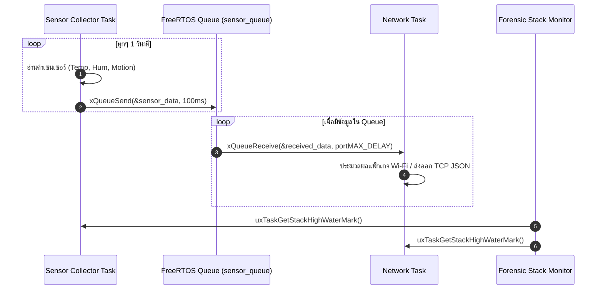

# ใบงานที่ 6.3: การออกแบบ FreeRTOS Task Architecture & Sensor Data Fusion ผ่าน Queue

## 0. กล่าวนำ (Introduction)
ในแอปพลิเคชัน IoT ระดับอุตสาหกรรม โปรแกรมเมอร์จะไม่เขียนโค้ดอ่านค่าเซนเซอร์และการรับส่งข้อมูล Wi-Fi รวมไว้ในฟังก์ชันเดียวกัน เพราะจะทำให้สแตกระบบเครือข่ายชะงัก (Network Latency & Blocking) 

ในใบงานนี้นักศึกษาจะได้ออกแบบสถาปัตยกรรม **FreeRTOS Multi-Tasking** โดยแยกโปรแกรมออกเป็น **Sensor Collector Task** และ **Network Communication Task** แล้วใช้ **FreeRTOS Queue** เป็นสะพานเชื่อมส่งผ่านโครงสร้างข้อมูล `sensor_data_t` อย่างปลอดภัย (Thread-Safe) พร้อมทั้งใช้คำสั่ง Forensic ตรวจวัดหน่วยความจำสแตก `uxTaskGetStackHighWaterMark()`

---

## 1. วัตถุประสงค์ (Objectives)
1. สามารถสร้างและบริหารจัดการ FreeRTOS Tasks บน ESP-IDF ด้วยฟังก์ชัน `xTaskCreate()` ได้
2. สามารถสร้างและใช้งาน FreeRTOS Queue (`xQueueCreate`, `xQueueSend`, `xQueueReceive`) ในการส่งผ่านข้อมูลได้
3. ป้องกันปัญหาการบล็อกระบบเครือข่าย Wi-Fi โดยการแยกงานอ่านเซนเซอร์ออกจาก Network Loop
4. ประเมินการใช้หน่วยความจำสแตกของแต่ละ Task ในสไตล์ Forensic ด้วย `uxTaskGetStackHighWaterMark()`

---

## 2. อุปกรณ์และซอฟต์แวร์ที่ใช้ในการทดลอง (Equipment & Tools)
1. บอร์ดไมโครคอนโทรลเลอร์ ESP32 จำนวน 1 บอร์ด
2. สายเชื่อมต่อ Micro-USB หรือ USB-C จำนวน 1 เส้น
3. โปรแกรม IDE เช่น VS Code พร้อม ESP-IDF Toolchain

---

## 3. สถาปัตยกรรมระบบ (System Architecture & Sequence)



---

## 4. ขั้นตอนการทดลอง (Experimental Procedures)

1. นำซอร์สโค้ดในข้อ 5 ไปวางในไฟล์ `main/main.c` ทำการ Build และ Flash ลงบอร์ด ESP32
2. สังเกต Forensic Log ใน Serial Monitor:
   - ตรวจดูข้อมูลที่ถูกส่งจาก `vSensorTask` เข้าสู่ Queue และถูกรับโดย `vNetworkTask`
   - ตรวจดูค่า **Stack High Water Mark** (ขนาดสแตกคงเหลือ) ของแต่ละ Task
3. ทดลองปรับขนาดสแตกของ `vSensorTask` ใน `xTaskCreate()` จาก `4096` ลดลงเหลือ `1024` สังเกตค่า High Water Mark และวิเคราะห์จุดเสี่ยง Stack Overflow

---

## 5. ซอร์สโค้ดการทดลอง (Complete ESP-IDF Source Code - `main.c`)

```c
#include <stdio.h>
#include <string.h>
#include "freertos/FreeRTOS.h"
#include "freertos/task.h"
#include "freertos/queue.h"
#include "esp_system.h"
#include "esp_log.h"
#include "esp_random.h"

static const char *TAG = "LAB_FREERTOS_QUEUE";

// Sensor Data Structure
typedef struct {
    float temperature;
    float humidity;
    uint32_t light_lux;
    uint32_t timestamp_ms;
} sensor_data_t;

// Queue Handle
static QueueHandle_t xSensorQueue = NULL;

// ------------------------------------------------------------------
// Task 1: Sensor Collector Task (Simulates Reading Hardware Sensors)
// ------------------------------------------------------------------
void vSensorTask(void *pvParameters) {
    sensor_data_t data;
    ESP_LOGI(TAG, "[TASK CREATED]: Sensor Collector Task Started on Core %d", xPortGetCoreID());

    while (1) {
        // 1. Simulate reading sensors
        data.temperature = 25.0f + (esp_random() % 100) / 10.0f;
        data.humidity = 50.0f + (esp_random() % 200) / 10.0f;
        data.light_lux = 200 + (esp_random() % 500);
        data.timestamp_ms = xTaskGetTickCount() * portTICK_PERIOD_MS;

        ESP_LOGI(TAG, "[SENSOR TASK]: Pushing Data -> Temp: %.1f C, Hum: %.1f %%, Lux: %ld",
                 data.temperature, data.humidity, data.light_lux);

        // 2. Send data structure to FreeRTOS Queue
        if (xQueueSend(xSensorQueue, &data, pdMS_TO_TICKS(100)) != pdPASS) {
            ESP_LOGW(TAG, "[QUEUE WARNING]: Queue Full! Failed to push sensor data.");
        }

        // 3. Stack High Water Mark Check
        UBaseType_t hwm = uxTaskGetStackHighWaterMark(NULL);
        ESP_LOGI("FORENSIC_STACK", "  -> SensorTask Stack Remaining: %u words (%u bytes)",
                 hwm, hwm * sizeof(StackType_t));

        vTaskDelay(pdMS_TO_TICKS(1500));
    }
}

// ------------------------------------------------------------------
// Task 2: Network Task (Consumes Data from Queue for Wi-Fi Transmission)
// ------------------------------------------------------------------
void vNetworkTask(void *pvParameters) {
    sensor_data_t rx_data;
    ESP_LOGI(TAG, "[TASK CREATED]: Network Task Started on Core %d", xPortGetCoreID());

    while (1) {
        // Wait indefinitely for data from Queue
        if (xQueueReceive(xSensorQueue, &rx_data, portMAX_DELAY) == pdTRUE) {
            ESP_LOGI(TAG, "=======================================================");
            ESP_LOGI(TAG, "[NETWORK TASK]: Data Received from Queue!");
            ESP_LOGI(TAG, "  -> Timestamp   : %ld ms", rx_data.timestamp_ms);
            ESP_LOGI(TAG, "  -> Temperature : %.2f degC", rx_data.temperature);
            ESP_LOGI(TAG, "  -> Humidity    : %.2f %%", rx_data.humidity);
            ESP_LOGI(TAG, "  -> Light Lux   : %ld lux", rx_data.light_lux);
            ESP_LOGI(TAG, "[NETWORK TASK]: Preparing JSON Packet for Wi-Fi Transmission...");
            ESP_LOGI(TAG, "=======================================================");
        }

        UBaseType_t hwm = uxTaskGetStackHighWaterMark(NULL);
        ESP_LOGI("FORENSIC_STACK", "  -> NetworkTask Stack Remaining: %u words (%u bytes)",
                 hwm, hwm * sizeof(StackType_t));
    }
}

void app_main(void) {
    ESP_LOGI(TAG, "==================================================================");
    ESP_LOGI(TAG, "  Lab 6.3: FreeRTOS Multi-Tasking & Sensor Data Queue Fusion");
    ESP_LOGI(TAG, "==================================================================");

    // Create FreeRTOS Queue for 10 items of sensor_data_t
    xSensorQueue = xQueueCreate(10, sizeof(sensor_data_t));
    if (xSensorQueue == NULL) {
        ESP_LOGE(TAG, "Failed to create FreeRTOS Queue!");
        return;
    }

    // Create Tasks
    xTaskCreate(vSensorTask, "SensorCollectorTask", 3072, NULL, 5, NULL);
    xTaskCreate(vNetworkTask, "NetworkCommTask", 4096, NULL, 4, NULL);
}
```

---

## 6. ตารางบันทึกผลการทดลอง (Experiment Results)

### 6.1 บันทึกข้อมูล Forensic Stack High Water Mark

| ชื่อ FreeRTOS Task | ขนาด Stack ที่กำหนดใน `xTaskCreate` (Bytes) | ค่า High Water Mark ที่อ่านได้ (Words / Bytes) | สถานะความปลอดภัยสแตก |
| :--- | :---: | :---: | :---: |
| **`SensorCollectorTask`** | 3072 |2,084 Words (8,336 Bytes) | ปลอดภัย (เหลือมากกว่า 67%)|
| **`NetworkCommTask`** | 4096 |3,136 Words (12,544 Bytes) |ปลอดภัย (เหลือมากกว่า 76%) |

---

## 7. คำถามท้ายการทดลอง (Post-Lab Questions)

1. เหตุใดการใช้ **FreeRTOS Queue** จึงมีความปลอดภัย (Thread-Safe) มากกว่าการใช้ตัวแปรแบบ Global ในการรับส่งข้อมูลระหว่างสอง Task?
```
   มีระบบป้องกันข้อมูลตีกัน (Thread-Safe / Mutex ในตัว): ควบคุมให้เข้าถึงได้ทีละ Task ป้องกันข้อมูลเสียหาย (Data Race) หากถูกแทรกจังหวะ (Interrupt) ต่างจาก Global Variable ที่เสี่ยงข้อมูลตีกันจนรวน
```
2. ค่า **Stack High Water Mark** มีประโยชน์อย่างไรในการตรวจวินิจฉัยปัญหาบั๊กในระบบเรียลไทม์ (RTOS)?
   ```
   วัดความปลอดภัยของ RAM: บอกขนาด Stack ที่ เหลือน้อยที่สุด นับตั้งแต่เปิดเครื่อง ทำให้รู้ว่าเสี่ยงเกิด Stack Overflow หรือไม่ และช่วยให้ปรับลดขนาด RAM ที่จองไว้ให้พอดี ไม่สิ้นเปลือง
   ```
3. หาก `vSensorTask` ส่งข้อมูลเร็วมาก (เช่น ทุก 10ms) แต่ `vNetworkTask` ส่งข้อมูลออก Wi-Fi ได้ช้า (เช่น ใช้เวลา 500ms) จะเกิดอะไรขึ้นกับ Queue และระบบจะรับมืออย่างไร?
   ```
   สิ่งที่เกิดขึ้น: ข้อมูลจะเต็ม Queue อย่างรวดเร็ว
การรับมือของระบบ:
ถ้าตั้งให้ รอ (Block): SensorTask จะโดนสั่งหยุดรอจนกว่า Queue จะมีที่ว่าง
ถ้าตั้งให้ ไม่รอ (Non-blocking): ข้อมูลใหม่จะถูก ทิ้ง (Drop) ทันที พร้อมคืนค่า Queue เต็ม
   ```
