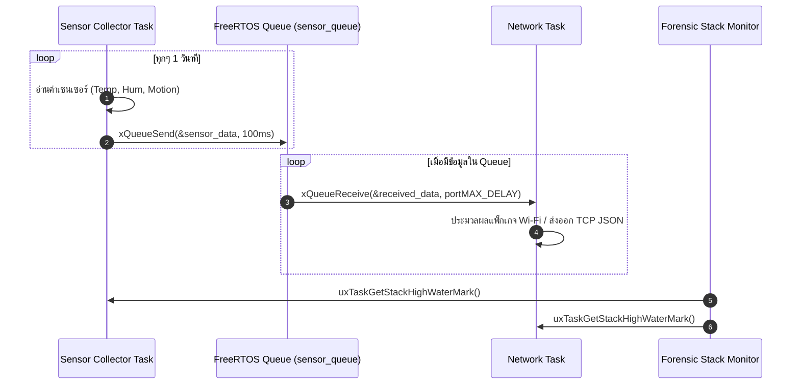

# ใบงานที่ 6.3: การออกแบบ FreeRTOS Task Architecture & Sensor Data Fusion ผ่าน Queue

## 0. กล่าวนำ (Introduction)
ในแอปพลิเคชัน IoT ระดับอุตสาหกรรม โปรแกรมเมอร์จะไม่เขียนโค้ดอ่านค่าเซนเซอร์และการรับส่งข้อมูล Wi-Fi รวมไว้ในฟังก์ชันเดียวกัน เพราะจะทำให้สแตกระบบเครือข่ายชะงัก (Network Latency & Blocking) 

ในใบงานนี้นักศึกษาจะได้ออกแบบสถาปัตยกรรม **FreeRTOS Multi-Tasking** โดยแยกโปรแกรมออกเป็น **Sensor Collector Task** และ **Network Communication Task** แล้วใช้ **FreeRTOS Queue** เป็นสะพานเชื่อมส่งผ่านโครงสร้างข้อมูล `sensor_data_t` อย่างปลอดภัย (Thread-Safe) พร้อมทั้งใช้คำสั่ง Forensic ตรวจวัดหน่วยความจำสแตก `uxTaskGetStackHighWaterMark()`

---

## 1. วัตถุประสงค์ (Objectives)
1. สามารถสร้างและบริหารจัดการ FreeRTOS Tasks บน ESP-IDF ด้วยฟังก์ชัน `xTaskCreate()` ได้
2. สามารถสร้างและใช้งาน FreeRTOS Queue (`xQueueCreate`, `xQueueSend`, `xQueueReceive`) ในการส่งผ่านข้อมูลได้
3. ป้องกันปัญหาการบล็อกระบบเครือข่าย Wi-Fi โดยการแยกงานอ่านเซนเซอร์ออกจาก Network Loop
4. ประเมินการใช้หน่วยความจำสแตกของแต่ละ Task ในสไตล์ Forensic ด้วย `uxTaskGetStackHighWaterMark()`

---

## 2. อุปกรณ์และซอฟต์แวร์ที่ใช้ในการทดลอง (Equipment & Tools)
1. บอร์ดไมโครคอนโทรลเลอร์ ESP32 จำนวน 1 บอร์ด
2. สายเชื่อมต่อ Micro-USB หรือ USB-C จำนวน 1 เส้น
3. โปรแกรม IDE เช่น VS Code พร้อม ESP-IDF Toolchain

---

## 3. สถาปัตยกรรมระบบ (System Architecture & Sequence)



---

## 4. ขั้นตอนการทดลอง (Experimental Procedures)

1. นำซอร์สโค้ดในข้อ 5 ไปวางในไฟล์ `main/main.c` ทำการ Build และ Flash ลงบอร์ด ESP32
2. สังเกต Forensic Log ใน Serial Monitor:
   - ตรวจดูข้อมูลที่ถูกส่งจาก `vSensorTask` เข้าสู่ Queue และถูกรับโดย `vNetworkTask`
   - ตรวจดูค่า **Stack High Water Mark** (ขนาดสแตกคงเหลือ) ของแต่ละ Task
3. ทดลองปรับขนาดสแตกของ `vSensorTask` ใน `xTaskCreate()` จาก `4096` ลดลงเหลือ `1024` สังเกตค่า High Water Mark และวิเคราะห์จุดเสี่ยง Stack Overflow

---

## 5. ซอร์สโค้ดการทดลอง (Complete ESP-IDF Source Code - `main.c`)

```c
#include <stdio.h>
#include <string.h>
#include "freertos/FreeRTOS.h"
#include "freertos/task.h"
#include "freertos/queue.h"
#include "esp_system.h"
#include "esp_log.h"
#include "esp_random.h"

static const char *TAG = "LAB_FREERTOS_QUEUE";

// Sensor Data Structure
typedef struct {
    float temperature;
    float humidity;
    uint32_t light_lux;
    uint32_t timestamp_ms;
} sensor_data_t;

// Queue Handle
static QueueHandle_t xSensorQueue = NULL;

// ------------------------------------------------------------------
// Task 1: Sensor Collector Task (Simulates Reading Hardware Sensors)
// ------------------------------------------------------------------
void vSensorTask(void *pvParameters) {
    sensor_data_t data;
    ESP_LOGI(TAG, "[TASK CREATED]: Sensor Collector Task Started on Core %d", xPortGetCoreID());

    while (1) {
        // 1. Simulate reading sensors
        data.temperature = 25.0f + (esp_random() % 100) / 10.0f;
        data.humidity = 50.0f + (esp_random() % 200) / 10.0f;
        data.light_lux = 200 + (esp_random() % 500);
        data.timestamp_ms = xTaskGetTickCount() * portTICK_PERIOD_MS;

        ESP_LOGI(TAG, "[SENSOR TASK]: Pushing Data -> Temp: %.1f C, Hum: %.1f %%, Lux: %ld",
                 data.temperature, data.humidity, data.light_lux);

        // 2. Send data structure to FreeRTOS Queue
        if (xQueueSend(xSensorQueue, &data, pdMS_TO_TICKS(100)) != pdPASS) {
            ESP_LOGW(TAG, "[QUEUE WARNING]: Queue Full! Failed to push sensor data.");
        }

        // 3. Stack High Water Mark Check
        UBaseType_t hwm = uxTaskGetStackHighWaterMark(NULL);
        ESP_LOGI("FORENSIC_STACK", "  -> SensorTask Stack Remaining: %u words (%u bytes)",
                 hwm, hwm * sizeof(StackType_t));

        vTaskDelay(pdMS_TO_TICKS(1500));
    }
}

// ------------------------------------------------------------------
// Task 2: Network Task (Consumes Data from Queue for Wi-Fi Transmission)
// ------------------------------------------------------------------
void vNetworkTask(void *pvParameters) {
    sensor_data_t rx_data;
    ESP_LOGI(TAG, "[TASK CREATED]: Network Task Started on Core %d", xPortGetCoreID());

    while (1) {
        // Wait indefinitely for data from Queue
        if (xQueueReceive(xSensorQueue, &rx_data, portMAX_DELAY) == pdTRUE) {
            ESP_LOGI(TAG, "=======================================================");
            ESP_LOGI(TAG, "[NETWORK TASK]: Data Received from Queue!");
            ESP_LOGI(TAG, "  -> Timestamp   : %ld ms", rx_data.timestamp_ms);
            ESP_LOGI(TAG, "  -> Temperature : %.2f degC", rx_data.temperature);
            ESP_LOGI(TAG, "  -> Humidity    : %.2f %%", rx_data.humidity);
            ESP_LOGI(TAG, "  -> Light Lux   : %ld lux", rx_data.light_lux);
            ESP_LOGI(TAG, "[NETWORK TASK]: Preparing JSON Packet for Wi-Fi Transmission...");
            ESP_LOGI(TAG, "=======================================================");
        }

        UBaseType_t hwm = uxTaskGetStackHighWaterMark(NULL);
        ESP_LOGI("FORENSIC_STACK", "  -> NetworkTask Stack Remaining: %u words (%u bytes)",
                 hwm, hwm * sizeof(StackType_t));
    }
}

void app_main(void) {
    ESP_LOGI(TAG, "==================================================================");
    ESP_LOGI(TAG, "  Lab 6.3: FreeRTOS Multi-Tasking & Sensor Data Queue Fusion");
    ESP_LOGI(TAG, "==================================================================");

    // Create FreeRTOS Queue for 10 items of sensor_data_t
    xSensorQueue = xQueueCreate(10, sizeof(sensor_data_t));
    if (xSensorQueue == NULL) {
        ESP_LOGE(TAG, "Failed to create FreeRTOS Queue!");
        return;
    }

    // Create Tasks
    xTaskCreate(vSensorTask, "SensorCollectorTask", 3072, NULL, 5, NULL);
    xTaskCreate(vNetworkTask, "NetworkCommTask", 4096, NULL, 4, NULL);
}
```

---

## 6. ตารางบันทึกผลการทดลอง (Experiment Results)

### 6.1 บันทึกข้อมูล Forensic Stack High Water Mark

| ชื่อ FreeRTOS Task        | ขนาด Stack ที่กำหนดใน `xTaskCreate` (Bytes) | ค่า High Water Mark ที่อ่านได้ (Words / Bytes) |     สถานะความปลอดภัยสแตก      |
| :------------------------ | :-----------------------------------------: | :--------------------------------------------: | :---------------------------: |
| **`SensorCollectorTask`** |                    3072                     |            2028 Words / 2028 Bytes             | ปลอดภัย (มี Stack เหลือ ~66%) |
| **`NetworkCommTask`**     |                    4096                     |            3080 Words / 3080 Bytes             | ปลอดภัย (มี Stack เหลือ ~75%) |

---

## 7. คำถามท้ายการทดลอง (Post-Lab Questions)

1. เหตุใดการใช้ **FreeRTOS Queue** จึงมีความปลอดภัย (Thread-Safe) มากกว่าการใช้ตัวแปรแบบ Global ในการรับส่งข้อมูลระหว่างสอง Task?
- **ป้องกัน Data Race / Race Condition:** Queue มีกลไกสร้างคิวและควบคุมการเข้าถึง (Mutual Exclusion) ในตัว ทำให้สอง Task ไม่สามารถอ่าน-เขียนข้อมูลในพื้นที่เดียวกันพร้อมกันจนเกิดข้อมูลขยะ
- **เป็นแบบ Copy-by-Value:** Queue จะคัดลอกค่าข้อมูลไปเก็บไว้ใน Memory Buffer ของ Queue เอง ทำให้ Task ผู้ส่งสามารถเปลี่ยนค่าตัวแปรเดิมของตัวเองต่อได้ทันทีโดยไม่กระทบข้อมูลที่รอส่ง
- **มี Task Synchronization:** หาก Queue ว่าง Task ผู้รับจะเข้าสู่สถานะรอ (Blocked) โดยไม่กินเวลา CPU ต่างจากการใช้ Global Variable ที่ต้องเขียน Loop วนเช็กข้อมูลเรื่อยๆ (Busy Waiting)

2. ค่า **Stack High Water Mark** มีประโยชน์อย่างไรในการตรวจวินิจฉัยปัญหาบั๊กในระบบเรียลไทม์ (RTOS)?
- **ป้องกันและตรวจจับ Stack Overflow:** ใช้ดูพื้นที่ Stack คงเหลือที่น้อยที่สุด (Minimum Ever Free Stack) ของ Task ช่วยเตือนก่อนที่ Stack จะเต็มจนระบบค้างหรือ Crash
- **ช่วยบริหารจัดการ RAM (Memory Optimization):** ทำให้รู้ว่าจองขนาด Stack ใน `xTaskCreate()` มากเกินความจำเป็นหรือไม่ เพื่อลดขนาดลงแล้วคืนพื้นที่ RAM ให้ระบบนำไปใช้ส่วนอื่น

3. หาก `vSensorTask` ส่งข้อมูลเร็วมาก (เช่น ทุก 10ms) แต่ `vNetworkTask` ส่งข้อมูลออก Wi-Fi ได้ช้า (เช่น ใช้เวลา 500ms) จะเกิดอะไรขึ้นกับ Queue และระบบจะรับมืออย่างไร?
- **เกิดภาวะ Queue เต็ม (Queue Overflow):** ข้อมูลจะถูกส่งเข้ามาล้นพื้นที่จัดสรรของ Queue อย่างรวดเร็วภายในเวลาไม่กี่มิลลิวินาที
- **ข้อมูลบางส่วนจะถูกทิ้ง (Data Drop):** เมื่อ Queue เต็ม ฟังก์ชัน `xQueueSend()` จะรอตามระยะเวลา Timeout ที่ตั้งไว้ หากยังไม่มีช่องว่าง ข้อมูลรอบนั้นจะถูกข้าม/ทิ้งไป และคืนค่าผิดพลาด (เช่น `errQUEUE_FULL`)
- **ระบบไม่ล่ม (System Stability):** ถึงแม้ข้อมูลบางส่วนจะหลุดหาย แต่โครงสร้างระบบจะไม่ Crash และ `vNetworkTask` ยังคงทยอยดึงข้อมูลเก่าตามลำดับไปประมวลผลต่อได้เรื่อยๆ ตามปกติ


## Log
```
rst:0x1 (POWERON_RESET),boot:0x13 (SPI_FAST_FLASH_BOOT)
configsip: 0, SPIWP:0xee
clk_drv:0x00,q_drv:0x00,d_drv:0x00,cs0_drv:0x00,hd_drv:0x00,wp_drv:0x00
mode:DIO, clock div:2
load:0x3fff0040,len:6272
load:0x40078000,len:15820
load:0x40080400,len:3920
--- 0x40080400: _invalid_pc_placeholder at C:/esp/v6.0.2/esp-idf/components/xtensa/xtensa_vectors.S:2259
entry 0x40080644
--- 0x40080644: call_start_cpu0 at C:/esp/v6.0.2/esp-idf/components/bootloader/subproject/main/bootloader_start.c:27
I (27) boot: ESP-IDF v6.0.2 2nd stage bootloader
I (27) boot: compile time Aug 11 2026 10:42:55
I (28) boot: Multicore bootloader
I (29) boot: chip revision: v3.1
I (32) boot.esp32: SPI Speed      : 40MHz
I (35) boot.esp32: SPI Mode       : DIO
I (39) boot.esp32: SPI Flash Size : 2MB
I (42) boot: Enabling RNG early entropy source...
I (47) boot: Partition Table:
I (49) boot: ## Label            Usage          Type ST Offset   Length
I (56) boot:  0 nvs              WiFi data        01 02 00009000 00006000
I (62) boot:  1 phy_init         RF data          01 01 0000f000 00001000
I (69) boot:  2 factory          factory app      00 00 00010000 00100000
I (75) boot: End of partition table
I (79) esp_image: segment 0: paddr=00010020 vaddr=3f400020 size=08938h ( 35128) map
I (99) esp_image: segment 1: paddr=00018960 vaddr=3ffb0000 size=029fch ( 10748) load
I (103) esp_image: segment 2: paddr=0001b364 vaddr=40080000 size=04cb4h ( 19636) load
I (111) esp_image: segment 3: paddr=00020020 vaddr=400d0020 size=0c3b0h ( 50096) map
I (130) esp_image: segment 4: paddr=0002c3d8 vaddr=40084cb4 size=05fe4h ( 24548) load
I (140) esp_image: segment 5: paddr=000323c4 vaddr=50000000 size=00028h (    40) load
I (146) boot: Loaded app from partition at offset 0x10000
I (146) boot: Disabling RNG early entropy source...
I (158) cpu_start: Multicore app
I (166) cpu_start: GPIO 3 and 1 are used as console UART I/O pins
I (167) cpu_start: Pro cpu start user code
I (167) cpu_start: cpu freq: 160000000 Hz
I (168) app_init: Application information:
I (172) app_init: Project name:     freertos_sensor_queue
I (177) app_init: App version:      029da6d-dirty
I (182) app_init: Compile time:     Aug 11 2026 10:42:36
I (187) app_init: ELF file SHA256:  2fc0b0103...
I (191) app_init: ESP-IDF:          v6.0.2
I (195) efuse_init: Min chip rev:     v0.0
I (199) efuse_init: Max chip rev:     v3.99 
I (203) efuse_init: Chip rev:         v3.1
I (207) heap_init: Initializing. RAM available for dynamic allocation:
I (213) heap_init: At 3FFAE6E0 len 00001920 (6 KiB): DRAM
I (218) heap_init: At 3FFB33A8 len 0002CC58 (179 KiB): DRAM
I (223) heap_init: At 3FFE0440 len 00003AE0 (14 KiB): D/IRAM
I (229) heap_init: At 3FFE4350 len 0001BCB0 (111 KiB): D/IRAM
I (234) heap_init: At 4008AC98 len 00015368 (84 KiB): IRAM
W (241) spi_flash: Detected boya flash chip but using generic driver. For optimal functionality, enable `SPI_FLASH_SUPPORT_BOYA_CHIP` in menuconfig
I (253) spi_flash: detected chip: generic
I (256) spi_flash: flash io: dio
W (259) spi_flash: Detected size(4096k) larger than the size in the binary image header(2048k). Using the size in the binary image header.
I (272) main_task: Started on CPU0
I (272) main_task: Calling app_main()
I (272) LAB_FREERTOS_QUEUE: ==================================================================
I (282) LAB_FREERTOS_QUEUE:   Lab 6.3: FreeRTOS Multi-Tasking & Sensor Data Queue Fusion
I (292) LAB_FREERTOS_QUEUE: ==================================================================
I (292) LAB_FREERTOS_QUEUE: [TASK CREATED]: Sensor Collector Task Started on Core 0
I (302) LAB_FREERTOS_QUEUE: [SENSOR TASK]: Pushing Data -> Temp: 27.0 C, Hum: 57.6 %, Lux: 371
I (312) FORENSIC_STACK:   -> SensorTask Stack Remaining: 2028 words (2028 bytes)
I (322) LAB_FREERTOS_QUEUE: [TASK CREATED]: Network Task Started on Core 0
I (322) LAB_FREERTOS_QUEUE: =======================================================
I (332) LAB_FREERTOS_QUEUE: [NETWORK TASK]: Data Received from Queue!
I (342) LAB_FREERTOS_QUEUE:   -> Timestamp   : 30 ms
I (342) LAB_FREERTOS_QUEUE:   -> Temperature : 27.00 degC
I (352) LAB_FREERTOS_QUEUE:   -> Humidity    : 57.60 %
I (352) LAB_FREERTOS_QUEUE:   -> Light Lux   : 371 lux
I (362) LAB_FREERTOS_QUEUE: [NETWORK TASK]: Preparing JSON Packet for Wi-Fi Transmission...
I (372) LAB_FREERTOS_QUEUE: =======================================================
I (372) FORENSIC_STACK:   -> NetworkTask Stack Remaining: 3080 words (3080 bytes)
I (382) main_task: Returned from app_main()
I (1822) LAB_FREERTOS_QUEUE: [SENSOR TASK]: Pushing Data -> Temp: 28.4 C, Hum: 68.9 %, Lux: 383
I (1822) FORENSIC_STACK:   -> SensorTask Stack Remaining: 2028 words (2028 bytes)
I (1822) LAB_FREERTOS_QUEUE: =======================================================
I (1832) LAB_FREERTOS_QUEUE: [NETWORK TASK]: Data Received from Queue!
I (1832) LAB_FREERTOS_QUEUE:   -> Timestamp   : 1550 ms
I (1842) LAB_FREERTOS_QUEUE:   -> Temperature : 28.40 degC
I (1842) LAB_FREERTOS_QUEUE:   -> Humidity    : 68.90 %
I (1852) LAB_FREERTOS_QUEUE:   -> Light Lux   : 383 lux
I (1852) LAB_FREERTOS_QUEUE: [NETWORK TASK]: Preparing JSON Packet for Wi-Fi Transmission...
I (1862) LAB_FREERTOS_QUEUE: =======================================================
I (1872) FORENSIC_STACK:   -> NetworkTask Stack Remaining: 3080 words (3080 bytes)
I (3322) LAB_FREERTOS_QUEUE: [SENSOR TASK]: Pushing Data -> Temp: 30.1 C, Hum: 52.2 %, Lux: 506
I (3322) LAB_FREERTOS_QUEUE: =======================================================
I (3322) FORENSIC_STACK:   -> SensorTask Stack Remaining: 2028 words (2028 bytes)
I (3322) LAB_FREERTOS_QUEUE: [NETWORK TASK]: Data Received from Queue!
I (3332) LAB_FREERTOS_QUEUE:   -> Timestamp   : 3050 ms
I (3342) LAB_FREERTOS_QUEUE:   -> Temperature : 30.10 degC
I (3342) LAB_FREERTOS_QUEUE:   -> Humidity    : 52.20 %
I (3352) LAB_FREERTOS_QUEUE:   -> Light Lux   : 506 lux
I (3352) LAB_FREERTOS_QUEUE: [NETWORK TASK]: Preparing JSON Packet for Wi-Fi Transmission...
I (3362) LAB_FREERTOS_QUEUE: =======================================================
I (3372) FORENSIC_STACK:   -> NetworkTask Stack Remaining: 3080 words (3080 bytes)
I (4832) LAB_FREERTOS_QUEUE: [SENSOR TASK]: Pushing Data -> Temp: 31.3 C, Hum: 65.7 %, Lux: 471
I (4832) LAB_FREERTOS_QUEUE: =======================================================
I (4832) FORENSIC_STACK:   -> SensorTask Stack Remaining: 2028 words (2028 bytes)
I (4832) LAB_FREERTOS_QUEUE: [NETWORK TASK]: Data Received from Queue!
I (4842) LAB_FREERTOS_QUEUE:   -> Timestamp   : 4560 ms
I (4852) LAB_FREERTOS_QUEUE:   -> Temperature : 31.30 degC
I (4852) LAB_FREERTOS_QUEUE:   -> Humidity    : 65.70 %
I (4862) LAB_FREERTOS_QUEUE:   -> Light Lux   : 471 lux
I (4862) LAB_FREERTOS_QUEUE: [NETWORK TASK]: Preparing JSON Packet for Wi-Fi Transmission...
I (4872) LAB_FREERTOS_QUEUE: =======================================================
I (4882) FORENSIC_STACK:   -> NetworkTask Stack Remaining: 3080 words (3080 bytes)
I (6342) LAB_FREERTOS_QUEUE: [SENSOR TASK]: Pushing Data -> Temp: 31.7 C, Hum: 59.7 %, Lux: 501
I (6342) LAB_FREERTOS_QUEUE: =======================================================
I (6342) FORENSIC_STACK:   -> SensorTask Stack Remaining: 2028 words (2028 bytes)
I (6342) LAB_FREERTOS_QUEUE: [NETWORK TASK]: Data Received from Queue!
I (6352) LAB_FREERTOS_QUEUE:   -> Timestamp   : 6070 ms
I (6362) LAB_FREERTOS_QUEUE:   -> Temperature : 31.70 degC
I (6362) LAB_FREERTOS_QUEUE:   -> Humidity    : 59.70 %
I (6372) LAB_FREERTOS_QUEUE:   -> Light Lux   : 501 lux
I (6372) LAB_FREERTOS_QUEUE: [NETWORK TASK]: Preparing JSON Packet for Wi-Fi Transmission...
I (6382) LAB_FREERTOS_QUEUE: =======================================================
I (6392) FORENSIC_STACK:   -> NetworkTask Stack Remaining: 3080 words (3080 bytes)
I (7852) LAB_FREERTOS_QUEUE: [SENSOR TASK]: Pushing Data -> Temp: 34.7 C, Hum: 62.0 %, Lux: 535
I (7852) LAB_FREERTOS_QUEUE: =======================================================
I (7852) FORENSIC_STACK:   -> SensorTask Stack Remaining: 2028 words (2028 bytes)
I (7852) LAB_FREERTOS_QUEUE: [NETWORK TASK]: Data Received from Queue!
I (7862) LAB_FREERTOS_QUEUE:   -> Timestamp   : 7580 ms
I (7872) LAB_FREERTOS_QUEUE:   -> Temperature : 34.70 degC
I (7872) LAB_FREERTOS_QUEUE:   -> Humidity    : 62.00 %
I (7882) LAB_FREERTOS_QUEUE:   -> Light Lux   : 535 lux
I (7882) LAB_FREERTOS_QUEUE: [NETWORK TASK]: Preparing JSON Packet for Wi-Fi Transmission...
I (7892) LAB_FREERTOS_QUEUE: =======================================================
I (7902) FORENSIC_STACK:   -> NetworkTask Stack Remaining: 3080 words (3080 bytes)
I (9362) LAB_FREERTOS_QUEUE: [SENSOR TASK]: Pushing Data -> Temp: 30.0 C, Hum: 58.3 %, Lux: 554
I (9362) LAB_FREERTOS_QUEUE: =======================================================
I (9362) FORENSIC_STACK:   -> SensorTask Stack Remaining: 2028 words (2028 bytes)
I (9362) LAB_FREERTOS_QUEUE: [NETWORK TASK]: Data Received from Queue!
I (9372) LAB_FREERTOS_QUEUE:   -> Timestamp   : 9090 ms
I (9382) LAB_FREERTOS_QUEUE:   -> Temperature : 30.00 degC
I (9382) LAB_FREERTOS_QUEUE:   -> Humidity    : 58.30 %
I (9392) LAB_FREERTOS_QUEUE:   -> Light Lux   : 554 lux
I (9392) LAB_FREERTOS_QUEUE: [NETWORK TASK]: Preparing JSON Packet for Wi-Fi Transmission...
I (9402) LAB_FREERTOS_QUEUE: =======================================================
I (9412) FORENSIC_STACK:   -> NetworkTask Stack Remaining: 3080 words (3080 bytes)
I (10872) LAB_FREERTOS_QUEUE: [SENSOR TASK]: Pushing Data -> Temp: 31.3 C, Hum: 61.3 %, Lux: 471
I (10872) LAB_FREERTOS_QUEUE: =======================================================
I (10872) FORENSIC_STACK:   -> SensorTask Stack Remaining: 2028 words (2028 bytes)
I (10872) LAB_FREERTOS_QUEUE: [NETWORK TASK]: Data Received from Queue!
I (10882) LAB_FREERTOS_QUEUE:   -> Timestamp   : 10600 ms
I (10892) LAB_FREERTOS_QUEUE:   -> Temperature : 31.30 degC
I (10892) LAB_FREERTOS_QUEUE:   -> Humidity    : 61.30 %
I (10902) LAB_FREERTOS_QUEUE:   -> Light Lux   : 471 lux
I (10902) LAB_FREERTOS_QUEUE: [NETWORK TASK]: Preparing JSON Packet for Wi-Fi Transmission...
I (10912) LAB_FREERTOS_QUEUE: =======================================================
I (10922) FORENSIC_STACK:   -> NetworkTask Stack Remaining: 3080 words (3080 bytes)
I (12382) LAB_FREERTOS_QUEUE: [SENSOR TASK]: Pushing Data -> Temp: 29.9 C, Hum: 55.3 %, Lux: 372
I (12382) LAB_FREERTOS_QUEUE: =======================================================
I (12382) FORENSIC_STACK:   -> SensorTask Stack Remaining: 2028 words (2028 bytes)
I (12382) LAB_FREERTOS_QUEUE: [NETWORK TASK]: Data Received from Queue!
I (12392) LAB_FREERTOS_QUEUE:   -> Timestamp   : 12110 ms
I (12402) LAB_FREERTOS_QUEUE:   -> Temperature : 29.90 degC
I (12402) LAB_FREERTOS_QUEUE:   -> Humidity    : 55.30 %
I (12412) LAB_FREERTOS_QUEUE:   -> Light Lux   : 372 lux
I (12412) LAB_FREERTOS_QUEUE: [NETWORK TASK]: Preparing JSON Packet for Wi-Fi Transmission...
I (12422) LAB_FREERTOS_QUEUE: =======================================================
I (12432) FORENSIC_STACK:   -> NetworkTask Stack Remaining: 3080 words (3080 bytes)
I (13892) LAB_FREERTOS_QUEUE: [SENSOR TASK]: Pushing Data -> Temp: 34.9 C, Hum: 50.3 %, Lux: 331
I (13892) LAB_FREERTOS_QUEUE: =======================================================
I (13892) FORENSIC_STACK:   -> SensorTask Stack Remaining: 2028 words (2028 bytes)
I (13892) LAB_FREERTOS_QUEUE: [NETWORK TASK]: Data Received from Queue!
I (13902) LAB_FREERTOS_QUEUE:   -> Timestamp   : 13620 ms
I (13912) LAB_FREERTOS_QUEUE:   -> Temperature : 34.90 degC
I (13912) LAB_FREERTOS_QUEUE:   -> Humidity    : 50.30 %
I (13922) LAB_FREERTOS_QUEUE:   -> Light Lux   : 331 lux
I (13922) LAB_FREERTOS_QUEUE: [NETWORK TASK]: Preparing JSON Packet for Wi-Fi Transmission...
I (13932) LAB_FREERTOS_QUEUE: =======================================================
I (13942) FORENSIC_STACK:   -> NetworkTask Stack Remaining: 3080 words (3080 bytes)
I (15402) LAB_FREERTOS_QUEUE: [SENSOR TASK]: Pushing Data -> Temp: 29.6 C, Hum: 63.2 %, Lux: 390
I (15402) LAB_FREERTOS_QUEUE: =======================================================
I (15402) FORENSIC_STACK:   -> SensorTask Stack Remaining: 2028 words (2028 bytes)
I (15402) LAB_FREERTOS_QUEUE: [NETWORK TASK]: Data Received from Queue!
I (15412) LAB_FREERTOS_QUEUE:   -> Timestamp   : 15130 ms
I (15422) LAB_FREERTOS_QUEUE:   -> Temperature : 29.60 degC
I (15422) LAB_FREERTOS_QUEUE:   -> Humidity    : 63.20 %
I (15432) LAB_FREERTOS_QUEUE:   -> Light Lux   : 390 lux
I (15432) LAB_FREERTOS_QUEUE: [NETWORK TASK]: Preparing JSON Packet for Wi-Fi Transmission...
I (15442) LAB_FREERTOS_QUEUE: =======================================================
I (15452) FORENSIC_STACK:   -> NetworkTask Stack Remaining: 3080 words (3080 bytes)
I (16912) LAB_FREERTOS_QUEUE: [SENSOR TASK]: Pushing Data -> Temp: 34.0 C, Hum: 68.5 %, Lux: 232
I (16912) LAB_FREERTOS_QUEUE: =======================================================
I (16912) FORENSIC_STACK:   -> SensorTask Stack Remaining: 2028 words (2028 bytes)
I (16912) LAB_FREERTOS_QUEUE: [NETWORK TASK]: Data Received from Queue!
I (16922) LAB_FREERTOS_QUEUE:   -> Timestamp   : 16640 ms
I (16932) LAB_FREERTOS_QUEUE:   -> Temperature : 34.00 degC
I (16932) LAB_FREERTOS_QUEUE:   -> Humidity    : 68.50 %
I (16942) LAB_FREERTOS_QUEUE:   -> Light Lux   : 232 lux
I (16942) LAB_FREERTOS_QUEUE: [NETWORK TASK]: Preparing JSON Packet for Wi-Fi Transmission...
I (16952) LAB_FREERTOS_QUEUE: =======================================================
I (16962) FORENSIC_STACK:   -> NetworkTask Stack Remaining: 3080 words (3080 bytes)
I (18422) LAB_FREERTOS_QUEUE: [SENSOR TASK]: Pushing Data -> Temp: 34.7 C, Hum: 62.0 %, Lux: 472
I (18422) LAB_FREERTOS_QUEUE: =======================================================
I (18422) FORENSIC_STACK:   -> SensorTask Stack Remaining: 2028 words (2028 bytes)
I (18422) LAB_FREERTOS_QUEUE: [NETWORK TASK]: Data Received from Queue!
I (18432) LAB_FREERTOS_QUEUE:   -> Timestamp   : 18150 ms
I (18442) LAB_FREERTOS_QUEUE:   -> Temperature : 34.70 degC
I (18442) LAB_FREERTOS_QUEUE:   -> Humidity    : 62.00 %
I (18452) LAB_FREERTOS_QUEUE:   -> Light Lux   : 472 lux
I (18452) LAB_FREERTOS_QUEUE: [NETWORK TASK]: Preparing JSON Packet for Wi-Fi Transmission...
I (18462) LAB_FREERTOS_QUEUE: =======================================================
I (18472) FORENSIC_STACK:   -> NetworkTask Stack Remaining: 3080 words (3080 bytes)
I (19932) LAB_FREERTOS_QUEUE: [SENSOR TASK]: Pushing Data -> Temp: 34.9 C, Hum: 52.8 %, Lux: 243
I (19932) LAB_FREERTOS_QUEUE: =======================================================
I (19932) FORENSIC_STACK:   -> SensorTask Stack Remaining: 2028 words (2028 bytes)
I (19932) LAB_FREERTOS_QUEUE: [NETWORK TASK]: Data Received from Queue!
I (19942) LAB_FREERTOS_QUEUE:   -> Timestamp   : 19660 ms
I (19952) LAB_FREERTOS_QUEUE:   -> Temperature : 34.90 degC
I (19952) LAB_FREERTOS_QUEUE:   -> Humidity    : 52.80 %
I (19962) LAB_FREERTOS_QUEUE:   -> Light Lux   : 243 lux
I (19962) LAB_FREERTOS_QUEUE: [NETWORK TASK]: Preparing JSON Packet for Wi-Fi Transmission...
I (19972) LAB_FREERTOS_QUEUE: =======================================================
I (19982) FORENSIC_STACK:   -> NetworkTask Stack Remaining: 3080 words (3080 bytes)
I (21442) LAB_FREERTOS_QUEUE: [SENSOR TASK]: Pushing Data -> Temp: 25.0 C, Hum: 57.6 %, Lux: 644
I (21442) LAB_FREERTOS_QUEUE: =======================================================
I (21442) FORENSIC_STACK:   -> SensorTask Stack Remaining: 2028 words (2028 bytes)
I (21442) LAB_FREERTOS_QUEUE: [NETWORK TASK]: Data Received from Queue!
I (21452) LAB_FREERTOS_QUEUE:   -> Timestamp   : 21170 ms
I (21462) LAB_FREERTOS_QUEUE:   -> Temperature : 25.00 degC
I (21462) LAB_FREERTOS_QUEUE:   -> Humidity    : 57.60 %
I (21472) LAB_FREERTOS_QUEUE:   -> Light Lux   : 644 lux
I (21472) LAB_FREERTOS_QUEUE: [NETWORK TASK]: Preparing JSON Packet for Wi-Fi Transmission...
I (21482) LAB_FREERTOS_QUEUE: =======================================================
I (21492) FORENSIC_STACK:   -> NetworkTask Stack Remaining: 3080 words (3080 bytes)
I (22952) LAB_FREERTOS_QUEUE: [SENSOR TASK]: Pushing Data -> Temp: 32.8 C, Hum: 61.4 %, Lux: 605
I (22952) LAB_FREERTOS_QUEUE: =======================================================
I (22952) FORENSIC_STACK:   -> SensorTask Stack Remaining: 2028 words (2028 bytes)
I (22952) LAB_FREERTOS_QUEUE: [NETWORK TASK]: Data Received from Queue!
I (22962) LAB_FREERTOS_QUEUE:   -> Timestamp   : 22680 ms
I (22972) LAB_FREERTOS_QUEUE:   -> Temperature : 32.80 degC
I (22972) LAB_FREERTOS_QUEUE:   -> Humidity    : 61.40 %
I (22982) LAB_FREERTOS_QUEUE:   -> Light Lux   : 605 lux
I (22982) LAB_FREERTOS_QUEUE: [NETWORK TASK]: Preparing JSON Packet for Wi-Fi Transmission...
I (22992) LAB_FREERTOS_QUEUE: =======================================================
I (23002) FORENSIC_STACK:   -> NetworkTask Stack Remaining: 3080 words (3080 bytes)
I (24462) LAB_FREERTOS_QUEUE: [SENSOR TASK]: Pushing Data -> Temp: 32.1 C, Hum: 57.3 %, Lux: 617
I (24462) LAB_FREERTOS_QUEUE: =======================================================
I (24462) FORENSIC_STACK:   -> SensorTask Stack Remaining: 2028 words (2028 bytes)
I (24462) LAB_FREERTOS_QUEUE: [NETWORK TASK]: Data Received from Queue!
I (24472) LAB_FREERTOS_QUEUE:   -> Timestamp   : 24190 ms
I (24482) LAB_FREERTOS_QUEUE:   -> Temperature : 32.10 degC
I (24482) LAB_FREERTOS_QUEUE:   -> Humidity    : 57.30 %
I (24492) LAB_FREERTOS_QUEUE:   -> Light Lux   : 617 lux
I (24492) LAB_FREERTOS_QUEUE: [NETWORK TASK]: Preparing JSON Packet for Wi-Fi Transmission...
I (24502) LAB_FREERTOS_QUEUE: =======================================================
I (24512) FORENSIC_STACK:   -> NetworkTask Stack Remaining: 3080 words (3080 bytes)
I (25972) LAB_FREERTOS_QUEUE: [SENSOR TASK]: Pushing Data -> Temp: 31.0 C, Hum: 62.1 %, Lux: 549
I (25972) LAB_FREERTOS_QUEUE: =======================================================
I (25972) FORENSIC_STACK:   -> SensorTask Stack Remaining: 2028 words (2028 bytes)
I (25972) LAB_FREERTOS_QUEUE: [NETWORK TASK]: Data Received from Queue!
I (25982) LAB_FREERTOS_QUEUE:   -> Timestamp   : 25700 ms
I (25992) LAB_FREERTOS_QUEUE:   -> Temperature : 31.00 degC
I (25992) LAB_FREERTOS_QUEUE:   -> Humidity    : 62.10 %
I (26002) LAB_FREERTOS_QUEUE:   -> Light Lux   : 549 lux
I (26002) LAB_FREERTOS_QUEUE: [NETWORK TASK]: Preparing JSON Packet for Wi-Fi Transmission...
I (26012) LAB_FREERTOS_QUEUE: =======================================================
I (26022) FORENSIC_STACK:   -> NetworkTask Stack Remaining: 3080 words (3080 bytes)
I (27482) LAB_FREERTOS_QUEUE: [SENSOR TASK]: Pushing Data -> Temp: 29.3 C, Hum: 64.1 %, Lux: 657
I (27482) LAB_FREERTOS_QUEUE: =======================================================
I (27482) FORENSIC_STACK:   -> SensorTask Stack Remaining: 2028 words (2028 bytes)
I (27482) LAB_FREERTOS_QUEUE: [NETWORK TASK]: Data Received from Queue!
I (27492) LAB_FREERTOS_QUEUE:   -> Timestamp   : 27210 ms
I (27502) LAB_FREERTOS_QUEUE:   -> Temperature : 29.30 degC
I (27502) LAB_FREERTOS_QUEUE:   -> Humidity    : 64.10 %
I (27512) LAB_FREERTOS_QUEUE:   -> Light Lux   : 657 lux
I (27512) LAB_FREERTOS_QUEUE: [NETWORK TASK]: Preparing JSON Packet for Wi-Fi Transmission...
I (27522) LAB_FREERTOS_QUEUE: =======================================================
I (27532) FORENSIC_STACK:   -> NetworkTask Stack Remaining: 3080 words (3080 bytes)
I (28992) LAB_FREERTOS_QUEUE: [SENSOR TASK]: Pushing Data -> Temp: 31.1 C, Hum: 66.8 %, Lux: 506
I (28992) LAB_FREERTOS_QUEUE: =======================================================
I (28992) FORENSIC_STACK:   -> SensorTask Stack Remaining: 2028 words (2028 bytes)
I (28992) LAB_FREERTOS_QUEUE: [NETWORK TASK]: Data Received from Queue!
I (29002) LAB_FREERTOS_QUEUE:   -> Timestamp   : 28720 ms
I (29012) LAB_FREERTOS_QUEUE:   -> Temperature : 31.10 degC
I (29012) LAB_FREERTOS_QUEUE:   -> Humidity    : 66.80 %
I (29022) LAB_FREERTOS_QUEUE:   -> Light Lux   : 506 lux
I (29022) LAB_FREERTOS_QUEUE: [NETWORK TASK]: Preparing JSON Packet for Wi-Fi Transmission...
I (29032) LAB_FREERTOS_QUEUE: =======================================================
I (29042) FORENSIC_STACK:   -> NetworkTask Stack Remaining: 3080 words (3080 bytes)

```