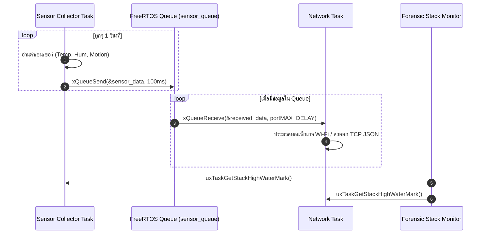

# ใบงานที่ 6.3: การออกแบบ FreeRTOS Task Architecture & Sensor Data Fusion ผ่าน Queue

## 0. กล่าวนำ (Introduction)
ในแอปพลิเคชัน IoT ระดับอุตสาหกรรม โปรแกรมเมอร์จะไม่เขียนโค้ดอ่านค่าเซนเซอร์และการรับส่งข้อมูล Wi-Fi รวมไว้ในฟังก์ชันเดียวกัน เพราะจะทำให้สแตกระบบเครือข่ายชะงัก (Network Latency & Blocking) 

ในใบงานนี้นักศึกษาจะได้ออกแบบสถาปัตยกรรม **FreeRTOS Multi-Tasking** โดยแยกโปรแกรมออกเป็น **Sensor Collector Task** และ **Network Communication Task** แล้วใช้ **FreeRTOS Queue** เป็นสะพานเชื่อมส่งผ่านโครงสร้างข้อมูล `sensor_data_t` อย่างปลอดภัย (Thread-Safe) พร้อมทั้งใช้คำสั่ง Forensic ตรวจวัดหน่วยความจำสแตก `uxTaskGetStackHighWaterMark()`

---

## 1. วัตถุประสงค์ (Objectives)
1. สามารถสร้างและบริหารจัดการ FreeRTOS Tasks บน ESP-IDF ด้วยฟังก์ชัน `xTaskCreate()` ได้
2. สามารถสร้างและใช้งาน FreeRTOS Queue (`xQueueCreate`, `xQueueSend`, `xQueueReceive`) ในการส่งผ่านข้อมูลได้
3. ป้องกันปัญหาการบล็อกระบบเครือข่าย Wi-Fi โดยการแยกงานอ่านเซนเซอร์ออกจาก Network Loop
4. ประเมินการใช้หน่วยความจำสแตกของแต่ละ Task ในสไตล์ Forensic ด้วย `uxTaskGetStackHighWaterMark()`

---

## 2. อุปกรณ์และซอฟต์แวร์ที่ใช้ในการทดลอง (Equipment & Tools)
1. บอร์ดไมโครคอนโทรลเลอร์ ESP32 จำนวน 1 บอร์ด
2. สายเชื่อมต่อ Micro-USB หรือ USB-C จำนวน 1 เส้น
3. โปรแกรม IDE เช่น VS Code พร้อม ESP-IDF Toolchain

---

## 3. สถาปัตยกรรมระบบ (System Architecture & Sequence)



---

## 4. ขั้นตอนการทดลอง (Experimental Procedures)

1. นำซอร์สโค้ดในข้อ 5 ไปวางในไฟล์ `main/main.c` ทำการ Build และ Flash ลงบอร์ด ESP32
2. สังเกต Forensic Log ใน Serial Monitor:
   - ตรวจดูข้อมูลที่ถูกส่งจาก `vSensorTask` เข้าสู่ Queue และถูกรับโดย `vNetworkTask`
   - ตรวจดูค่า **Stack High Water Mark** (ขนาดสแตกคงเหลือ) ของแต่ละ Task
3. ทดลองปรับขนาดสแตกของ `vSensorTask` ใน `xTaskCreate()` จาก `4096` ลดลงเหลือ `1024` สังเกตค่า High Water Mark และวิเคราะห์จุดเสี่ยง Stack Overflow

---

## 5. ซอร์สโค้ดการทดลอง (Complete ESP-IDF Source Code - `main.c`)

```c
#include <stdio.h>
#include <string.h>
#include "freertos/FreeRTOS.h"
#include "freertos/task.h"
#include "freertos/queue.h"
#include "esp_system.h"
#include "esp_log.h"
#include "esp_random.h"

static const char *TAG = "LAB_FREERTOS_QUEUE";

// Sensor Data Structure
typedef struct {
    float temperature;
    float humidity;
    uint32_t light_lux;
    uint32_t timestamp_ms;
} sensor_data_t;

// Queue Handle
static QueueHandle_t xSensorQueue = NULL;

// ------------------------------------------------------------------
// Task 1: Sensor Collector Task (Simulates Reading Hardware Sensors)
// ------------------------------------------------------------------
void vSensorTask(void *pvParameters) {
    sensor_data_t data;
    ESP_LOGI(TAG, "[TASK CREATED]: Sensor Collector Task Started on Core %d", xPortGetCoreID());

    while (1) {
        // 1. Simulate reading sensors
        data.temperature = 25.0f + (esp_random() % 100) / 10.0f;
        data.humidity = 50.0f + (esp_random() % 200) / 10.0f;
        data.light_lux = 200 + (esp_random() % 500);
        data.timestamp_ms = xTaskGetTickCount() * portTICK_PERIOD_MS;

        ESP_LOGI(TAG, "[SENSOR TASK]: Pushing Data -> Temp: %.1f C, Hum: %.1f %%, Lux: %ld",
                 data.temperature, data.humidity, data.light_lux);

        // 2. Send data structure to FreeRTOS Queue
        if (xQueueSend(xSensorQueue, &data, pdMS_TO_TICKS(100)) != pdPASS) {
            ESP_LOGW(TAG, "[QUEUE WARNING]: Queue Full! Failed to push sensor data.");
        }

        // 3. Stack High Water Mark Check
        UBaseType_t hwm = uxTaskGetStackHighWaterMark(NULL);
        ESP_LOGI("FORENSIC_STACK", "  -> SensorTask Stack Remaining: %u words (%u bytes)",
                 hwm, hwm * sizeof(StackType_t));

        vTaskDelay(pdMS_TO_TICKS(1500));
    }
}

// ------------------------------------------------------------------
// Task 2: Network Task (Consumes Data from Queue for Wi-Fi Transmission)
// ------------------------------------------------------------------
void vNetworkTask(void *pvParameters) {
    sensor_data_t rx_data;
    ESP_LOGI(TAG, "[TASK CREATED]: Network Task Started on Core %d", xPortGetCoreID());

    while (1) {
        // Wait indefinitely for data from Queue
        if (xQueueReceive(xSensorQueue, &rx_data, portMAX_DELAY) == pdTRUE) {
            ESP_LOGI(TAG, "=======================================================");
            ESP_LOGI(TAG, "[NETWORK TASK]: Data Received from Queue!");
            ESP_LOGI(TAG, "  -> Timestamp   : %ld ms", rx_data.timestamp_ms);
            ESP_LOGI(TAG, "  -> Temperature : %.2f degC", rx_data.temperature);
            ESP_LOGI(TAG, "  -> Humidity    : %.2f %%", rx_data.humidity);
            ESP_LOGI(TAG, "  -> Light Lux   : %ld lux", rx_data.light_lux);
            ESP_LOGI(TAG, "[NETWORK TASK]: Preparing JSON Packet for Wi-Fi Transmission...");
            ESP_LOGI(TAG, "=======================================================");
        }

        UBaseType_t hwm = uxTaskGetStackHighWaterMark(NULL);
        ESP_LOGI("FORENSIC_STACK", "  -> NetworkTask Stack Remaining: %u words (%u bytes)",
                 hwm, hwm * sizeof(StackType_t));
    }
}

void app_main(void) {
    ESP_LOGI(TAG, "==================================================================");
    ESP_LOGI(TAG, "  Lab 6.3: FreeRTOS Multi-Tasking & Sensor Data Queue Fusion");
    ESP_LOGI(TAG, "==================================================================");

    // Create FreeRTOS Queue for 10 items of sensor_data_t
    xSensorQueue = xQueueCreate(10, sizeof(sensor_data_t));
    if (xSensorQueue == NULL) {
        ESP_LOGE(TAG, "Failed to create FreeRTOS Queue!");
        return;
    }

    // Create Tasks
    xTaskCreate(vSensorTask, "SensorCollectorTask", 3072, NULL, 5, NULL);
    xTaskCreate(vNetworkTask, "NetworkCommTask", 4096, NULL, 4, NULL);
}
```

---

## 6. ตารางบันทึกผลการทดลอง (Experiment Results)

### 6.1 บันทึกข้อมูล Forensic Stack High Water Mark

| ชื่อ FreeRTOS Task | ขนาด Stack ที่กำหนดใน `xTaskCreate` (Bytes) | ค่า High Water Mark ที่อ่านได้ (Words / Bytes) | สถานะความปลอดภัยสแตก |
| :--- | :---: | :---: | :---: |
| **`SensorCollectorTask`** | 3072 |2020 | ปลอดภัย เหลือ 34.24% |
| **`NetworkCommTask`** | 4096 |3072 | ปลอดภัย เหลือ 25%|

---

## 7. คำถามท้ายการทดลอง (Post-Lab Questions)

1. เหตุใดการใช้ **FreeRTOS Queue** จึงมีความปลอดภัย (Thread-Safe) มากกว่าการใช้ตัวแปรแบบ Global ในการรับส่งข้อมูลระหว่างสอง Task?
2. ค่า **Stack High Water Mark** มีประโยชน์อย่างไรในการตรวจวินิจฉัยปัญหาบั๊กในระบบเรียลไทม์ (RTOS)?
3. หาก `vSensorTask` ส่งข้อมูลเร็วมาก (เช่น ทุก 10ms) แต่ `vNetworkTask` ส่งข้อมูลออก Wi-Fi ได้ช้า (เช่น ใช้เวลา 500ms) จะเกิดอะไรขึ้นกับ Queue และระบบจะรับมืออย่างไร?

### Log 
```
ittikorntongsima@Sloth lab3 %  idf.py flash monitor

Adding "flash"'s dependency "all" to list of commands with default set of options.
Executing action: all (aliases: build)
Running ninja in directory /Users/ittikorntongsima/Store/KMITl/IOT/term1/WEEK8/lab3/build
Executing "ninja all"...
[1/4] cd /Users/ittikorntongsima/Store/KMITl/IOT/term1/WEEK8/lab3/b...rs/ittikorntongsima/Store/KMITl/IOT/term1/WEEK8/lab3/build/lab3.bin
lab3.bin binary size 0x22a90 bytes. Smallest app partition is 0x100000 bytes. 0xdd570 bytes (86%) free.
[1/1] cd /Users/ittikorntongsima/Store/KMITl/IOT/term1/WEEK8/lab3/b...ma/Store/KMITl/IOT/term1/WEEK8/lab3/build/bootloader/bootloader.bin
Bootloader binary size 0x6610 bytes. 0x9f0 bytes (9%) free.
[4/4] Completed 'bootloader'Executing action: flash
Serial port /dev/cu.usbserial-0001:
Connecting....
Detecting chip type... ESP32
Running ninja in directory /Users/ittikorntongsima/Store/KMITl/IOT/term1/WEEK8/lab3/build
Executing "ninja flash"...
[1/5] cd /Users/ittikorntongsima/Store/KMITl/IOT/term1/WEEK8/lab3/build && /Users/ittikorntongsima/.espressif/python_env/idf6.1_py3.14_env/bin/python /Users/ittikorntongsima/My-Library/esp-idf/components/partition_table/check_sizes.py --offset 0x8000 partition --type app /Users/ittikorntongsima/Store/KMITl/IOT/term1/WEEK8/lab3/build/partition_table/partition-table.bin /Users/ittikorntongsima/Store/KMITl/IOT/term1/WEEK8/lab3/build/lab3.bin
lab3.bin binary size 0x22a90 bytes. Smallest app partition is 0x100000 bytes. 0xdd570 bytes (86%) free.
[2/5] Performing build step for 'bootloader'
[1/1] cd /Users/ittikorntongsima/Store/KMITl/IOT/term1/WEEK8/lab3/build/bootloader && /Users/ittikorntongsima/.espressif/python_env/idf6.1_py3.14_env/bin/python /Users/ittikorntongsima/My-Library/esp-idf/components/partition_table/check_sizes.py --offset 0x8000 bootloader 0x1000 /Users/ittikorntongsima/Store/KMITl/IOT/term1/WEEK8/lab3/build/bootloader/bootloader.bin
Bootloader binary size 0x6610 bytes. 0x9f0 bytes (9%) free.
[3/5] No install step for 'bootloader'
[4/5] Completed 'bootloader'
[4/5] Running utility command for flash
esptool --chip esp32 -p /dev/cu.usbserial-0001 -b 460800 --before=default-reset --after=hard-reset write-flash --flash-mode dio --flash-freq 40m --flash-size 2MB 0x1000 bootloader/bootloader.bin 0x8000 partition_table/partition-table.bin 0x10000 lab3.bin
esptool v5.3.dev1
Connected to ESP32 on /dev/cu.usbserial-0001:
Chip type:          ESP32-D0WD-V3 (revision v3.1)
Features:           Wi-Fi, BT, Dual Core + LP Core, 240MHz, Vref calibration in eFuse, Coding Scheme None
Crystal frequency:  40MHz
MAC:                8c:94:df:45:93:e4

Stub flasher running.
Changing baud rate to 460800...
Changed.

Configuring flash size...

Writing 'bootloader/bootloader.bin' at 0x00001000...
SHA digest in image updated.
Flash will be erased from 0x00001000 to 0x00007fff...
Wrote 26128 bytes (16592 compressed) at 0x00001000 in 0.9 seconds (230.4 kbit/s).
Hash of data verified.

Writing 'partition_table/partition-table.bin' at 0x00008000...
Flash will be erased from 0x00008000 to 0x00008fff...
Wrote 3072 bytes (103 compressed) at 0x00008000 in 0.1 seconds (314.2 kbit/s).
Hash of data verified.

Writing 'lab3.bin' at 0x00010000...
Flash will be erased from 0x00010000 to 0x00032fff...
Wrote 141968 bytes (80966 compressed) at 0x00010000 in 2.1 seconds (539.0 kbit/s).
Hash of data verified.

Hard resetting via RTS pin...
Executing action: monitor
Running idf_monitor in directory /Users/ittikorntongsima/Store/KMITl/IOT/term1/WEEK8/lab3
Executing "/Users/ittikorntongsima/.espressif/python_env/idf6.1_py3.14_env/bin/python /Users/ittikorntongsima/My-Library/esp-idf/tools/idf_monitor.py -p /dev/cu.usbserial-0001 -b 115200 --toolchain-prefix xtensa-esp32-elf- --target esp32 --revision 0 /Users/ittikorntongsima/Store/KMITl/IOT/term1/WEEK8/lab3/build/lab3.elf /Users/ittikorntongsima/Store/KMITl/IOT/term1/WEEK8/lab3/build/bootloader/bootloader.elf -m '/Users/ittikorntongsima/.espressif/python_env/idf6.1_py3.14_env/bin/python' '/Users/ittikorntongsima/My-Library/esp-idf/tools/idf.py'"...
--- esp-idf-monitor 1.9.0 on /dev/cu.usbserial-0001 115200
--- Quit: Ctrl+] | Menu: Ctrl+T | Help: Ctrl+T followed by Ctrl+H
J (148) boot: Disabling RN�ets Jul 29 2019 12:21:46

rst:0x1 (POWERON_RESET),boot:0x13 (SPI_FAST_FLASH_BOOT)
configsip: 0, SPIWP:0xee
clk_drv:0x00,q_drv:0x00,d_drv:0x00,cs0_drv:0x00,hd_drv:0x00,wp_drv:0x00
mode:DIO, clock div:2
load:0x3fff0040,len:6272
load:0x40078000,len:15848
load:0x40080400,len:3920
--- 0x40080400: _invalid_pc_placeholder at /Users/ittikorntongsima/My-Library/esp-idf/components/xtensa/xtensa_vectors.S:2259
entry 0x40080644
--- 0x40080644: call_start_cpu0 at /Users/ittikorntongsima/My-Library/esp-idf/components/bootloader/subproject/main/bootloader_start.c:27
I (27) boot: ESP-IDF v6.1-dev-3480-g44c77cbf46 2nd stage bootloader
I (27) boot: compile time Aug 23 2026 22:47:51
I (28) boot: Multicore bootloader
I (30) boot: chip revision: v3.1
I (33) boot.esp32: SPI Speed      : 40MHz
I (37) boot.esp32: SPI Mode       : DIO
I (40) boot.esp32: SPI Flash Size : 2MB
I (44) boot: Enabling RNG early entropy source...
I (49) boot: Partition Table:
I (51) boot: ## Label            Usage          Type ST Offset   Length
I (57) boot:  0 nvs              WiFi data        01 02 00009000 00006000
I (64) boot:  1 phy_init         RF data          01 01 0000f000 00001000
I (71) boot:  2 factory          factory app      00 00 00010000 00100000
I (77) boot: End of partition table
I (80) esp_image: segment 0: paddr=00010020 vaddr=3f400020 size=08b58h ( 35672) map
I (101) esp_image: segment 1: paddr=00018b80 vaddr=3ffb0000 size=02a7ch ( 10876) load
I (105) esp_image: segment 2: paddr=0001b604 vaddr=40080000 size=04a14h ( 18964) load
I (113) esp_image: segment 3: paddr=00020020 vaddr=400d0020 size=0c770h ( 51056) map
I (131) esp_image: segment 4: paddr=0002c798 vaddr=40084a14 size=062a4h ( 25252) load
I (142) esp_image: segment 5: paddr=00032a44 vaddr=50000000 size=00028h (    40) load
I (148) boot: Loaded app from partition at offset 0x10000
I (148) boot: Disabling RNG early entropy source...
I (160) cpu_start: Multicore app
I (168) cpu_start: GPIO 3 and 1 are used as console UART I/O pins
I (169) cpu_start: Pro cpu start user code
I (169) cpu_start: cpu freq: 160000000 Hz
I (170) app_init: Application information:
I (174) app_init: Project name:     lab3
I (178) app_init: App version:      1
I (181) app_init: Compile time:     Aug 23 2026 22:47:43
I (186) app_init: ELF file SHA256:  a91c577e7...
I (191) app_init: ESP-IDF:          v6.1-dev-3480-g44c77cbf46
I (196) efuse_init: Min chip rev:     v0.0
I (200) efuse_init: Max chip rev:     v3.99
I (204) efuse_init: Chip rev:         v3.1
I (208) heap_init: Initializing. RAM available for dynamic allocation:
I (214) heap_init: At 3FFAE6E0 len 00001920 (6 KiB): DRAM
I (219) heap_init: At 3FFB3430 len 0002CBD0 (178 KiB): DRAM
I (224) heap_init: At 3FFE0440 len 00003AE0 (14 KiB): D/IRAM
I (230) heap_init: At 3FFE4350 len 0001BCB0 (111 KiB): D/IRAM
I (235) heap_init: At 4008ACB8 len 00015348 (84 KiB): IRAM
I (242) spi_flash: detected chip: generic
I (244) spi_flash: flash io: dio
W (247) spi_flash: Detected size(4096k) larger than the size in the binary image header(2048k). Using the size in the binary image header.
I (261) main_task: Started on CPU0
I (271) main_task: Calling app_main()
I (271) LAB_FREERTOS_QUEUE: ==================================================================
I (271) LAB_FREERTOS_QUEUE:   Lab 6.3: FreeRTOS Multi-Tasking & Sensor Data Queue Fusion
I (281) LAB_FREERTOS_QUEUE: ==================================================================
I (281) LAB_FREERTOS_QUEUE: [TASK CREATED]: Sensor Collector Task Started on Core 0
I (291) LAB_FREERTOS_QUEUE: [SENSOR TASK]: Pushing Data -> Temp: 29.2 C, Hum: 61.6 %, Lux: 546
I (301) FORENSIC_STACK:   -> SensorTask Stack Remaining: 2020 words (2020 bytes)
I (311) LAB_FREERTOS_QUEUE: [TASK CREATED]: Network Task Started on Core 0
I (311) LAB_FREERTOS_QUEUE: =======================================================
I (321) LAB_FREERTOS_QUEUE: [NETWORK TASK]: Data Received from Queue!
I (331) LAB_FREERTOS_QUEUE:   -> Timestamp   : 30 ms
I (331) LAB_FREERTOS_QUEUE:   -> Temperature : 29.20 degC
I (341) LAB_FREERTOS_QUEUE:   -> Humidity    : 61.60 %
I (341) LAB_FREERTOS_QUEUE:   -> Light Lux   : 546 lux
I (351) LAB_FREERTOS_QUEUE: [NETWORK TASK]: Preparing JSON Packet for Wi-Fi Transmission...
I (361) LAB_FREERTOS_QUEUE: =======================================================
I (361) FORENSIC_STACK:   -> NetworkTask Stack Remaining: 3072 words (3072 bytes)
I (371) main_task: Returned from app_main()
I (1811) LAB_FREERTOS_QUEUE: [SENSOR TASK]: Pushing Data -> Temp: 30.5 C, Hum: 52.7 %, Lux: 347
I (1811) FORENSIC_STACK:   -> SensorTask Stack Remaining: 2020 words (2020 bytes)
I (1811) LAB_FREERTOS_QUEUE: =======================================================
I (1821) LAB_FREERTOS_QUEUE: [NETWORK TASK]: Data Received from Queue!
I (1821) LAB_FREERTOS_QUEUE:   -> Timestamp   : 1550 ms
I (1831) LAB_FREERTOS_QUEUE:   -> Temperature : 30.50 degC
I (1831) LAB_FREERTOS_QUEUE:   -> Humidity    : 52.70 %
I (1841) LAB_FREERTOS_QUEUE:   -> Light Lux   : 347 lux
I (1841) LAB_FREERTOS_QUEUE: [NETWORK TASK]: Preparing JSON Packet for Wi-Fi Transmission...
I (1851) LAB_FREERTOS_QUEUE: =======================================================
I (1861) FORENSIC_STACK:   -> NetworkTask Stack Remaining: 3072 words (3072 bytes)
I (3311) LAB_FREERTOS_QUEUE: [SENSOR TASK]: Pushing Data -> Temp: 26.2 C, Hum: 61.7 %, Lux: 419
I (3311) LAB_FREERTOS_QUEUE: =======================================================
I (3311) FORENSIC_STACK:   -> SensorTask Stack Remaining: 2020 words (2020 bytes)
I (3311) LAB_FREERTOS_QUEUE: [NETWORK TASK]: Data Received from Queue!
I (3321) LAB_FREERTOS_QUEUE:   -> Timestamp   : 3050 ms
I (3331) LAB_FREERTOS_QUEUE:   -> Temperature : 26.20 degC
I (3331) LAB_FREERTOS_QUEUE:   -> Humidity    : 61.70 %
I (3341) LAB_FREERTOS_QUEUE:   -> Light Lux   : 419 lux
I (3341) LAB_FREERTOS_QUEUE: [NETWORK TASK]: Preparing JSON Packet for Wi-Fi Transmission...
I (3351) LAB_FREERTOS_QUEUE: =======================================================
I (3361) FORENSIC_STACK:   -> NetworkTask Stack Remaining: 3072 words (3072 bytes)
I (4821) LAB_FREERTOS_QUEUE: [SENSOR TASK]: Pushing Data -> Temp: 28.1 C, Hum: 64.2 %, Lux: 531
I (4821) LAB_FREERTOS_QUEUE: =======================================================
I (4821) FORENSIC_STACK:   -> SensorTask Stack Remaining: 2020 words (2020 bytes)
I (4821) LAB_FREERTOS_QUEUE: [NETWORK TASK]: Data Received from Queue!
I (4831) LAB_FREERTOS_QUEUE:   -> Timestamp   : 4560 ms
I (4841) LAB_FREERTOS_QUEUE:   -> Temperature : 28.10 degC
I (4841) LAB_FREERTOS_QUEUE:   -> Humidity    : 64.20 %
I (4851) LAB_FREERTOS_QUEUE:   -> Light Lux   : 531 lux
I (4851) LAB_FREERTOS_QUEUE: [NETWORK TASK]: Preparing JSON Packet for Wi-Fi Transmission...
I (4861) LAB_FREERTOS_QUEUE: =======================================================
I (4871) FORENSIC_STACK:   -> NetworkTask Stack Remaining: 3072 words (3072 bytes)

Done
ittikorntongsima@Sloth lab3 %
```
