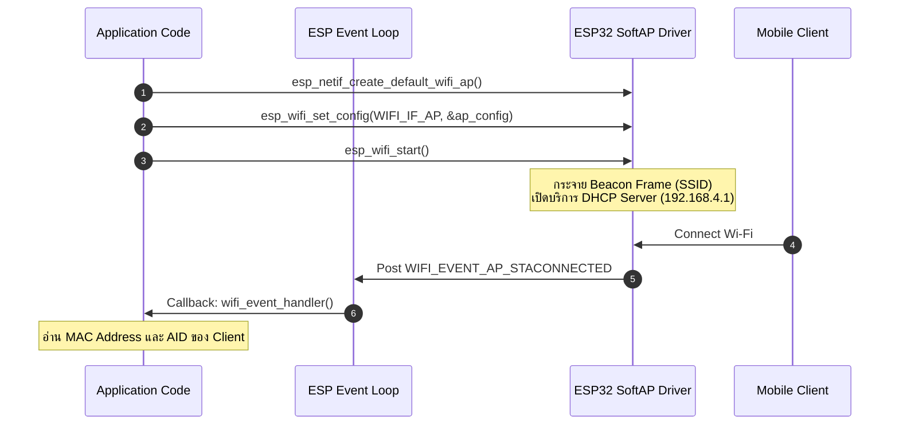
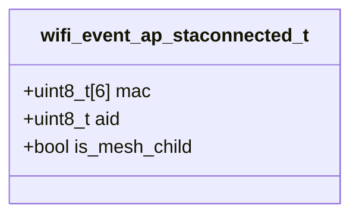

# ใบงานที่ 6.1: การคอนฟิก ESP32 SoftAP และการสกัด Forensic Log ข้อมูล Client (Wi-Fi Access Point Mode)

## 0. กล่าวนำ (Introduction)
ในใบงานนี้ นักศึกษาจะได้สลับบทบาทของ ESP32 จากการเป็นลูกข่าย (Station) มาเป็นผู้ให้บริการจุดเชื่อมต่อไร้สาย **SoftAP (Software Access Point Mode)** ด้วยสถาปัตยกรรม ESP-IDF 

นักศึกษาจะได้เรียนรู้การเปิดบริการ DHCP Server การตั้งค่าโหมดความปลอดภัย WPA2-PSK และดักจับ Forensic Log เมื่อมีอุปกรณ์ลูกข่าย (เช่น สมาร์ตโฟน หรือ ESP32 Station ของเพื่อน) เข้ามาเชื่อมต่อ โดยสกัดข้อมูลในระดับ Link Layer เช่น **MAC Address** และ **Association ID (AID)** จาก Event `WIFI_EVENT_AP_STACONNECTED`

---

## 1. วัตถุประสงค์ (Objectives)
1. สามารถคอนฟิก ESP32 ให้ทำงานในโหมด SoftAP (`WIFI_MODE_AP`) และเปิดบริการ DHCP Server ได้สำเร็จ
2. สามารถใช้ Event Loop ในการดักจับ Event `WIFI_EVENT_AP_STACONNECTED` และ `WIFI_EVENT_AP_STADISCONNECTED`
3. สกัดและวิเคราะห์ข้อมูล MAC Address (BSSID) และ Association ID (AID) ของอุปกรณ์ลูกข่ายที่เข้ามาเชื่อมต่อ
4. เข้าใจกลไกการจำกัดจำนวนการเชื่อมต่อสูงสุด (`max_connection`) บน ESP32

---

## 2. อุปกรณ์และซอฟต์แวร์ที่ใช้ในการทดลอง (Equipment & Tools)
1. บอร์ดไมโครคอนโทรลเลอร์ ESP32 จำนวน 1 บอร์ด
2. สายเชื่อมต่อ Micro-USB หรือ USB-C จำนวน 1 เส้น
3. สมาร์ตโฟน หรือ คอมพิวเตอร์ สำหรับทดสอบเชื่อมต่อ Wi-Fi ที่ ESP32 สร้างขึ้น
4. โปรแกรม IDE เช่น VS Code พร้อม ESP-IDF Toolchain

---

## 3. ความรู้พื้นฐานที่เกี่ยวข้อง (Theoretical Background)

### 3.1 สถาปัตยกรรม Event และ DHCP Server ในโหมด SoftAP



### 3.2 โครงสร้างข้อมูล `wifi_event_ap_staconnected_t` (Class Diagram)



---

## 4. ขั้นตอนการทดลอง (Experimental Procedures)

1. สแกนและตั้งชื่อ SSID ของ ESP32 AP เป็นชื่อเฉพาะของตนเอง (เช่น `"ESP32_AP_XXXX"` โดยระบุรหัสนักศึกษา 4 ตัวท้าย)
2. กำหนดรหัสผ่าน Wi-Fi เป็น `"12345678"` (WPA2-PSK) และจำกัดจำนวนการเชื่อมต่อไว้ที่ 4 เครื่อง (`.max_connection = 4`)
3. ทำการ Build และ Flash ซอร์สโค้ดลงบอร์ด ESP32
4. นำสมาร์ตโฟนกดค้นหา Wi-Fi และป้อนรหัสผ่านเพื่อเชื่อมต่อเข้ากับ ESP32 AP
5. สังเกต Forensic Log ใน Serial Monitor และบันทึกค่า MAC Address, AID และ IP Address ที่ ESP32 แจกจ่ายให้

---

## 5. ซอร์สโค้ดการทดลอง (Complete ESP-IDF Source Code - `main.c`)

ดูใน Lab6-1-Wi-Fi-SoftAP\main\main.c

---

## 6. ตารางบันทึกผลการทดลอง (Experiment Results)

### 6.1 บันทึกข้อมูล Client ที่เชื่อมต่อเข้ากับ ESP32 SoftAP

| อุปกรณ์ที่ใช้ทดสอบ (เช่น iPhone/Android) | MAC Address ที่ดักจับได้ | Association ID (AID) | หมายเลข IP Address ที่ได้ (ถ้าทราบ) |
| :--------------------------------------- | :----------------------- | :------------------: | :---------------------------------: |
| **อุปกรณ์ที่ 1**                         |       3E:94:70:68:EA:01     |           1           |                192.168.4.2                     |
| **อุปกรณ์ที่ 2**                         |      02:E9:5E:47:4D:31        |          2          |                  192.168.4.3                   |

---

## 7. คำถามท้ายการทดลอง (Post-Lab Questions)

1. เหตุใด IP Address เริ่มต้นของ ESP32 SoftAP จึงเป็น `192.168.4.1` และ DHCP Server บน ESP32 เริ่มแจกจ่าย IP ที่หมายเลขใด?
   
   **ตอบ**  เพราะหมายเลข 192.168.4.1 เป็นค่า IP เริ่มต้น (Default IP) ที่กำหนดมาในไลบรารีของ ESP-IDF สำหรับโครงข่ายแบบ SoftAP
   และ DHCP Server บน ESP32 เริ่มแจกจ่าย IP ที่หมายเลข 192.168.4.2
   
2. สมาชิกตัวแปร `mac` ในโครงสร้าง `wifi_event_ap_staconnected_t` สามารถนำไปประยุกต์ใช้ทำระบบความปลอดภัยขั้นสูง (เช่น MAC Filtering) ได้อย่างไร?
   
   **ตอบ** ตัวแปร mac จะเก็บข้อมูล MAC Address (BSSID) ของอุปกรณ์ที่พยายามเชื่อมต่อเข้ามาใน Event WIFI_EVENT_AP_STACONNECTED
   ซึ่งสามารถนำค่า MAC Address นี้ไปตรวจสอบกับรายชื่อที่อนุญาต (Whitelist) ในโค้ดโปรแกรมได้ หากพบว่า MAC Address ของอุปกรณ์นั้นไม่ตรงกับรายชื่อที่บันทึกไว้ ระบบสามารถสั่งตัดการเชื่อมต่ออุปกรณ์นั้นออกไปได้ทันที เพื่อป้องกันผู้บุกรุก
   
3. หากมี Client พยายามเชื่อมต่อเป็นเครื่องที่ 5 (เกินค่า `max_connection = 4`) จะเกิดเหตุการณ์ใดขึ้นในระดับสัญญาณวิทยุ?
   
    **ตอบ** หากมีอุปกรณ์ลูกข่ายเครื่องที่ 5 พยายามเข้ามาเชื่อมต่อ บอร์ด ESP32 จะทำการปฏิเสธการเชื่อมต่อในระดับสัญญาณวิทยุของอุปกรณ์นั้นทันที ทำให้อุปกรณ์เครื่องที่ 5 ไม่สามารถเชื่อมต่อ Wi-Fi และไม่ได้รับ IP Address ได้

---

**ผล output log จากการทดลอง**
```
--- 0x40080400: _invalid_pc_placeholder at C:/Users/Rusneeda/esp/v5.5.1/esp-idf/components/xtensa/xtensa_vectors.S:2235
entry 0x40080638
--- 0x40080638: call_start_cpu0 at C:/Users/Rusneeda/esp/v5.5.1/esp-idf/components/bootloader/subproject/main/bootloader_start.c:25
I (29) boot: ESP-IDF v5.5.1 2nd stage bootloader
I (29) boot: compile time Aug 30 2026 17:09:36
I (29) boot: Multicore bootloader
I (31) boot: chip revision: v3.1
I (33) boot.esp32: SPI Speed      : 40MHz
I (37) boot.esp32: SPI Mode       : DIO
I (41) boot.esp32: SPI Flash Size : 2MB
I (44) boot: Enabling RNG early entropy source...
I (49) boot: Partition Table:
I (51) boot: ## Label            Usage          Type ST Offset   Length
I (58) boot:  0 nvs              WiFi data        01 02 00009000 00006000
I (64) boot:  1 phy_init         RF data          01 01 0000f000 00001000
I (71) boot:  2 factory          factory app      00 00 00010000 00100000
I (77) boot: End of partition table
I (81) esp_image: segment 0: paddr=00010020 vaddr=3f400020 size=19a68h (105064) map
I (124) esp_image: segment 1: paddr=00029a90 vaddr=3ffb0000 size=03eech ( 16108) load
I (130) esp_image: segment 2: paddr=0002d984 vaddr=40080000 size=02694h (  9876) load
I (134) esp_image: segment 3: paddr=00030020 vaddr=400d0020 size=87d80h (556416) map
I (325) esp_image: segment 4: paddr=000b7da8 vaddr=40082694 size=15778h ( 87928) load
I (360) esp_image: segment 5: paddr=000cd528 vaddr=50000000 size=00020h (    32) load
I (372) boot: Loaded app from partition at offset 0x10000
I (372) boot: Disabling RNG early entropy source...
I (382) cpu_start: Multicore app
I (391) cpu_start: Pro cpu start user code
I (391) cpu_start: cpu freq: 160000000 Hz
I (391) app_init: Application information:
I (391) app_init: Project name:     lab1
I (394) app_init: App version:      1
I (398) app_init: Compile time:     Aug 30 2026 17:08:48
I (403) app_init: ELF file SHA256:  d503754f9...
I (407) app_init: ESP-IDF:          v5.5.1
I (411) efuse_init: Min chip rev:     v0.0
I (415) efuse_init: Max chip rev:     v3.99 
I (419) efuse_init: Chip rev:         v3.1
I (423) heap_init: Initializing. RAM available for dynamic allocation:
I (429) heap_init: At 3FFAE6E0 len 00001920 (6 KiB): DRAM
I (434) heap_init: At 3FFB7FC8 len 00028038 (160 KiB): DRAM
I (439) heap_init: At 3FFE0440 len 00003AE0 (14 KiB): D/IRAM
I (445) heap_init: At 3FFE4350 len 0001BCB0 (111 KiB): D/IRAM
I (450) heap_init: At 40097E0C len 000081F4 (32 KiB): IRAM
W (457) spi_flash: Detected boya flash chip but using generic driver. For optimal functionality, enable `SPI_FLASH_SUPPORT_BOYA_CHIP` in menuconfig
I (469) spi_flash: detected chip: generic
I (472) spi_flash: flash io: dio
W (475) spi_flash: Detected size(4096k) larger than the size in the binary image header(2048k). Using the size in the binary image header.
I (488) main_task: Started on CPU0
I (498) main_task: Calling app_main()
I (498) LAB_SOFTAP: [FORENSIC]: Call nvs_flash_init()
I (518) LAB_SOFTAP: [FORENSIC]: Call esp_netif_init()
I (518) LAB_SOFTAP: [FORENSIC]: Call esp_event_loop_create_default()
I (518) LAB_SOFTAP: [FORENSIC]: Call esp_netif_create_default_wifi_ap()
I (528) LAB_SOFTAP: [FORENSIC]: SoftAP Interface created at 0x3ffbd700 (Default IP: 192.168.4.1)
I (528) LAB_SOFTAP: [FORENSIC]: Call esp_wifi_init(&cfg)
I (548) wifi:wifi driver task: 3ffbfe40, prio:23, stack:6656, core=0
I (548) wifi:wifi firmware version: 14da9b7
I (548) wifi:wifi certification version: v7.0
I (558) wifi:config NVS flash: enabled
I (558) wifi:config nano formatting: disabled
I (558) wifi:Init data frame dynamic rx buffer num: 32
I (568) wifi:Init static rx mgmt buffer num: 5
I (568) wifi:Init management short buffer num: 32
I (568) wifi:Init dynamic tx buffer num: 32
I (578) wifi:Init static rx buffer size: 1600
I (578) wifi:Init static rx buffer num: 10
I (588) wifi:Init dynamic rx buffer num: 32
I (588) wifi_init: rx ba win: 6
I (588) wifi_init: accept mbox: 6
I (598) wifi_init: tcpip mbox: 32
I (598) wifi_init: udp mbox: 6
I (598) wifi_init: tcp mbox: 6
I (598) wifi_init: tcp tx win: 5760
I (608) wifi_init: tcp rx win: 5760
I (608) wifi_init: tcp mss: 1440
I (608) wifi_init: WiFi IRAM OP enabled
I (618) wifi_init: WiFi RX IRAM OP enabled
I (618) LAB_SOFTAP: [FORENSIC]: Call esp_event_handler_instance_register(WIFI_EVENT)
I (628) LAB_SOFTAP: [FORENSIC]: Call esp_wifi_set_mode(WIFI_MODE_AP)
I (638) LAB_SOFTAP: [FORENSIC]: Call esp_wifi_set_config(WIFI_IF_AP, &wifi_config)
I (898) LAB_SOFTAP: [FORENSIC]: Call esp_wifi_start()
I (898) phy_init: phy_version 4861,b71b5ad,Aug  5 2025,11:16:06
I (978) phy_init: Saving new calibration data due to checksum failure or outdated calibration data, mode(0)
I (1008) wifi:mode : softAP (14:08:08:a5:50:c5)
I (1018) wifi:Total power save buffer number: 16
I (1018) wifi:Init max length of beacon: 752/752
I (1018) wifi:Init max length of beacon: 752/752
I (1018) LAB_SOFTAP: ==================================================================
I (1018) esp_netif_lwip: DHCP server started on interface WIFI_AP_DEF with IP: 192.168.4.1
I (1038) LAB_SOFTAP:   ESP32 SoftAP Running! SSID: "ESP32_AP_0195", Channel: 1
I (1038) LAB_SOFTAP: ==================================================================
I (1048) LAB_SOFTAP: [TCP SERVER]: Listening on 192.168.4.1:8080
I (1058) main_task: Returned from app_main()
I (52948) wifi:new:<1,0>, old:<1,1>, ap:<1,1>, sta:<255,255>, prof:1, snd_ch_cfg:0x0
I (52948) wifi:station: 3e:94:70:68:ea:01 join, AID=1, bgn, 20
I (52968) LAB_SOFTAP: =======================================================
I (52968) LAB_SOFTAP: [FORENSIC EVENT]: Client Connected to ESP32 SoftAP!
I (52968) LAB_SOFTAP:   -> Client MAC Address : 3E:94:70:68:EA:01
I (52978) LAB_SOFTAP:   -> Assigned AID       : 1
I (52978) LAB_SOFTAP: =======================================================
I (53118) esp_netif_lwip: DHCP server assigned IP to a client, IP is: 192.168.4.2
I (53578) wifi:<ba-add>idx:2 (ifx:1, 3e:94:70:68:ea:01), tid:0, ssn:17, winSize:64
I (93918) wifi:<ba-add>idx:3 (ifx:1, 3e:94:70:68:ea:01), tid:6, ssn:16, winSize:64
I (138018) wifi:new:<1,0>, old:<1,0>, ap:<1,0>, sta:<255,255>, prof:1, snd_ch_cfg:0x0
I (138018) wifi:station: 02:e9:5e:47:4d:31 join, AID=2, bgn, 20
I (138038) LAB_SOFTAP: =======================================================
I (138038) LAB_SOFTAP: [FORENSIC EVENT]: Client Connected to ESP32 SoftAP!
I (138048) LAB_SOFTAP:   -> Client MAC Address : 02:E9:5E:47:4D:31
I (138048) LAB_SOFTAP:   -> Assigned AID       : 2
I (138058) LAB_SOFTAP: =======================================================
I (138078) wifi:<ba-add>idx:4 (ifx:1, 02:e9:5e:47:4d:31), tid:6, ssn:2493, winSize:64
I (139258) esp_netif_lwip: DHCP server assigned IP to a client, IP is: 192.168.4.3
I (199718) wifi:[ADDBA]RX DELBA, reason:1, delete tid:0, initiator:0(recipient)
```
