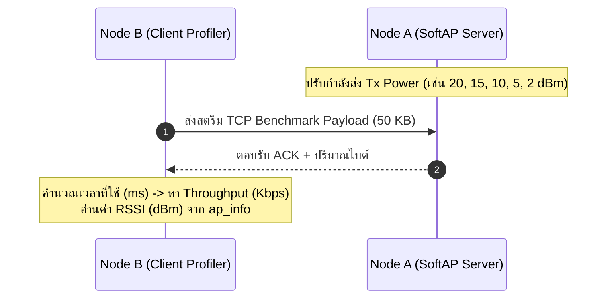

# ใบงานที่ 6.2: การประเมินความสัมพันธ์ RSSI vs Throughput ด้วย Software Tx-Power Control (Pair Work 👥)

## 0. กล่าวนำ (Introduction)
ใบงานนี้ออกแบบมาให้นักศึกษาจับคู่ 2 คน (**Node A: ESP32 SoftAP Server** และ **Node B: ESP32 Station Client**) เพื่อร่วมกันทดลองวัดและวิเคราะห์ประสิทธิภาพการรับส่งข้อมูลจริงระดับเครือข่ายไร้สาย (Throughput Speed Profiling) 

นักศึกษาจะได้ทดลองควบคุมระดับกำลังส่งสัญญาณวิทยุด้วยคำสั่ง `esp_wifi_set_max_tx_power()` ร่วมกับการปรับระยะห่างในห้องเรียน บันทึกค่าความแรงสัญญาณ **RSSI (dBm)** คู่กับความเร็ว **Throughput (Kbps)** และนำชุดข้อมูลที่ได้ไปพล็อต **Scatter Plot** เพื่อสร้างสมการถดถอย **(Regression Analysis)** ประเมินพฤติกรรมความเร็วของระบบ Wi-Fi

---

## 1. วัตถุประสงค์ (Objectives)
1. สามารถปรับกำลังส่งคลื่นวิทยุของ ESP32 ด้วยฟังก์ชัน `esp_wifi_set_max_tx_power()` ได้
2. คำนวณความเร็วระดับเครือข่าย (Throughput in Kbps) และค่าเวลาหน่วง (Latency in ms) ได้ถูกต้อง
3. สังเกตและวิเคราะห์ผลกระทบของระดับ RSSI (dBm) ที่มีต่อความเร็วและอัตราแพ็กเกจหล่นหาย (Packet Loss)
4. นำผลลัพธ์จากการทดลองไปสร้างแผนภาพ Scatter Plot และวิเคราะห์สมการถดถอย (Regression Analysis)

---

## 2. อุปกรณ์ที่ใช้ในการทดลอง (Equipment)
1. บอร์ด ESP32 จำนวน 2 บอร์ด (Node A ทำหน้าที่ AP / Node B ทำหน้าที่ Client Profiler)
2. สายเชื่อมต่อ USB จำนวน 2 เส้น
3. คอมพิวเตอร์สำหรับรันโปรแกรมและวิเคราะห์ข้อมูลสถิติ (Excel / Python)

---

## 3. ขั้นตอนการทดลอง (Experimental Procedures)



### ขั้นตอนการทดสอบ 5 ระดับกำลังส่ง (Software Attenuation Test):
1. **Node A (Server)**: รันโปรแกรมตั้งเป็น SoftAP และคอยรับ TCP Benchmark Connection
2. **Node B (Client)**: รันโปรแกรม Client Profiler คอยส่งชุดข้อมูลขนาด 50 KB จำนวน 10 รอบ
3. **การทดลองที่ 1**: กำหนด Tx Power = **20 dBm** (`esp_wifi_set_max_tx_power(80)`) -> อ่าน RSSI และบันทึก Throughput (Kbps)
4. **การทดลองที่ 2**: กำหนด Tx Power = **15 dBm** (`esp_wifi_set_max_tx_power(60)`) -> อ่าน RSSI และบันทึก Throughput
5. **การทดลองที่ 3**: กำหนด Tx Power = **10 dBm** (`esp_wifi_set_max_tx_power(40)`) -> อ่าน RSSI และบันทึก Throughput
6. **การทดลองที่ 4**: กำหนด Tx Power = **5 dBm** (`esp_wifi_set_max_tx_power(20)`) -> อ่าน RSSI และบันทึก Throughput
7. **การทดลองที่ 5**: กำหนด Tx Power = **2 dBm** (`esp_wifi_set_max_tx_power(8)`) -> อ่าน RSSI และบันทึก Throughput

---

## 4. ซอร์สโค้ดการทดลอง (Node B: Client Profiler - `main.c`)

ดูใน  Lab6-2-RSSI-Speed-Profiler\main\main.c

---

## 5. ตารางบันทึกผลการทดลอง (Experiment Results)

ให้นักศึกษาบันทึกค่าที่ได้จากการทดสอบในระดับ Tx Power ต่างๆ:

| การทดลองที่ | ค่า Tx Power ที่ตั้ง (dBm) | ค่า RSSI ที่อ่านได้จริง (dBm) | เวลาที่ใช้ (Seconds) | ความเร็วที่วัดได้ Throughput (Kbps) |
| :---------: | :------------------------: | :---------------------------: | :------------------: | :---------------------------------: |
|    **1**    |        20 dBm (Max)        |             -53.2             |        0.1675        |               1130.92               |
|    **2**    |           15 dBm           |            -46.44             |        0.1139        |               3607.86               |
|    **3**    |           10 dBm           |             -50.1             |        0.1323        |               3644.65               |
|    **4**    |           5 dBm            |             -48.9             |        0.1051        |               3974.27               |
|    **5**    |        2 dBm (Min)         |             -47.9             |        0.1307        |               3232.71               |

---

## 6. งานวิเคราะห์ข้อมูลเชิงสถิติ (Data Science & Regression Task)

ให้นักศึกษานำค่า **RSSI (x-axis)** และ **Throughput (y-axis)** จากตารางทดลองไปสร้างแผนภาพใน Excel หรือ Python (Jupyter Notebook):

1. สร้างแผนภาพ **Scatter Plot** แสดงจุดข้อมูลระหว่าง RSSI กับ Speed
2. สร้างเส้นแนวโน้ม **Trendline / Regression Curve** (เช่น Logarithmic Regression: $y = a \cdot \ln(x) + b$)
3. คำนวณค่า **$R^2$ (Coefficient of Determination)** เพื่อประเมินความแม่นยำของสมการ
4. ระบุจุด **Threshold RSSI (dBm)** ที่ความเร็วเริ่มลดลงมากกว่า 50% จากระดับสูงสุด
![[screen.png]]

---

## 7. คำถามท้ายการทดลอง (Post-Lab Questions)

1. เมื่อลดระดับ Tx Power ลงจาก 20 dBm เหลือ 2 dBm ค่า RSSI ลดลงกี่ dBm และส่งผลต่อความเร็ว Throughput อย่างไร?
	ค่า RSSI เพิ่มขึ้นจาก -53.2 เป็น -47.9 ซึ่งเพิ่มขึ้นมา 5.3 ความเร็วที่วัดได้ Throughput เพิ่มขึ้นมา -2,101.79

2. เหตุใดในระดับ RSSI ที่อ่อนกว่า `-80 dBm` ความเร็ว Throughput ถึงตกลงอย่างกะทันหันในโปรโตคอล TCP?
	* PHY layer ปรับ Modulation ลงเมื่อสัญญาณอ่อนมาก Wi-Fi driver จะลด modulation scheme ลงอัตโนมัติ เพื่อรักษาความถูกต้องของข้อมูล แลกกับ raw bitrate ที่ลดลงมาก
	* TCP Retransmission/Congestion Control  ที่ RSSI ต่ำมาก Bit Error Rate สูงขึ้นมาก ทำให้ packet loss สูง TCP จะตีความว่ามี congestion แล้วลด window size ลงอัตโนมัติ ยิ่งลด throughput ซ้ำเข้าไปอีกชั้น  เป็นเหตุผลที่กราฟ RSSI vs Throughput มักมี จุดหักเห ชัดเจนแถว -70 ถึง -80 dBm ไม่ใช่ค่อย ๆ ลาดลงเรื่อย ๆ

3. สมการ Regression ที่ได้จากการทดลองสามารถนำไปประยุกต์ใช้ทำนายคุณภาพการเชื่อมต่อในแอปพลิเคชัน IoT ได้อย่างไร?
    - Adaptive Data Rate อุปกรณ์ปลายทางอ่านค่า RSSI แล้วคำนวณ throughput ที่คาดว่าจะได้ล่วงหน้า เพื่อตัดสินใจว่าจะส่งข้อมูลขนาดใหญ่  หรือส่งแค่ข้อมูล sensor เล็ก ๆ ตอนนั้น
	* สามารถฝังสมการ Regression ลงในโค้ดของอุปกรณ์ IoT เพื่อให้มันประเมินความเร็ว Throughput ล่วงหน้าได้ทันทีจากค่า RSSI ที่อ่านได้ หากระบบคำนวณพบว่าความเร็วขณะนั้นต่ำกว่าเกณฑ์ อุปกรณ์ IoT อาจสลับไปส่งเฉพาะข้อมูลที่จำเป็น แจ้งเตือนคุณภาพสัญญาณให้ผู้ใช้ทราบ หรือรอจนกว่าค่า RSSI จะดีขึ้นแล้วจึงค่อยส่งชุดข้อมูลขนาดใหญ่


---

ผล output log ฝั่ง AP
```
I (3600) LAB_SOFTAP: =======================================================
I (3600) LAB_SOFTAP: [TCP SERVER SESSION 1]: Client connected from 192.168.4.2:60850
I (3760) LAB_SOFTAP: [TCP SERVER SESSION 1]: Transfer complete
I (3760) LAB_SOFTAP:   -> Total Received : 51200 Bytes
I (3760) LAB_SOFTAP: =======================================================
I (5770) LAB_SOFTAP: =======================================================
I (5780) LAB_SOFTAP: [TCP SERVER SESSION 2]: Client connected from 192.168.4.2:60851
I (5940) LAB_SOFTAP: [TCP SERVER SESSION 2]: Transfer complete
I (5940) LAB_SOFTAP:   -> Total Received : 51200 Bytes
I (5940) LAB_SOFTAP: =======================================================
I (7970) LAB_SOFTAP: =======================================================
I (7970) LAB_SOFTAP: [TCP SERVER SESSION 3]: Client connected from 192.168.4.2:60852
I (8120) LAB_SOFTAP: [TCP SERVER SESSION 3]: Transfer complete
I (8120) LAB_SOFTAP:   -> Total Received : 51200 Bytes
I (8120) LAB_SOFTAP: =======================================================
I (10150) LAB_SOFTAP: =======================================================
I (10150) LAB_SOFTAP: [TCP SERVER SESSION 4]: Client connected from 192.168.4.2:60853
I (10270) LAB_SOFTAP: [TCP SERVER SESSION 4]: Transfer complete
I (10270) LAB_SOFTAP:   -> Total Received : 51200 Bytes
I (10270) LAB_SOFTAP: =======================================================
I (12310) LAB_SOFTAP: =======================================================
I (12310) LAB_SOFTAP: [TCP SERVER SESSION 5]: Client connected from 192.168.4.2:60854
I (12430) LAB_SOFTAP: [TCP SERVER SESSION 5]: Transfer complete
I (12430) LAB_SOFTAP:   -> Total Received : 51200 Bytes
I (12430) LAB_SOFTAP: =======================================================
I (14470) LAB_SOFTAP: =======================================================
I (14470) LAB_SOFTAP: [TCP SERVER SESSION 6]: Client connected from 192.168.4.2:60855
I (14570) LAB_SOFTAP: [TCP SERVER SESSION 6]: Transfer complete
I (14570) LAB_SOFTAP:   -> Total Received : 51200 Bytes
I (14570) LAB_SOFTAP: =======================================================
I (16600) LAB_SOFTAP: =======================================================
I (16600) LAB_SOFTAP: [TCP SERVER SESSION 7]: Client connected from 192.168.4.2:60856
I (16730) LAB_SOFTAP: [TCP SERVER SESSION 7]: Transfer complete
I (16730) LAB_SOFTAP:   -> Total Received : 51200 Bytes
I (16730) LAB_SOFTAP: =======================================================
I (18750) LAB_SOFTAP: =======================================================
I (18750) LAB_SOFTAP: [TCP SERVER SESSION 8]: Client connected from 192.168.4.2:60857
I (18860) LAB_SOFTAP: [TCP SERVER SESSION 8]: Transfer complete
I (18860) LAB_SOFTAP:   -> Total Received : 51200 Bytes
I (18860) LAB_SOFTAP: =======================================================
I (20900) LAB_SOFTAP: =======================================================
I (20900) LAB_SOFTAP: [TCP SERVER SESSION 9]: Client connected from 192.168.4.2:60858
I (21120) LAB_SOFTAP: [TCP SERVER SESSION 9]: Transfer complete
I (21120) LAB_SOFTAP:   -> Total Received : 51200 Bytes
I (21120) LAB_SOFTAP: =======================================================
I (23130) LAB_SOFTAP: =======================================================
I (23130) LAB_SOFTAP: [TCP SERVER SESSION 10]: Client connected from 192.168.4.2:60859
I (23250) LAB_SOFTAP: [TCP SERVER SESSION 10]: Transfer complete
I (23250) LAB_SOFTAP:   -> Total Received : 51200 Bytes
I (23250) LAB_SOFTAP: =======================================================
```


ผล output log ฝั่ง Client
```
I (11681) CLIENT_PROFILER: =======================================================
I (11681) CLIENT_PROFILER:  [BENCHMARK RESULT 1/10]
I (11681) CLIENT_PROFILER:   -> Current RSSI       : -52 dBm
I (11681) CLIENT_PROFILER:   -> Total Transferred  : 51200 Bytes
I (11691) CLIENT_PROFILER:   -> Time Elapsed       : 0.145 Seconds
I (11691) CLIENT_PROFILER:   -> Measured Speed     : 2822.10 Kbps
I (11701) CLIENT_PROFILER: =======================================================
I (13711) CLIENT_PROFILER: [ROUND 2/10]: Connecting to 192.168.4.1:8080
I (13871) CLIENT_PROFILER: =======================================================
I (13871) CLIENT_PROFILER:  [BENCHMARK RESULT 2/10]
I (13871) CLIENT_PROFILER:   -> Current RSSI       : -53 dBm
I (13871) CLIENT_PROFILER:   -> Total Transferred  : 51200 Bytes
I (13881) CLIENT_PROFILER:   -> Time Elapsed       : 0.154 Seconds
I (13891) CLIENT_PROFILER:   -> Measured Speed     : 2653.67 Kbps
I (13891) CLIENT_PROFILER: =======================================================
I (15901) CLIENT_PROFILER: [ROUND 3/10]: Connecting to 192.168.4.1:8080
I (16051) CLIENT_PROFILER: =======================================================
I (16051) CLIENT_PROFILER:  [BENCHMARK RESULT 3/10]
I (16051) CLIENT_PROFILER:   -> Current RSSI       : -50 dBm
I (16061) CLIENT_PROFILER:   -> Total Transferred  : 51200 Bytes
I (16061) CLIENT_PROFILER:   -> Time Elapsed       : 0.145 Seconds
I (16071) CLIENT_PROFILER:   -> Measured Speed     : 2829.16 Kbps
I (16071) CLIENT_PROFILER: =======================================================
I (18081) CLIENT_PROFILER: [ROUND 4/10]: Connecting to 192.168.4.1:8080
I (18211) CLIENT_PROFILER: =======================================================
I (18211) CLIENT_PROFILER:  [BENCHMARK RESULT 4/10]
I (18211) CLIENT_PROFILER:   -> Current RSSI       : -46 dBm
I (18211) CLIENT_PROFILER:   -> Total Transferred  : 51200 Bytes
I (18221) CLIENT_PROFILER:   -> Time Elapsed       : 0.121 Seconds
I (18231) CLIENT_PROFILER:   -> Measured Speed     : 3376.97 Kbps
I (18231) CLIENT_PROFILER: =======================================================
I (20241) CLIENT_PROFILER: [ROUND 5/10]: Connecting to 192.168.4.1:8080
I (20361) CLIENT_PROFILER: =======================================================
I (20371) CLIENT_PROFILER:  [BENCHMARK RESULT 5/10]
I (20371) CLIENT_PROFILER:   -> Current RSSI       : -44 dBm
I (20371) CLIENT_PROFILER:   -> Total Transferred  : 51200 Bytes
I (20381) CLIENT_PROFILER:   -> Time Elapsed       : 0.117 Seconds
I (20381) CLIENT_PROFILER:   -> Measured Speed     : 3504.63 Kbps
I (20391) CLIENT_PROFILER: =======================================================
I (22401) CLIENT_PROFILER: [ROUND 6/10]: Connecting to 192.168.4.1:8080
I (22501) CLIENT_PROFILER: =======================================================
I (22501) CLIENT_PROFILER:  [BENCHMARK RESULT 6/10]
I (22501) CLIENT_PROFILER:   -> Current RSSI       : -44 dBm
I (22511) CLIENT_PROFILER:   -> Total Transferred  : 51200 Bytes
I (22511) CLIENT_PROFILER:   -> Time Elapsed       : 0.098 Seconds
I (22521) CLIENT_PROFILER:   -> Measured Speed     : 4171.93 Kbps
I (22531) CLIENT_PROFILER: =======================================================
I (24531) CLIENT_PROFILER: [ROUND 7/10]: Connecting to 192.168.4.1:8080
I (24651) CLIENT_PROFILER: =======================================================
I (24651) CLIENT_PROFILER:  [BENCHMARK RESULT 7/10]
I (24651) CLIENT_PROFILER:   -> Current RSSI       : -47 dBm
I (24661) CLIENT_PROFILER:   -> Total Transferred  : 51200 Bytes
I (24661) CLIENT_PROFILER:   -> Time Elapsed       : 0.117 Seconds
I (24671) CLIENT_PROFILER:   -> Measured Speed     : 3497.24 Kbps
I (24671) CLIENT_PROFILER: =======================================================
I (26681) CLIENT_PROFILER: [ROUND 8/10]: Connecting to 192.168.4.1:8080
I (26801) CLIENT_PROFILER: =======================================================
I (26801) CLIENT_PROFILER:  [BENCHMARK RESULT 8/10]
I (26801) CLIENT_PROFILER:   -> Current RSSI       : -48 dBm
I (26801) CLIENT_PROFILER:   -> Total Transferred  : 51200 Bytes
I (26811) CLIENT_PROFILER:   -> Time Elapsed       : 0.112 Seconds
I (26811) CLIENT_PROFILER:   -> Measured Speed     : 3653.00 Kbps
I (26821) CLIENT_PROFILER: =======================================================
I (28831) CLIENT_PROFILER: [ROUND 9/10]: Connecting to 192.168.4.1:8080
I (29021) CLIENT_PROFILER: =======================================================
I (29021) CLIENT_PROFILER:  [BENCHMARK RESULT 9/10]
I (29031) CLIENT_PROFILER:   -> Current RSSI       : -47 dBm
I (29031) CLIENT_PROFILER:   -> Total Transferred  : 51200 Bytes
I (29041) CLIENT_PROFILER:   -> Time Elapsed       : 0.183 Seconds
I (29041) CLIENT_PROFILER:   -> Measured Speed     : 2241.31 Kbps
I (29051) CLIENT_PROFILER: =======================================================
I (31061) CLIENT_PROFILER: [ROUND 10/10]: Connecting to 192.168.4.1:8080
I (31181) CLIENT_PROFILER: =======================================================
I (31181) CLIENT_PROFILER:  [BENCHMARK RESULT 10/10]
I (31181) CLIENT_PROFILER:   -> Current RSSI       : -48 dBm
I (31191) CLIENT_PROFILER:   -> Total Transferred  : 51200 Bytes
I (31191) CLIENT_PROFILER:   -> Time Elapsed       : 0.115 Seconds
I (31201) CLIENT_PROFILER:   -> Measured Speed     : 3577.04 Kbps
I (31201) CLIENT_PROFILER: =======================================================
I (33211) CLIENT_PROFILER: All benchmark rounds completed
```

