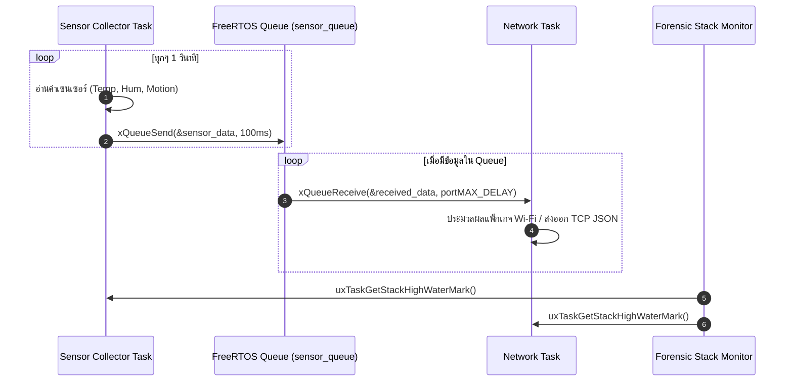

# ใบงานที่ 6.3: การออกแบบ FreeRTOS Task Architecture & Sensor Data Fusion ผ่าน Queue

## 0. กล่าวนำ (Introduction)
ในแอปพลิเคชัน IoT ระดับอุตสาหกรรม โปรแกรมเมอร์จะไม่เขียนโค้ดอ่านค่าเซนเซอร์และการรับส่งข้อมูล Wi-Fi รวมไว้ในฟังก์ชันเดียวกัน เพราะจะทำให้สแตกระบบเครือข่ายชะงัก (Network Latency & Blocking) 

ในใบงานนี้นักศึกษาจะได้ออกแบบสถาปัตยกรรม **FreeRTOS Multi-Tasking** โดยแยกโปรแกรมออกเป็น **Sensor Collector Task** และ **Network Communication Task** แล้วใช้ **FreeRTOS Queue** เป็นสะพานเชื่อมส่งผ่านโครงสร้างข้อมูล `sensor_data_t` อย่างปลอดภัย (Thread-Safe) พร้อมทั้งใช้คำสั่ง Forensic ตรวจวัดหน่วยความจำสแตก `uxTaskGetStackHighWaterMark()`

---

## 1. วัตถุประสงค์ (Objectives)
1. สามารถสร้างและบริหารจัดการ FreeRTOS Tasks บน ESP-IDF ด้วยฟังก์ชัน `xTaskCreate()` ได้
2. สามารถสร้างและใช้งาน FreeRTOS Queue (`xQueueCreate`, `xQueueSend`, `xQueueReceive`) ในการส่งผ่านข้อมูลได้
3. ป้องกันปัญหาการบล็อกระบบเครือข่าย Wi-Fi โดยการแยกงานอ่านเซนเซอร์ออกจาก Network Loop
4. ประเมินการใช้หน่วยความจำสแตกของแต่ละ Task ในสไตล์ Forensic ด้วย `uxTaskGetStackHighWaterMark()`

---

## 2. อุปกรณ์และซอฟต์แวร์ที่ใช้ในการทดลอง (Equipment & Tools)
1. บอร์ดไมโครคอนโทรลเลอร์ ESP32 จำนวน 1 บอร์ด
2. สายเชื่อมต่อ Micro-USB หรือ USB-C จำนวน 1 เส้น
3. โปรแกรม IDE เช่น VS Code พร้อม ESP-IDF Toolchain

---

## 3. สถาปัตยกรรมระบบ (System Architecture & Sequence)



---

## 4. ขั้นตอนการทดลอง (Experimental Procedures)

1. นำซอร์สโค้ดในข้อ 5 ไปวางในไฟล์ `main/main.c` ทำการ Build และ Flash ลงบอร์ด ESP32
2. สังเกต Forensic Log ใน Serial Monitor:
   - ตรวจดูข้อมูลที่ถูกส่งจาก `vSensorTask` เข้าสู่ Queue และถูกรับโดย `vNetworkTask`
   - ตรวจดูค่า **Stack High Water Mark** (ขนาดสแตกคงเหลือ) ของแต่ละ Task
3. ทดลองปรับขนาดสแตกของ `vSensorTask` ใน `xTaskCreate()` จาก `4096` ลดลงเหลือ `1024` สังเกตค่า High Water Mark และวิเคราะห์จุดเสี่ยง Stack Overflow

---

## 5. ซอร์สโค้ดการทดลอง (Complete ESP-IDF Source Code - `main.c`)

```c
#include <stdio.h>
#include <string.h>
#include "freertos/FreeRTOS.h"
#include "freertos/task.h"
#include "freertos/queue.h"
#include "esp_system.h"
#include "esp_log.h"
#include "esp_random.h"

static const char *TAG = "LAB_FREERTOS_QUEUE";

// Sensor Data Structure
typedef struct {
    float temperature;
    float humidity;
    uint32_t light_lux;
    uint32_t timestamp_ms;
} sensor_data_t;

// Queue Handle
static QueueHandle_t xSensorQueue = NULL;

// ------------------------------------------------------------------
// Task 1: Sensor Collector Task (Simulates Reading Hardware Sensors)
// ------------------------------------------------------------------
void vSensorTask(void *pvParameters) {
    sensor_data_t data;
    ESP_LOGI(TAG, "[TASK CREATED]: Sensor Collector Task Started on Core %d", xPortGetCoreID());

    while (1) {
        // 1. Simulate reading sensors
        data.temperature = 25.0f + (esp_random() % 100) / 10.0f;
        data.humidity = 50.0f + (esp_random() % 200) / 10.0f;
        data.light_lux = 200 + (esp_random() % 500);
        data.timestamp_ms = xTaskGetTickCount() * portTICK_PERIOD_MS;

        ESP_LOGI(TAG, "[SENSOR TASK]: Pushing Data -> Temp: %.1f C, Hum: %.1f %%, Lux: %ld",
                 data.temperature, data.humidity, data.light_lux);

        // 2. Send data structure to FreeRTOS Queue
        if (xQueueSend(xSensorQueue, &data, pdMS_TO_TICKS(100)) != pdPASS) {
            ESP_LOGW(TAG, "[QUEUE WARNING]: Queue Full! Failed to push sensor data.");
        }

        // 3. Stack High Water Mark Check
        UBaseType_t hwm = uxTaskGetStackHighWaterMark(NULL);
        ESP_LOGI("FORENSIC_STACK", "  -> SensorTask Stack Remaining: %u words (%u bytes)",
                 hwm, hwm * sizeof(StackType_t));

        vTaskDelay(pdMS_TO_TICKS(1500));
    }
}

// ------------------------------------------------------------------
// Task 2: Network Task (Consumes Data from Queue for Wi-Fi Transmission)
// ------------------------------------------------------------------
void vNetworkTask(void *pvParameters) {
    sensor_data_t rx_data;
    ESP_LOGI(TAG, "[TASK CREATED]: Network Task Started on Core %d", xPortGetCoreID());

    while (1) {
        // Wait indefinitely for data from Queue
        if (xQueueReceive(xSensorQueue, &rx_data, portMAX_DELAY) == pdTRUE) {
            ESP_LOGI(TAG, "=======================================================");
            ESP_LOGI(TAG, "[NETWORK TASK]: Data Received from Queue!");
            ESP_LOGI(TAG, "  -> Timestamp   : %ld ms", rx_data.timestamp_ms);
            ESP_LOGI(TAG, "  -> Temperature : %.2f degC", rx_data.temperature);
            ESP_LOGI(TAG, "  -> Humidity    : %.2f %%", rx_data.humidity);
            ESP_LOGI(TAG, "  -> Light Lux   : %ld lux", rx_data.light_lux);
            ESP_LOGI(TAG, "[NETWORK TASK]: Preparing JSON Packet for Wi-Fi Transmission...");
            ESP_LOGI(TAG, "=======================================================");
        }

        UBaseType_t hwm = uxTaskGetStackHighWaterMark(NULL);
        ESP_LOGI("FORENSIC_STACK", "  -> NetworkTask Stack Remaining: %u words (%u bytes)",
                 hwm, hwm * sizeof(StackType_t));
    }
}

void app_main(void) {
    ESP_LOGI(TAG, "==================================================================");
    ESP_LOGI(TAG, "  Lab 6.3: FreeRTOS Multi-Tasking & Sensor Data Queue Fusion");
    ESP_LOGI(TAG, "==================================================================");

    // Create FreeRTOS Queue for 10 items of sensor_data_t
    xSensorQueue = xQueueCreate(10, sizeof(sensor_data_t));
    if (xSensorQueue == NULL) {
        ESP_LOGE(TAG, "Failed to create FreeRTOS Queue!");
        return;
    }

    // Create Tasks
    xTaskCreate(vSensorTask, "SensorCollectorTask", 3072, NULL, 5, NULL);
    xTaskCreate(vNetworkTask, "NetworkCommTask", 4096, NULL, 4, NULL);
}
```

---

## 6. ตารางบันทึกผลการทดลอง (Experiment Results)

### 6.1 บันทึกข้อมูล Forensic Stack High Water Mark

| ชื่อ FreeRTOS Task        | ขนาด Stack ที่กำหนดใน `xTaskCreate` (Bytes) | ค่า High Water Mark ที่อ่านได้ (Words / Bytes) | สถานะความปลอดภัยสแตก |
| :------------------------ | :-----------------------------------------: | :--------------------------------------------: | :------------------: |
| **`SensorCollectorTask`** |                    3072                     |            1196 words (1196 bytes)             |       ปลอดภัย        |
| **`NetworkCommTask`**     |                    4096                     |            2248 words (2248 bytes)             |       ปลอดภัย        |

---

## 7. คำถามท้ายการทดลอง (Post-Lab Questions)

1. เหตุใดการใช้ **FreeRTOS Queue** จึงมีความปลอดภัย (Thread-Safe) มากกว่าการใช้ตัวแปรแบบ Global ในการรับส่งข้อมูลระหว่างสอง Task?
	**ตอบ** FreeRTOS Queue มีกลไกป้องกันการแย่งกันเข้าถึงข้อมูล (Race Condition) อยู่ในตัว ทำให้ข้อมูลไม่ชนกันหรือเสียหาย ต่างจากตัวแปร Global ที่ถ้าอ่านเขียนพร้อมกันข้อมูลจะพังได้

2. ค่า **Stack High Water Mark** มีประโยชน์อย่างไรในการตรวจวินิจฉัยปัญหาบั๊กในระบบเรียลไทม์ (RTOS)?
	**ตอบ** ใช้ตรวจสอบว่ามีหน่วยความจำ Stack **เหลือว่างน้อยที่สุดเท่าไหร่** เพื่อเช็กความเสี่ยงระบบล่มจาก Stack Overflow หรือดูว่าจองเมมโมรีไว้เกินความจำเป็นหรือไม่

3. หาก `vSensorTask` ส่งข้อมูลเร็วมาก (เช่น ทุก 10ms) แต่ `vNetworkTask` ส่งข้อมูลออก Wi-Fi ได้ช้า (เช่น ใช้เวลา 500ms) จะเกิดอะไรขึ้นกับ Queue และระบบจะรับมืออย่างไร?
	**ตอบ** Queue จะเต็มและล้น ทำให้ข้อมูลชุดใหม่ใส่เข้าคิวไม่ได้ (ข้อมูลสูญหาย) แต่ระบบจะไม่ค้าง และจะพิมพ์ข้อความแจ้งเตือนคิวเต็มออกมาทาง Log แทน


ผล output log จากการทดลอง
```
rst:0x1 (POWERON_RESET),boot:0x13 (SPI_FAST_FLASH_BOOT)
configsip: 0, SPIWP:0xee
clk_drv:0x00,q_drv:0x00,d_drv:0x00,cs0_drv:0x00,hd_drv:0x00,wp_drv:0x00
mode:DIO, clock div:2
load:0x3fff0030,len:6380
ho 0 tail 12 room 4
load:0x40078000,len:15916
load:0x40080400,len:3860
--- 0x40080400: _invalid_pc_placeholder at C:/Users/Rusneeda/esp/v5.5.1/esp-idf/components/xtensa/xtensa_vectors.S:2235
entry 0x40080638
--- 0x40080638: call_start_cpu0 at C:/Users/Rusneeda/esp/v5.5.1/esp-idf/components/bootloader/subproject/main/bootloader_start.c:25
I (29) boot: ESP-IDF v5.5.1 2nd stage bootloader
I (29) boot: compile time Aug 30 2026 19:32:20
I (29) boot: Multicore bootloader
I (31) boot: chip revision: v3.1
I (33) boot.esp32: SPI Speed      : 40MHz
I (37) boot.esp32: SPI Mode       : DIO
I (41) boot.esp32: SPI Flash Size : 2MB
I (44) boot: Enabling RNG early entropy source...
I (49) boot: Partition Table:
I (51) boot: ## Label            Usage          Type ST Offset   Length
I (58) boot:  0 nvs              WiFi data        01 02 00009000 00006000
I (64) boot:  1 phy_init         RF data          01 01 0000f000 00001000
I (71) boot:  2 factory          factory app      00 00 00010000 00100000
I (77) boot: End of partition table
I (81) esp_image: segment 0: paddr=00010020 vaddr=3f400020 size=09e38h ( 40504) map
I (102) esp_image: segment 1: paddr=00019e60 vaddr=3ffb0000 size=023d8h (  9176) load
I (106) esp_image: segment 2: paddr=0001c240 vaddr=40080000 size=03dd8h ( 15832) load
I (112) esp_image: segment 3: paddr=00020020 vaddr=400d0020 size=13850h ( 79952) map
I (141) esp_image: segment 4: paddr=00033878 vaddr=40083dd8 size=0934ch ( 37708) load
I (156) esp_image: segment 5: paddr=0003cbcc vaddr=50000000 size=00020h (    32) load
I (162) boot: Loaded app from partition at offset 0x10000
I (162) boot: Disabling RNG early entropy source...
I (174) cpu_start: Multicore app
I (182) cpu_start: Pro cpu start user code
I (182) cpu_start: cpu freq: 160000000 Hz
I (182) app_init: Application information:
I (182) app_init: Project name:     lab3
I (186) app_init: App version:      1
I (189) app_init: Compile time:     Aug 30 2026 19:31:37
I (194) app_init: ELF file SHA256:  d96b7f631...
I (199) app_init: ESP-IDF:          v5.5.1
I (202) efuse_init: Min chip rev:     v0.0
I (206) efuse_init: Max chip rev:     v3.99 
I (210) efuse_init: Chip rev:         v3.1
I (214) heap_init: Initializing. RAM available for dynamic allocation:
I (221) heap_init: At 3FFAE6E0 len 00001920 (6 KiB): DRAM
I (225) heap_init: At 3FFB2CA8 len 0002D358 (180 KiB): DRAM
I (231) heap_init: At 3FFE0440 len 00003AE0 (14 KiB): D/IRAM
I (236) heap_init: At 3FFE4350 len 0001BCB0 (111 KiB): D/IRAM
I (242) heap_init: At 4008D124 len 00012EDC (75 KiB): IRAM
W (248) spi_flash: Detected boya flash chip but using generic driver. For optimal functionality, enable `SPI_FLASH_SUPPORT_BOYA_CHIP` in menuconfig
I (260) spi_flash: detected chip: generic
I (263) spi_flash: flash io: dio
W (266) spi_flash: Detected size(4096k) larger than the size in the binary image header(2048k). Using the size in the binary image header.
I (279) main_task: Started on CPU0
I (289) main_task: Calling app_main()
I (289) LAB_FREERTOS_QUEUE: ==================================================================
I (289) LAB_FREERTOS_QUEUE:   Lab 6.3: FreeRTOS Multi-Tasking & Sensor Data Queue Fusion
I (299) LAB_FREERTOS_QUEUE: ==================================================================
I (309) LAB_FREERTOS_QUEUE: [TASK CREATED]: Sensor Collector Task Started on Core 0
I (309) LAB_FREERTOS_QUEUE: [SENSOR TASK]: Pushing Data -> Temp: 26.2 C, Hum: 62.9 %, Lux: 411
I (319) FORENSIC_STACK:   -> SensorTask Stack Remaining: 1196 words (1196 bytes)
I (329) LAB_FREERTOS_QUEUE: [TASK CREATED]: Network Task Started on Core 0
I (329) LAB_FREERTOS_QUEUE: =======================================================
I (339) LAB_FREERTOS_QUEUE: [NETWORK TASK]: Data Received from Queue!
I (349) LAB_FREERTOS_QUEUE:   -> Timestamp   : 30 ms
I (349) LAB_FREERTOS_QUEUE:   -> Temperature : 26.20 degC
I (359) LAB_FREERTOS_QUEUE:   -> Humidity    : 62.90 %
I (359) LAB_FREERTOS_QUEUE:   -> Light Lux   : 411 lux
I (369) LAB_FREERTOS_QUEUE: [NETWORK TASK]: Preparing JSON Packet for Wi-Fi Transmission...
I (379) LAB_FREERTOS_QUEUE: =======================================================
I (379) FORENSIC_STACK:   -> NetworkTask Stack Remaining: 2248 words (2248 bytes)
I (389) main_task: Returned from app_main()
I (1829) LAB_FREERTOS_QUEUE: [SENSOR TASK]: Pushing Data -> Temp: 32.1 C, Hum: 55.1 %, Lux: 239
I (1829) FORENSIC_STACK:   -> SensorTask Stack Remaining: 1196 words (1196 bytes)
I (1829) LAB_FREERTOS_QUEUE: =======================================================
I (1839) LAB_FREERTOS_QUEUE: [NETWORK TASK]: Data Received from Queue!
I (1839) LAB_FREERTOS_QUEUE:   -> Timestamp   : 1550 ms
I (1849) LAB_FREERTOS_QUEUE:   -> Temperature : 32.10 degC
I (1849) LAB_FREERTOS_QUEUE:   -> Humidity    : 55.10 %
I (1859) LAB_FREERTOS_QUEUE:   -> Light Lux   : 239 lux
I (1859) LAB_FREERTOS_QUEUE: [NETWORK TASK]: Preparing JSON Packet for Wi-Fi Transmission...
I (1869) LAB_FREERTOS_QUEUE: =======================================================
I (1879) FORENSIC_STACK:   -> NetworkTask Stack Remaining: 2248 words (2248 bytes)
I (3329) LAB_FREERTOS_QUEUE: [SENSOR TASK]: Pushing Data -> Temp: 30.6 C, Hum: 67.5 %, Lux: 691
I (3329) LAB_FREERTOS_QUEUE: =======================================================
I (3329) FORENSIC_STACK:   -> SensorTask Stack Remaining: 1196 words (1196 bytes)
I (3329) LAB_FREERTOS_QUEUE: [NETWORK TASK]: Data Received from Queue!
I (3339) LAB_FREERTOS_QUEUE:   -> Timestamp   : 3050 ms
I (3349) LAB_FREERTOS_QUEUE:   -> Temperature : 30.60 degC
I (3349) LAB_FREERTOS_QUEUE:   -> Humidity    : 67.50 %
I (3359) LAB_FREERTOS_QUEUE:   -> Light Lux   : 691 lux
I (3359) LAB_FREERTOS_QUEUE: [NETWORK TASK]: Preparing JSON Packet for Wi-Fi Transmission...
I (3369) LAB_FREERTOS_QUEUE: =======================================================
I (3379) FORENSIC_STACK:   -> NetworkTask Stack Remaining: 2248 words (2248 bytes)
I (4839) LAB_FREERTOS_QUEUE: [SENSOR TASK]: Pushing Data -> Temp: 27.3 C, Hum: 65.0 %, Lux: 252
I (4839) LAB_FREERTOS_QUEUE: =======================================================
I (4839) FORENSIC_STACK:   -> SensorTask Stack Remaining: 1196 words (1196 bytes)
I (4839) LAB_FREERTOS_QUEUE: [NETWORK TASK]: Data Received from Queue!
I (4849) LAB_FREERTOS_QUEUE:   -> Timestamp   : 4560 ms
I (4859) LAB_FREERTOS_QUEUE:   -> Temperature : 27.30 degC
I (4859) LAB_FREERTOS_QUEUE:   -> Humidity    : 65.00 %
I (4869) LAB_FREERTOS_QUEUE:   -> Light Lux   : 252 lux
I (4869) LAB_FREERTOS_QUEUE: [NETWORK TASK]: Preparing JSON Packet for Wi-Fi Transmission...
I (4879) LAB_FREERTOS_QUEUE: =======================================================
I (4889) FORENSIC_STACK:   -> NetworkTask Stack Remaining: 2248 words (2248 bytes)
I (6349) LAB_FREERTOS_QUEUE: [SENSOR TASK]: Pushing Data -> Temp: 25.9 C, Hum: 66.6 %, Lux: 268
I (6349) LAB_FREERTOS_QUEUE: =======================================================
I (6349) FORENSIC_STACK:   -> SensorTask Stack Remaining: 1196 words (1196 bytes)
I (6349) LAB_FREERTOS_QUEUE: [NETWORK TASK]: Data Received from Queue!
I (6359) LAB_FREERTOS_QUEUE:   -> Timestamp   : 6070 ms
I (6369) LAB_FREERTOS_QUEUE:   -> Temperature : 25.90 degC
I (6369) LAB_FREERTOS_QUEUE:   -> Humidity    : 66.60 %
I (6379) LAB_FREERTOS_QUEUE:   -> Light Lux   : 268 lux
I (6379) LAB_FREERTOS_QUEUE: [NETWORK TASK]: Preparing JSON Packet for Wi-Fi Transmission...
I (6389) LAB_FREERTOS_QUEUE: =======================================================
I (6399) FORENSIC_STACK:   -> NetworkTask Stack Remaining: 2248 words (2248 bytes)
I (7859) LAB_FREERTOS_QUEUE: [SENSOR TASK]: Pushing Data -> Temp: 31.6 C, Hum: 55.9 %, Lux: 642
I (7859) LAB_FREERTOS_QUEUE: =======================================================
I (7859) FORENSIC_STACK:   -> SensorTask Stack Remaining: 1196 words (1196 bytes)
I (7859) LAB_FREERTOS_QUEUE: [NETWORK TASK]: Data Received from Queue!
I (7869) LAB_FREERTOS_QUEUE:   -> Timestamp   : 7580 ms
I (7879) LAB_FREERTOS_QUEUE:   -> Temperature : 31.60 degC
I (7879) LAB_FREERTOS_QUEUE:   -> Humidity    : 55.90 %
I (7889) LAB_FREERTOS_QUEUE:   -> Light Lux   : 642 lux
I (7889) LAB_FREERTOS_QUEUE: [NETWORK TASK]: Preparing JSON Packet for Wi-Fi Transmission...
I (7899) LAB_FREERTOS_QUEUE: =======================================================
I (7909) FORENSIC_STACK:   -> NetworkTask Stack Remaining: 2248 words (2248 bytes)
I (9369) LAB_FREERTOS_QUEUE: [SENSOR TASK]: Pushing Data -> Temp: 28.6 C, Hum: 65.3 %, Lux: 295
I (9369) LAB_FREERTOS_QUEUE: =======================================================
I (9369) FORENSIC_STACK:   -> SensorTask Stack Remaining: 1196 words (1196 bytes)
I (9369) LAB_FREERTOS_QUEUE: [NETWORK TASK]: Data Received from Queue!
I (9379) LAB_FREERTOS_QUEUE:   -> Timestamp   : 9090 ms
I (9389) LAB_FREERTOS_QUEUE:   -> Temperature : 28.60 degC
I (9389) LAB_FREERTOS_QUEUE:   -> Humidity    : 65.30 %
I (9399) LAB_FREERTOS_QUEUE:   -> Light Lux   : 295 lux
I (9399) LAB_FREERTOS_QUEUE: [NETWORK TASK]: Preparing JSON Packet for Wi-Fi Transmission...
I (9409) LAB_FREERTOS_QUEUE: =======================================================
I (9419) FORENSIC_STACK:   -> NetworkTask Stack Remaining: 2248 words (2248 bytes)
I (10879) LAB_FREERTOS_QUEUE: [SENSOR TASK]: Pushing Data -> Temp: 34.5 C, Hum: 55.8 %, Lux: 690
I (10879) LAB_FREERTOS_QUEUE: =======================================================
I (10879) FORENSIC_STACK:   -> SensorTask Stack Remaining: 1196 words (1196 bytes)
I (10879) LAB_FREERTOS_QUEUE: [NETWORK TASK]: Data Received from Queue!
I (10889) LAB_FREERTOS_QUEUE:   -> Timestamp   : 10600 ms
I (10899) LAB_FREERTOS_QUEUE:   -> Temperature : 34.50 degC
I (10899) LAB_FREERTOS_QUEUE:   -> Humidity    : 55.80 %
I (10909) LAB_FREERTOS_QUEUE:   -> Light Lux   : 690 lux
I (10909) LAB_FREERTOS_QUEUE: [NETWORK TASK]: Preparing JSON Packet for Wi-Fi Transmission...
I (10919) LAB_FREERTOS_QUEUE: =======================================================
I (10929) FORENSIC_STACK:   -> NetworkTask Stack Remaining: 2248 words (2248 bytes)

Done
PS D:\1-2569\IOT\week06\lab03> 
```