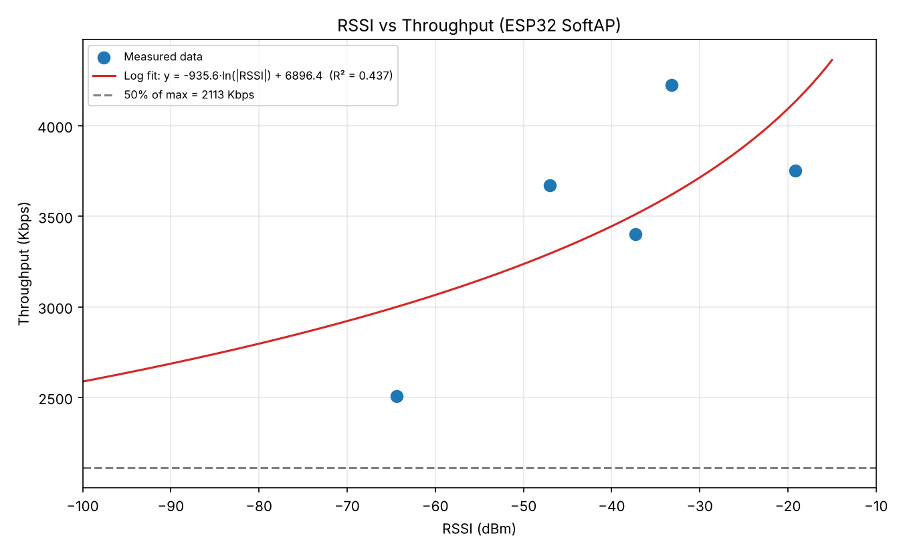
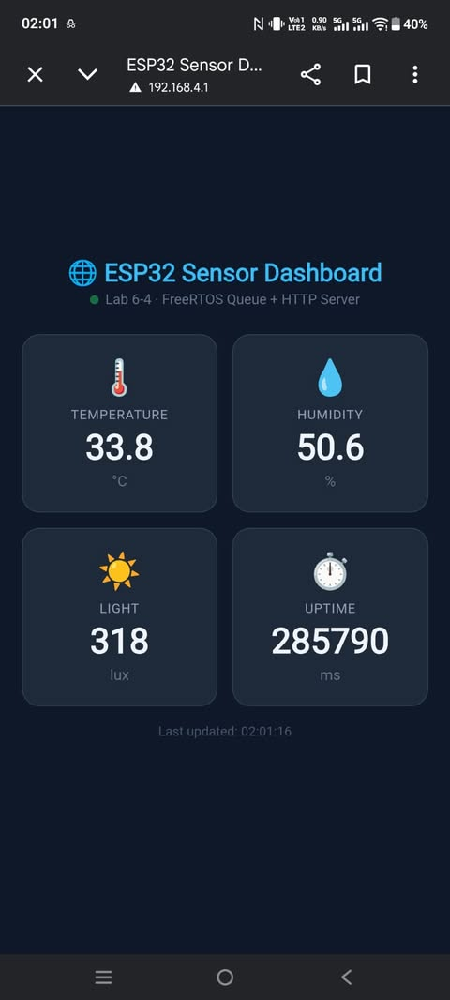

# Lab6-1
## 6.1 บันทึกข้อมูล Client ที่เชื่อมต่อเข้ากับ ESP32 SoftAP

| อุปกรณ์ที่ใช้ทดสอบ (เช่น iPhone/Android) | MAC Address ที่ดักจับได้ | Association ID (AID) | หมายเลข IP Address ที่ได้ (ถ้าทราบ) |
| :--- | :--- | :---: | :---: |
| **อุปกรณ์ที่ 1** | 92:19:A3:19:E6:C5 | 1 | 192.168.4.2 |
| **อุปกรณ์ที่ 2** | 94:BB:43:77:9D:5B | 2 | 192.168.4.3 |

### Log
```
I (27) boot: ESP-IDF v6.0.2 2nd stage bootloader
I (27) boot: compile time Aug 10 2026 09:49:02
I (28) boot: Multicore bootloader
I (29) boot: chip revision: v3.1
I (32) boot.esp32: SPI Speed      : 40MHz
I (35) boot.esp32: SPI Mode       : DIO
I (39) boot.esp32: SPI Flash Size : 2MB
I (42) boot: Enabling RNG early entropy source...
I (47) boot: Partition Table:
I (49) boot: ## Label            Usage          Type ST Offset   Length
I (56) boot:  0 nvs              WiFi data        01 02 00009000 00006000
I (62) boot:  1 phy_init         RF data          01 01 0000f000 00001000
I (69) boot:  2 factory          factory app      00 00 00010000 00100000
I (75) boot: End of partition table
I (79) esp_image: segment 0: paddr=00010020 vaddr=3f400020 size=1a240h (107072) map
I (124) esp_image: segment 1: paddr=0002a268 vaddr=3ffb0000 size=04528h ( 17704) load
I (131) esp_image: segment 2: paddr=0002e798 vaddr=40080000 size=01880h (  6272) load
I (134) esp_image: segment 3: paddr=00030020 vaddr=400d0020 size=87e00h (556544) map
I (334) esp_image: segment 4: paddr=000b7e28 vaddr=40081880 size=13d88h ( 81288) load
I (368) esp_image: segment 5: paddr=000cbbb8 vaddr=50000000 size=00028h (    40) load
I (379) boot: Loaded app from partition at offset 0x10000
I (379) boot: Disabling RNG early entropy source...
I (389) cpu_start: Multicore app
I (397) cpu_start: GPIO 3 and 1 are used as console UART I/O pins
I (398) cpu_start: Pro cpu start user code
I (398) cpu_start: cpu freq: 160000000 Hz
I (400) app_init: Application information:
I (403) app_init: Project name:     wifi_softap_tracking
I (408) app_init: App version:      029da6d-dirty
I (413) app_init: Compile time:     Aug 10 2026 09:48:44
I (418) app_init: ELF file SHA256:  ee3f9a171...
I (422) app_init: ESP-IDF:          v6.0.2
I (426) efuse_init: Min chip rev:     v0.0
I (430) efuse_init: Max chip rev:     v3.99 
I (434) efuse_init: Chip rev:         v3.1
I (438) heap_init: Initializing. RAM available for dynamic allocation:
I (444) heap_init: At 3FFAE6E0 len 00001920 (6 KiB): DRAM
I (449) heap_init: At 3FFB8A20 len 000275E0 (157 KiB): DRAM
I (454) heap_init: At 3FFE0440 len 00003AE0 (14 KiB): D/IRAM
I (460) heap_init: At 3FFE4350 len 0001BCB0 (111 KiB): D/IRAM
I (465) heap_init: At 40095608 len 0000A9F8 (42 KiB): IRAM
I (472) spi_flash: detected chip: generic
I (474) spi_flash: flash io: dio
W (477) spi_flash: Detected size(4096k) larger than the size in the binary image header(2048k). Using the size in the binary image header.
I (491) main_task: Started on CPU0
I (491) main_task: Calling app_main()
I (491) LAB_SOFTAP: [FORENSIC]: Call nvs_flash_init()
I (531) LAB_SOFTAP: [FORENSIC]: Call esp_netif_init()
I (531) LAB_SOFTAP: [FORENSIC]: Call esp_event_loop_create_default()
I (531) LAB_SOFTAP: [FORENSIC]: Call esp_netif_create_default_wifi_ap()
I (541) LAB_SOFTAP: [FORENSIC]: SoftAP Interface created at 0x3ffbddfc (Default IP: 192.168.4.1)
I (541) LAB_SOFTAP: [FORENSIC]: Call esp_wifi_init(&cfg)
I (561) wifi:wifi driver task: 3ffc0580, prio:23, stack:6656, core=0
I (581) wifi:wifi firmware version: 00ad238
I (581) wifi:wifi certification version: v7.0
I (581) wifi:config NVS flash: enabled
I (581) wifi:config nano formatting: disabled
I (581) wifi:Init data frame dynamic rx buffer num: 32
I (591) wifi:Init static rx mgmt buffer num: 5
I (591) wifi:Init management short buffer num: 32
I (591) wifi:Init dynamic tx buffer num: 32
I (601) wifi:Init static rx buffer size: 1600
I (601) wifi:Init static rx buffer num: 10
I (611) wifi:Init dynamic rx buffer num: 32
I (611) wifi_init: rx ba win: 6
I (611) wifi_init: accept mbox: 6
I (621) wifi_init: tcpip mbox: 32
I (621) wifi_init: udp mbox: 6
I (621) wifi_init: tcp mbox: 6
I (621) wifi_init: tcp tx win: 5760
I (631) wifi_init: tcp rx win: 5760
I (631) wifi_init: tcp mss: 1440
I (631) wifi_init: WiFi IRAM OP enabled
I (641) wifi_init: WiFi RX IRAM OP enabled
I (641) LAB_SOFTAP: [FORENSIC]: Call esp_event_handler_instance_register(WIFI_EVENT)
I (651) LAB_SOFTAP: [FORENSIC]: Call esp_wifi_set_mode(WIFI_MODE_AP)
I (651) LAB_SOFTAP: [FORENSIC]: Call esp_wifi_set_config(WIFI_IF_AP, &wifi_config)
I (931) LAB_SOFTAP: [FORENSIC]: Call esp_wifi_start()
I (931) phy_init: phy_version 4863,a3a4459,Oct 28 2025,14:30:06
I (1011) wifi:mode : softAP (14:33:5c:0d:cd:75)
I (1011) wifi:Total power save buffer number: 16
I (1021) wifi:Init max length of beacon: 752/752
I (1021) wifi:Init max length of beacon: 752/752
I (1021) LAB_SOFTAP: ==================================================================
I (1021) esp_netif_lwip: DHCP server started on interface WIFI_AP_DEF with IP: 192.168.4.1
I (1031) LAB_SOFTAP:   ESP32 SoftAP Running! SSID: "MY_ESP32_AP_0344", Channel: 1
I (1041) LAB_SOFTAP: ==================================================================
I (1051) LAB_SOFTAP: [TCP SERVER]: Listening on 192.168.4.1:8080
I (1051) main_task: Returned from app_main()
I (750901) wifi:station: 92:19:a3:19:e6:c5 join, AID=1, bgn, 40U
I (750961) LAB_SOFTAP: =======================================================
I (750961) LAB_SOFTAP: [FORENSIC EVENT]: Client Connected to ESP32 SoftAP!
I (750961) LAB_SOFTAP:   -> Client MAC Address : 92:19:A3:19:E6:C5
I (750961) LAB_SOFTAP:   -> Assigned AID       : 1
I (750971) LAB_SOFTAP: =======================================================
I (751121) wifi:<ba-add>idx:2 (ifx:1, 92:19:a3:19:e6:c5), tid:0, ssn:0, winSize:64
I (751201) esp_netif_lwip: DHCP server assigned IP to a client, IP is: 192.168.4.2
I (867901) wifi:station: 94:bb:43:77:9d:5b join, AID=2, bgn, 40U
I (867991) LAB_SOFTAP: =======================================================
I (867991) LAB_SOFTAP: [FORENSIC EVENT]: Client Connected to ESP32 SoftAP!
I (867991) LAB_SOFTAP:   -> Client MAC Address : 94:BB:43:77:9D:5B
I (868001) LAB_SOFTAP:   -> Assigned AID       : 2
I (868001) LAB_SOFTAP: =======================================================
I (868381) esp_netif_lwip: DHCP server assigned IP to a client, IP is: 192.168.4.3
I (868501) wifi:<ba-add>idx:3 (ifx:1, 94:bb:43:77:9d:5b), tid:0, ssn:16, winSize:64
```

## 7. คำถามท้ายการทดลอง (Post-Lab Questions)

1. เหตุใด IP Address เริ่มต้นของ ESP32 SoftAP จึงเป็น `192.168.4.1` และ DHCP Server บน ESP32 เริ่มแจกจ่าย IP ที่หมายเลขใด?
```
- เหตุผลที่เป็น 192.168.4.1 เป็นค่ามาตรฐานเริ่มต้น (Default Gateway IP) ในสแต็กเครือข่ายของ ESP-IDF สำหรับโหมด SoftAP 
(esp_netif) เพื่อใช้เป็น IP ประจำตัวของ Access Point ในวงเครือข่ายส่วนตัว (Private IPv4)
- การแจกจ่าย IP ของ DHCP Server: DHCP Server บน ESP32 จะเริ่มแจกจ่าย IP Address ให้กับอุปกรณ์ลูกข่าย (Clients) 
ตั้งแต่หมายเลข 192.168.4.2 เป็นต้นไป
```

2. สมาชิกตัวแปร `mac` ในโครงสร้าง `wifi_event_ap_staconnected_t` สามารถนำไปประยุกต์ใช้ทำระบบความปลอดภัยขั้นสูง (เช่น MAC Filtering) ได้อย่างไร?
```
- MAC Filtering เมื่อเกิด Event WIFI_EVENT_AP_STACONNECTED โค้ดใน Callback สามารถนำค่า mac 
ไปตรวจสอบเทียบกับรายการรายชื่อที่อนุญาต (Whitelist) ทันที หากไม่ตรงกับเงื่อนไขสามารถสั่งตัดการเชื่อมต่อด้วยฟังก์ชัน 
esp_wifi_deauth_sta() เพื่อป้องกันไม่ให้อุปกรณ์แปลกปลอมเข้ามาใช้งานเครือข่าย
```

3. หากมี Client พยายามเชื่อมต่อเป็นเครื่องที่ 5 (เกินค่า `max_connection = 4`) จะเกิดเหตุการณ์ใดขึ้นในระดับสัญญาณวิทยุ?
```
- ESP32 จะปฏิเสธคำขอเชื่อมต่อ (Association Request) ของอุปกรณ์เครื่องที่ 5 โดยส่งกรอบข้อมูลตอบกลับประเภท Association Response 
ที่ระบุสถานะปฏิเสธการเชื่อมต่อ
```

# Lab6-2
## 5. ตารางบันทึกผลการทดลอง (Experiment Results)

ให้นักศึกษาบันทึกค่าที่ได้จากการทดสอบในระดับ Tx Power ต่างๆ:

| การทดลองที่ | ค่า Tx Power ที่ตั้ง (dBm) | ค่า RSSI ที่อ่านได้จริง (dBm) | เวลาที่ใช้ (Seconds) | ความเร็วที่วัดได้ Throughput (Kbps) |
| :---: | :---: | :---: | :---: | :---: |
| **1** | 20 dBm (Max) | -19.2 dBm | 0.110 Seconds | 3751.24 Kbps |
| **2** | 15 dBm | -33.2 dBm | 0.098 Seconds | 4226.31 Kbps |
| **3** | 10 dBm | -37.3 dBm | 0.120 Seconds | 3400.31 Kbps |
| **4** | 5 dBm | -47.0 dBm | 0.115 Seconds | 3670.66 Kbps |
| **5** | 2 dBm (Min) | -64.4 dB | 0.185 Seconds | 2506.83 Kbps |

---

## 6. งานวิเคราะห์ข้อมูลเชิงสถิติ (Data Science & Regression Task)

ให้นักศึกษานำค่า **RSSI (x-axis)** และ **Throughput (y-axis)** จากตารางทดลองไปสร้างแผนภาพใน Excel หรือ Python (Jupyter Notebook):

1. สร้างแผนภาพ **Scatter Plot** แสดงจุดข้อมูลระหว่าง RSSI กับ Speed
2. สร้างเส้นแนวโน้ม **Trendline / Regression Curve** (เช่น Logarithmic Regression: $y = a \cdot \ln(x) + b$)
3. คำนวณค่า **$R^2$ (Coefficient of Determination)** เพื่อประเมินความแม่นยำของสมการ
4. ระบุจุด **Threshold RSSI (dBm)** ที่ความเร็วเริ่มลดลงมากกว่า 50% จากระดับสูงสุด



---

## 7. คำถามท้ายการทดลอง (Post-Lab Questions)

1. เมื่อลดระดับ Tx Power ลงจาก 20 dBm เหลือ 2 dBm ค่า RSSI ลดลงกี่ dBm และส่งผลต่อความเร็ว Throughput อย่างไร?
```
- RSSI ลดลง 45.2 dB (จาก -19.2 เป็น -64.4 dBm) ส่งผลให้ Throughput ลดลงจาก 3751.24 เหลือ 2506.83 Kbps หรือประมาณ 33% 
คือความเร็วลดลงน้อยกว่า RSSI มาก เพราะที่ -64 dBm สัญญาณยังแรงพอให้ใช้อัตราส่งข้อมูลสูงได้
```

2. เหตุใดในระดับ RSSI ที่อ่อนกว่า `-80 dBm` ความเร็ว Throughput ถึงตกลงอย่างกะทันหันในโปรโตคอล TCP?
```
- เมื่อ RSSI ต่ำกว่า -80 dBm สัญญาณเข้าใกล้ noise floor ทำให้ SNR ต่ำและเฟรมผิดพลาดบ่อย ระบบจึงลดอัตราส่ง (rate adaptation) 
และส่งซ้ำระดับ MAC มากขึ้น ทำให้ delay สูง ACK มาช้าหรือหาย TCP จึงตีความว่าเครือข่ายคับคั่ง ลด congestion window 
และเกิด timeout/backoff ซ้ำๆ ความเร็วจึงตกอย่างกะทันหัน
```

3. สมการ Regression ที่ได้จากการทดลองสามารถนำไปประยุกต์ใช้ทำนายคุณภาพการเชื่อมต่อในแอปพลิเคชัน IoT ได้อย่างไร?
```
- นำค่า RSSI ที่โหนดอ่านได้ไปแทนในสมการ เพื่อประมาณ Throughput ล่วงหน้า แล้วให้โหนดปรับตัวอัตโนมัติ เช่น 
ลดขนาดข้อมูลหรือความถี่การส่ง เพิ่ม Tx Power หรือแจ้งเตือนเมื่อ RSSI ต่ำกว่าเกณฑ์ ทั้งนี้สมการนี้ใช้ได้เฉพาะช่วงที่วัดจริง 
(-19 ถึง -64 dBm) และเป็นการทำนายคร่าวๆ เพราะ R² ต่ำ (0.44)
```

# Lab6-3 
## 6. ตารางบันทึกผลการทดลอง (Experiment Results)

### 6.1 บันทึกข้อมูล Forensic Stack High Water Mark

| ชื่อ FreeRTOS Task | ขนาด Stack ที่กำหนดใน `xTaskCreate` (Bytes) | ค่า High Water Mark ที่อ่านได้ (Words / Bytes) | สถานะความปลอดภัยสแตก |
| :--- | :---: | :---: | :---: |
| **`SensorCollectorTask`** | 3072 | 2028 | ปลอดภัย (เหลือประมาณ 66%) |
| **`NetworkCommTask`** | 4096 | 3080 | ปลอดภัย (เหลือประมาณ 75%) |

### Log
```
I (27) boot: ESP-IDF v6.0.2 2nd stage bootloader
I (27) boot: compile time Nov  5 2026 01:22:19
I (28) boot: Multicore bootloader
I (29) boot: chip revision: v3.1
I (32) boot.esp32: SPI Speed      : 40MHz
I (35) boot.esp32: SPI Mode       : DIO
I (39) boot.esp32: SPI Flash Size : 2MB
I (42) boot: Enabling RNG early entropy source...
I (47) boot: Partition Table:
I (49) boot: ## Label            Usage          Type ST Offset   Length
I (56) boot:  0 nvs              WiFi data        01 02 00009000 00006000
I (62) boot:  1 phy_init         RF data          01 01 0000f000 00001000
I (69) boot:  2 factory          factory app      00 00 00010000 00100000
I (75) boot: End of partition table
I (79) esp_image: segment 0: paddr=00010020 vaddr=3f400020 size=08938h ( 35128) map
I (99) esp_image: segment 1: paddr=00018960 vaddr=3ffb0000 size=029fch ( 10748) load
I (103) esp_image: segment 2: paddr=0001b364 vaddr=40080000 size=04cb4h ( 19636) load
I (111) esp_image: segment 3: paddr=00020020 vaddr=400d0020 size=0c3b0h ( 50096) map
I (130) esp_image: segment 4: paddr=0002c3d8 vaddr=40084cb4 size=05fe4h ( 24548) load
I (140) esp_image: segment 5: paddr=000323c4 vaddr=50000000 size=00028h (    40) load
I (146) boot: Loaded app from partition at offset 0x10000
I (146) boot: Disabling RNG early entropy source...
I (158) cpu_start: Multicore app
I (166) cpu_start: GPIO 3 and 1 are used as console UART I/O pins
I (167) cpu_start: Pro cpu start user code
I (167) cpu_start: cpu freq: 160000000 Hz
I (168) app_init: Application information:
I (172) app_init: Project name:     freertos_sensor_queue
I (177) app_init: App version:      029da6d-dirty
I (182) app_init: Compile time:     Nov  5 2026 01:21:35
I (187) app_init: ELF file SHA256:  897d5ff4b...
I (191) app_init: ESP-IDF:          v6.0.2
I (195) efuse_init: Min chip rev:     v0.0
I (199) efuse_init: Max chip rev:     v3.99 
I (203) efuse_init: Chip rev:         v3.1
I (207) heap_init: Initializing. RAM available for dynamic allocation:
I (213) heap_init: At 3FFAE6E0 len 00001920 (6 KiB): DRAM
I (218) heap_init: At 3FFB33A8 len 0002CC58 (179 KiB): DRAM
I (223) heap_init: At 3FFE0440 len 00003AE0 (14 KiB): D/IRAM
I (229) heap_init: At 3FFE4350 len 0001BCB0 (111 KiB): D/IRAM
I (234) heap_init: At 4008AC98 len 00015368 (84 KiB): IRAM
I (241) spi_flash: detected chip: generic
I (243) spi_flash: flash io: dio
W (246) spi_flash: Detected size(4096k) larger than the size in the binary image header(2048k). Using the size in the binary image header.
I (259) main_task: Started on CPU0
I (259) main_task: Calling app_main()
I (259) LAB_FREERTOS_QUEUE: ==================================================================
I (269) LAB_FREERTOS_QUEUE:   Lab 6.3: FreeRTOS Multi-Tasking & Sensor Data Queue Fusion
I (279) LAB_FREERTOS_QUEUE: ==================================================================
I (279) LAB_FREERTOS_QUEUE: [TASK CREATED]: Sensor Collector Task Started on Core 0
I (289) LAB_FREERTOS_QUEUE: [SENSOR TASK]: Pushing Data -> Temp: 27.8 C, Hum: 59.3 %, Lux: 507
I (299) FORENSIC_STACK:   -> SensorTask Stack Remaining: 2028 words (2028 bytes)
I (309) LAB_FREERTOS_QUEUE: [TASK CREATED]: Network Task Started on Core 0
I (309) LAB_FREERTOS_QUEUE: =======================================================
I (319) LAB_FREERTOS_QUEUE: [NETWORK TASK]: Data Received from Queue!
I (329) LAB_FREERTOS_QUEUE:   -> Timestamp   : 30 ms
I (329) LAB_FREERTOS_QUEUE:   -> Temperature : 27.80 degC
I (339) LAB_FREERTOS_QUEUE:   -> Humidity    : 59.30 %
I (339) LAB_FREERTOS_QUEUE:   -> Light Lux   : 507 lux
I (349) LAB_FREERTOS_QUEUE: [NETWORK TASK]: Preparing JSON Packet for Wi-Fi Transmission...
I (359) LAB_FREERTOS_QUEUE: =======================================================
I (359) FORENSIC_STACK:   -> NetworkTask Stack Remaining: 3080 words (3080 bytes)
I (369) main_task: Returned from app_main()
I (1809) LAB_FREERTOS_QUEUE: [SENSOR TASK]: Pushing Data -> Temp: 25.5 C, Hum: 61.8 %, Lux: 364
I (1809) FORENSIC_STACK:   -> SensorTask Stack Remaining: 2028 words (2028 bytes)
I (1809) LAB_FREERTOS_QUEUE: =======================================================
I (1819) LAB_FREERTOS_QUEUE: [NETWORK TASK]: Data Received from Queue!
I (1819) LAB_FREERTOS_QUEUE:   -> Timestamp   : 1550 ms
I (1829) LAB_FREERTOS_QUEUE:   -> Temperature : 25.50 degC
I (1829) LAB_FREERTOS_QUEUE:   -> Humidity    : 61.80 %
I (1839) LAB_FREERTOS_QUEUE:   -> Light Lux   : 364 lux
I (1839) LAB_FREERTOS_QUEUE: [NETWORK TASK]: Preparing JSON Packet for Wi-Fi Transmission...
I (1849) LAB_FREERTOS_QUEUE: =======================================================
I (1859) FORENSIC_STACK:   -> NetworkTask Stack Remaining: 3080 words (3080 bytes)
I (3309) LAB_FREERTOS_QUEUE: [SENSOR TASK]: Pushing Data -> Temp: 26.9 C, Hum: 64.0 %, Lux: 391
I (3309) LAB_FREERTOS_QUEUE: =======================================================
I (3309) FORENSIC_STACK:   -> SensorTask Stack Remaining: 2028 words (2028 bytes)
I (3309) LAB_FREERTOS_QUEUE: [NETWORK TASK]: Data Received from Queue!
I (3319) LAB_FREERTOS_QUEUE:   -> Timestamp   : 3050 ms
I (3329) LAB_FREERTOS_QUEUE:   -> Temperature : 26.90 degC
I (3329) LAB_FREERTOS_QUEUE:   -> Humidity    : 64.00 %
I (3339) LAB_FREERTOS_QUEUE:   -> Light Lux   : 391 lux
I (3339) LAB_FREERTOS_QUEUE: [NETWORK TASK]: Preparing JSON Packet for Wi-Fi Transmission...
I (3349) LAB_FREERTOS_QUEUE: =======================================================
I (3359) FORENSIC_STACK:   -> NetworkTask Stack Remaining: 3080 words (3080 bytes)
```

---

## 7. คำถามท้ายการทดลอง (Post-Lab Questions)

1. เหตุใดการใช้ **FreeRTOS Queue** จึงมีความปลอดภัย (Thread-Safe) มากกว่าการใช้ตัวแปรแบบ Global ในการรับส่งข้อมูลระหว่างสอง Task?
```
- Queue มีกลไกล็อกและ synchronization ในตัว ทำให้การเขียนและอ่านเป็น atomic และคัดลอกข้อมูลทั้งก้อนอย่างสมบูรณ์ ส่วนตัวแปร 
Global อาจถูก Task อื่นขัดจังหวะกลางการเขียน ทำให้ได้ข้อมูลครึ่งเก่าครึ่งใหม่ (race condition) นอกจากนี้ Queue ยังให้ Task 
ผู้รับ Block รอ ข้อมูลได้โดยไม่เปลือง CPU ขณะที่ Global ต้อง polling
```

2. ค่า **Stack High Water Mark** มีประโยชน์อย่างไรในการตรวจวินิจฉัยปัญหาบั๊กในระบบเรียลไทม์ (RTOS)?
```
- บอกพื้นที่ stack ที่เหลือน้อยที่สุดของแต่ละ Task ช่วยตรวจจับความเสี่ยง Stack Overflow ก่อนเกิดปัญหา 
ซึ่งมักทำให้ระบบรีบูตหรือค้างแบบหาสาเหตุยาก ใช้ปรับขนาด stack ให้พอดี (ไม่เล็กเกินจนล้น ไม่ใหญ่เกินจนเปลือง RAM) 
และใช้ตรวจสอบหลังเพิ่มโค้ดใหม่ว่า stack ยังเพียงพอ
```

3. หาก `vSensorTask` ส่งข้อมูลเร็วมาก (เช่น ทุก 10ms) แต่ `vNetworkTask` ส่งข้อมูลออก Wi-Fi ได้ช้า (เช่น ใช้เวลา 500ms) จะเกิดอะไรขึ้นกับ Queue และระบบจะรับมืออย่างไร?
```
- Sensor สร้างข้อมูลประมาณ 100 ชุด/วินาที แต่ Network ดึงออกได้เพียงประมาณ 2 ชุด/วินาที Queue จึง เต็มอย่างรวดเร็ว 
และเมื่อเต็มแล้ว xQueueSend จะ Block รอจนหมด timeout หรือคืนค่า errQUEUE_FULL ทำให้ข้อมูลใหม่ สูญหาย 
(หรือ Sensor Task ถูกบล็อกหากตั้งรอแบบไม่จำกัด)
```

# Lab6-4
## 7. ตารางบันทึกผลการทดลอง (Experiment Results)

### 7.1 บันทึกข้อมูลจาก Dashboard

| ครั้งที่ | Temperature (°C) | Humidity (%) | Light Lux | Timestamp (ms) |
| :------: | :--------------: | :----------: | :-------: | :------------: |
|  **1**   |       25.30           |      54.00	       |   684        |    294850            |
|  **2**   |       29.20           |      67.90        |   477        |    296360            |
|  **3**   |       28.60           |      56.10        |   601        |    297870            |

### 7.2 ทดสอบ JSON API (`/api/data`)

บันทึก Raw JSON Response จาก Browser:
```json
{
"temperature":26.70,
"humidity":69.20,
"light_lux":571,
"timestamp_ms":306930
}

```

### Log
```
I (295396) NETWORK_TASK: =======================================================
I (295406) FORENSIC_STACK:   -> NetworkTask Stack Remaining: 2908 words (2908 bytes)
I (295746) HTTP_SERVER: [FORENSIC]: GET /api/data requested
I (295746) HTTP_SERVER: [FORENSIC]: Mutex acquired & released for /api/data
I (295756) HTTP_SERVER: [FORENSIC]: Response sent: {"temperature":25.30,"humidity":54.00,"light_lux":684,"timestamp_ms":294850}
I (296866) SENSOR_TASK: [SENSOR TASK]: Pushing -> Temp: 29.2 C, Hum: 67.9 %, Lux: 477
I (296866) NETWORK_TASK: =======================================================
I (296866) FORENSIC_STACK:   -> SensorTask Stack Remaining: 2024 words (2024 bytes)
I (296866) NETWORK_TASK: [NETWORK TASK]: Data Received from Queue!
I (296876) NETWORK_TASK:   -> Timestamp   : 296360 ms
I (296886) NETWORK_TASK:   -> Temperature : 29.20 degC
I (296886) NETWORK_TASK:   -> Humidity    : 67.90 %
I (296896) NETWORK_TASK:   -> Light Lux   : 477 lux
I (296896) NETWORK_TASK: [NETWORK TASK]: g_latest_data updated (Mutex OK)
I (296906) NETWORK_TASK: =======================================================
I (296916) FORENSIC_STACK:   -> NetworkTask Stack Remaining: 2908 words (2908 bytes)
I (297756) HTTP_SERVER: [FORENSIC]: GET /api/data requested
I (297756) HTTP_SERVER: [FORENSIC]: Mutex acquired & released for /api/data
I (297756) HTTP_SERVER: [FORENSIC]: Response sent: {"temperature":29.20,"humidity":67.90,"light_lux":477,"timestamp_ms":296360}
I (298376) SENSOR_TASK: [SENSOR TASK]: Pushing -> Temp: 28.6 C, Hum: 56.1 %, Lux: 601
I (298376) NETWORK_TASK: =======================================================
I (298376) FORENSIC_STACK:   -> SensorTask Stack Remaining: 2024 words (2024 bytes)
I (298376) NETWORK_TASK: [NETWORK TASK]: Data Received from Queue!
I (298386) NETWORK_TASK:   -> Timestamp   : 297870 ms
I (298396) NETWORK_TASK:   -> Temperature : 28.60 degC
I (298396) NETWORK_TASK:   -> Humidity    : 56.10 %
I (298406) NETWORK_TASK:   -> Light Lux   : 601 lux
I (298406) NETWORK_TASK: [NETWORK TASK]: g_latest_data updated (Mutex OK)
I (298416) NETWORK_TASK: =======================================================
I (298426) FORENSIC_STACK:   -> NetworkTask Stack Remaining: 2908 words (2908 bytes)
I (299766) HTTP_SERVER: [FORENSIC]: GET /api/data requested
I (299766) HTTP_SERVER: [FORENSIC]: Mutex acquired & released for /api/data
I (299776) HTTP_SERVER: [FORENSIC]: Response sent: {"temperature":28.60,"humidity":56.10,"light_lux":601,"timestamp_ms":297870}
I (299886) SENSOR_TASK: [SENSOR TASK]: Pushing -> Temp: 27.3 C, Hum: 62.9 %, Lux: 363
I (299886) NETWORK_TASK: =======================================================
I (299886) FORENSIC_STACK:   -> SensorTask Stack Remaining: 2024 words (2024 bytes)
I (299886) NETWORK_TASK: [NETWORK TASK]: Data Received from Queue!
I (299896) NETWORK_TASK:   -> Timestamp   : 299380 ms
I (299906) NETWORK_TASK:   -> Temperature : 27.30 degC
I (299906) NETWORK_TASK:   -> Humidity    : 62.90 %
I (299916) NETWORK_TASK:   -> Light Lux   : 363 lux
I (299916) NETWORK_TASK: [NETWORK TASK]: g_latest_data updated (Mutex OK)
I (299926) NETWORK_TASK: =======================================================
I (299936) FORENSIC_STACK:   -> NetworkTask Stack Remaining: 2908 words (2908 bytes)
I (301396) SENSOR_TASK: [SENSOR TASK]: Pushing -> Temp: 29.7 C, Hum: 63.2 %, Lux: 536
I (301396) NETWORK_TASK: =======================================================
I (301396) FORENSIC_STACK:   -> SensorTask Stack Remaining: 2024 words (2024 bytes)
I (301396) NETWORK_TASK: [NETWORK TASK]: Data Received from Queue!
I (301406) NETWORK_TASK:   -> Timestamp   : 300890 ms
I (301416) NETWORK_TASK:   -> Temperature : 29.70 degC
I (301416) NETWORK_TASK:   -> Humidity    : 63.20 %
I (301426) NETWORK_TASK:   -> Light Lux   : 536 lux
I (301426) NETWORK_TASK: [NETWORK TASK]: g_latest_data updated (Mutex OK)
I (301436) NETWORK_TASK: =======================================================
I (301446) FORENSIC_STACK:   -> NetworkTask Stack Remaining: 2908 words (2908 bytes)
I (301766) HTTP_SERVER: [FORENSIC]: GET /api/data requested
I (301766) HTTP_SERVER: [FORENSIC]: Mutex acquired & released for /api/data
I (301766) HTTP_SERVER: [FORENSIC]: Response sent: {"temperature":29.70,"humidity":63.20,"light_lux":536,"timestamp_ms":300890}
I (302906) SENSOR_TASK: [SENSOR TASK]: Pushing -> Temp: 25.8 C, Hum: 55.1 %, Lux: 358
I (302906) NETWORK_TASK: =======================================================
I (302906) FORENSIC_STACK:   -> SensorTask Stack Remaining: 2024 words (2024 bytes)
I (302906) NETWORK_TASK: [NETWORK TASK]: Data Received from Queue!
I (302916) NETWORK_TASK:   -> Timestamp   : 302400 ms
I (302926) NETWORK_TASK:   -> Temperature : 25.80 degC
I (302926) NETWORK_TASK:   -> Humidity    : 55.10 %
I (302936) NETWORK_TASK:   -> Light Lux   : 358 lux
I (302936) NETWORK_TASK: [NETWORK TASK]: g_latest_data updated (Mutex OK)
I (302946) NETWORK_TASK: =======================================================
I (302956) FORENSIC_STACK:   -> NetworkTask Stack Remaining: 2908 words (2908 bytes)
I (303746) HTTP_SERVER: [FORENSIC]: GET /api/data requested
I (303746) HTTP_SERVER: [FORENSIC]: Mutex acquired & released for /api/data
I (303756) HTTP_SERVER: [FORENSIC]: Response sent: {"temperature":25.80,"humidity":55.10,"light_lux":358,"timestamp_ms":302400}
I (304416) SENSOR_TASK: [SENSOR TASK]: Pushing -> Temp: 28.9 C, Hum: 59.7 %, Lux: 226
I (304416) NETWORK_TASK: =======================================================
I (304416) FORENSIC_STACK:   -> SensorTask Stack Remaining: 2024 words (2024 bytes)
I (304416) NETWORK_TASK: [NETWORK TASK]: Data Received from Queue!
I (304426) NETWORK_TASK:   -> Timestamp   : 303910 ms
I (304436) NETWORK_TASK:   -> Temperature : 28.90 degC
I (304436) NETWORK_TASK:   -> Humidity    : 59.70 %
I (304446) NETWORK_TASK:   -> Light Lux   : 226 lux
I (304446) NETWORK_TASK: [NETWORK TASK]: g_latest_data updated (Mutex OK)
I (304456) NETWORK_TASK: =======================================================
I (304466) FORENSIC_STACK:   -> NetworkTask Stack Remaining: 2908 words (2908 bytes)
I (305756) HTTP_SERVER: [FORENSIC]: GET /api/data requested
I (305756) HTTP_SERVER: [FORENSIC]: Mutex acquired & released for /api/data
I (305756) HTTP_SERVER: [FORENSIC]: Response sent: {"temperature":28.90,"humidity":59.70,"light_lux":226,"timestamp_ms":303910}
I (305926) SENSOR_TASK: [SENSOR TASK]: Pushing -> Temp: 34.4 C, Hum: 56.9 %, Lux: 374
I (305926) NETWORK_TASK: =======================================================
I (305926) FORENSIC_STACK:   -> SensorTask Stack Remaining: 2024 words (2024 bytes)
I (305926) NETWORK_TASK: [NETWORK TASK]: Data Received from Queue!
I (305936) NETWORK_TASK:   -> Timestamp   : 305420 ms
I (305946) NETWORK_TASK:   -> Temperature : 34.40 degC
I (305946) NETWORK_TASK:   -> Humidity    : 56.90 %
I (305956) NETWORK_TASK:   -> Light Lux   : 374 lux
I (305956) NETWORK_TASK: [NETWORK TASK]: g_latest_data updated (Mutex OK)
I (305966) NETWORK_TASK: =======================================================
I (305976) FORENSIC_STACK:   -> NetworkTask Stack Remaining: 2908 words (2908 bytes)
I (307436) SENSOR_TASK: [SENSOR TASK]: Pushing -> Temp: 26.7 C, Hum: 69.2 %, Lux: 571
I (307436) NETWORK_TASK: =======================================================
I (307436) FORENSIC_STACK:   -> SensorTask Stack Remaining: 2024 words (2024 bytes)
I (307436) NETWORK_TASK: [NETWORK TASK]: Data Received from Queue!
I (307446) NETWORK_TASK:   -> Timestamp   : 306930 ms
I (307456) NETWORK_TASK:   -> Temperature : 26.70 degC
I (307456) NETWORK_TASK:   -> Humidity    : 69.20 %
I (307466) NETWORK_TASK:   -> Light Lux   : 571 lux
I (307466) NETWORK_TASK: [NETWORK TASK]: g_latest_data updated (Mutex OK)
I (307476) NETWORK_TASK: =======================================================
I (307486) FORENSIC_STACK:   -> NetworkTask Stack Remaining: 2908 words (2908 bytes)
I (307766) HTTP_SERVER: [FORENSIC]: GET /api/data requested
I (307766) HTTP_SERVER: [FORENSIC]: Mutex acquired & released for /api/data
I (307776) HTTP_SERVER: [FORENSIC]: Response sent: {"temperature":26.70,"humidity":69.20,"light_lux":571,"timestamp_ms":306930}
```

---

## 8. คำถามท้ายการทดลอง (Post-Lab Questions)

1. เหตุใดจึงต้องใช้ **Mutex** ในการป้องกันการเข้าถึงตัวแปร `g_latest_data` ร่วมกันระหว่าง `vNetworkTask` และ HTTP Handler? ถ้าไม่ใช้จะเกิดอะไรขึ้น?
```
- g_latest_data เป็นโครงสร้างที่มีหลายฟิลด์ (temperature, humidity, lux, timestamp) โดย vNetworkTask เป็นฝ่ายเขียน และ 
HTTP Handler เป็นฝ่ายอ่านจากคนละ Task ซึ่งอาจสลับกันทำงานแทรกกลางกันได้ ถ้าไม่ใช้ Mutex จะเกิด race condition: Handler 
อาจอ่านตอนที่ Network Task เขียนเพิ่งเสร็จครึ่งเดียว ทำให้ได้ JSON ที่ข้อมูลปนกัน (เช่น อุณหภูมิใหม่แต่ความชื้นเก่า) Mutex 
ทำให้การเขียนและอ่านไม่ซ้อนกัน ข้อมูลที่ส่งออกจึงสอดคล้องกันเสมอ (ใน log จะเห็นข้อความ “Mutex acquired & released”)
```

2. `esp_http_server` รัน Handler บน Thread ใด — เป็น Thread เดียวกับ FreeRTOS Task ของเราหรือไม่?
```
- รันบน FreeRTOS Task ของเซิร์ฟเวอร์เอง (httpd task) ซึ่งเป็นคนละ Task กับ vSensorTask และ vNetworkTask ที่เราสร้าง 
ดังนั้น Handler จึงทำงานแบบ concurrent กับ Task ของเรา จึงต้องป้องกันข้อมูลร่วมด้วย Mutex ตามข้อ 1
```

3. การที่ Dashboard ใช้ `<meta http-equiv="refresh" content="2">` แทนที่จะใช้ JavaScript `fetch()` มีข้อดีและข้อเสียอย่างไร?
```
- ข้อดี เขียนง่าย ไม่ต้องใช้ JS ใช้ได้กับทุกเบราว์เซอร์ และโค้ดฝั่ง ESP32 เรียบง่าย
- ข้อเสีย โหลดทั้งหน้าทุก 2 วินาที หน้าจอกะพริบ เปลือง bandwidth และเพิ่มภาระให้ ESP32 และเก็บสถานะหน้าเว็บไม่ได้
```

# Lab6-5
## 5. ตารางบันทึกผลการทดลอง (Experiment Results)

### 5.1 ตารางบันทึกการเช็กชื่อผ่าน RF Proximity

| ลำดับที่ | ชื่อสมาร์ตโฟน / MAC Address | ระดับ RSSI (dBm) | ระยะทางประเมิน (Near/Far) | ผลการลงชื่อ (Passed/Rejected) |
| :---: | :--- | :---: | :---: | :---: |
| **1** | 5A:9F:84:5C:4F:4D | -45 dBm | NEAR | Passed (สำเร็จ) |
| **2** | B4:EE:B4:12:34:56 | -72 dBm | FAR | Rejected (ถูกปฏิเสธ) |

### Log
```
I (28) boot: Multicore bootloader
I (29) boot: chip revision: v3.1
I (32) boot.esp32: SPI Speed      : 40MHz
I (35) boot.esp32: SPI Mode       : DIO
I (39) boot.esp32: SPI Flash Size : 2MB
I (42) boot: Enabling RNG early entropy source...
I (47) boot: Partition Table:
I (49) boot: ## Label            Usage          Type ST Offset   Length
I (56) boot:  0 nvs              WiFi data        01 02 00009000 00006000
I (62) boot:  1 phy_init         RF data          01 01 0000f000 00001000
I (69) boot:  2 factory          factory app      00 00 00010000 00100000
I (75) boot: End of partition table
I (79) esp_image: segment 0: paddr=00010020 vaddr=3f400020 size=1c1f0h (115184) map
I (127) esp_image: segment 1: paddr=0002c218 vaddr=3ffb0000 size=03e00h ( 15872) load
I (134) esp_image: segment 2: paddr=00030020 vaddr=400d0020 size=8e370h (582512) map
I (341) esp_image: segment 3: paddr=000be398 vaddr=3ffb3e00 size=00728h (  1832) load
I (342) esp_image: segment 4: paddr=000beac8 vaddr=40080000 size=1562ch ( 87596) load
I (381) esp_image: segment 5: paddr=000d40fc vaddr=50000000 size=00028h (    40) load
I (392) boot: Loaded app from partition at offset 0x10000
I (392) boot: Disabling RNG early entropy source...
I (403) cpu_start: Multicore app
I (411) cpu_start: GPIO 3 and 1 are used as console UART I/O pins
I (411) cpu_start: Pro cpu start user code
I (411) cpu_start: cpu freq: 160000000 Hz
I (413) app_init: Application information:
I (417) app_init: Project name:     proximity_attendance
I (422) app_init: App version:      029da6d-dirty
I (427) app_init: Compile time:     Nov  5 2026 02:39:36
I (432) app_init: ELF file SHA256:  11be6122f...
I (436) app_init: ESP-IDF:          v6.0.2
I (440) efuse_init: Min chip rev:     v0.0
I (444) efuse_init: Max chip rev:     v3.99 
I (448) efuse_init: Chip rev:         v3.1
I (452) heap_init: Initializing. RAM available for dynamic allocation:
I (458) heap_init: At 3FFAE6E0 len 00001920 (6 KiB): DRAM
I (463) heap_init: At 3FFB8AA0 len 00027560 (157 KiB): DRAM
I (468) heap_init: At 3FFE0440 len 00003AE0 (14 KiB): D/IRAM
I (473) heap_init: At 3FFE4350 len 0001BCB0 (111 KiB): D/IRAM
I (479) heap_init: At 4009562C len 0000A9D4 (42 KiB): IRAM
I (486) spi_flash: detected chip: generic
I (488) spi_flash: flash io: dio
W (491) spi_flash: Detected size(4096k) larger than the size in the binary image header(2048k). Using the size in the binary image header.
I (505) main_task: Started on CPU0
I (505) main_task: Calling app_main()
I (555) wifi:wifi driver task: 3ffc0600, prio:23, stack:6656, core=0
I (575) wifi:wifi firmware version: 00ad238
I (575) wifi:wifi certification version: v7.0
I (575) wifi:config NVS flash: enabled
I (575) wifi:config nano formatting: disabled
I (575) wifi:Init data frame dynamic rx buffer num: 32
I (585) wifi:Init static rx mgmt buffer num: 5
I (585) wifi:Init management short buffer num: 32
I (585) wifi:Init dynamic tx buffer num: 32
I (595) wifi:Init static rx buffer size: 1600
I (595) wifi:Init static rx buffer num: 10
I (605) wifi:Init dynamic rx buffer num: 32
I (605) wifi_init: rx ba win: 6
I (605) wifi_init: accept mbox: 6
I (615) wifi_init: tcpip mbox: 32
I (615) wifi_init: udp mbox: 6
I (615) wifi_init: tcp mbox: 6
I (615) wifi_init: tcp tx win: 5760
I (625) wifi_init: tcp rx win: 5760
I (625) wifi_init: tcp mss: 1440
I (625) wifi_init: WiFi IRAM OP enabled
I (635) wifi_init: WiFi RX IRAM OP enabled
I (645) phy_init: phy_version 4863,a3a4459,Oct 28 2025,14:30:06
I (725) wifi:mode : softAP (14:33:5c:0d:cd:75)
I (725) wifi:Total power save buffer number: 16
I (735) wifi:Init max length of beacon: 752/752
I (735) wifi:Init max length of beacon: 752/752
I (735) esp_netif_lwip: DHCP server started on interface WIFI_AP_DEF with IP: 192.168.4.1
I (745) SMART_ATTENDANCE: Attendance Web Server Started at http://192.168.4.1
I (745) main_task: Returned from app_main()
I (46065) wifi:station: 5a:9f:84:5c:4f:4d join, AID=1, bgn, 40U
I (46115) SMART_ATTENDANCE: [PROXIMITY DETECTED]: New student device connected!
I (46155) wifi:<ba-add>idx:2 (ifx:1, 5a:9f:84:5c:4f:4d), tid:0, ssn:0, winSize:64
I (47625) esp_netif_lwip: DHCP server assigned IP to a client, IP is: 192.168.4.2
W (57645) httpd_uri: httpd_uri: Method '1' not allowed for URI '/checkin'
W (57645) httpd_txrx: httpd_resp_send_err: 405 Method Not Allowed - Specified method is invalid for this resource
I (65375) SMART_ATTENDANCE: Check-in button clicked!
I (75925) SMART_ATTENDANCE: Check-in button clicked!
I (213615) SMART_ATTENDANCE: Check-in button clicked!
```

---

## 6. คำถามท้ายการทดลอง (Post-Lab Questions)

1. การใช้ **RF Signal Proximity (RSSI)** ร่วมกับ **HTTP Web Server** บน ESP32 แก้ปัญหาการฝากเช็กชื่อแทนกันในห้องเรียนได้อย่างไร?
```
- ผู้ใช้ต้องเชื่อมต่อ Wi-Fi ของ ESP32 ก่อนจึงเข้าหน้าเช็กชื่อได้ และบอร์ดจะอ่านค่า RSSI ของเครื่องนั้น ถ้าสัญญาณแรง 
(อยู่ใกล้) จึงบันทึก Passed ถ้าอ่อน (อยู่ไกล) จะ Rejected ทำให้คนที่ไม่ได้อยู่ในห้องฝากเช็กชื่อไม่ได้
```

2. เหตุใดระดับเกณฑ์ RSSI ที่ `-55 dBm` จึงเหมาะสมสำหรับการระบุตำแหน่งอุปกรณ์ให้อยู่ภายในรัศมีโต๊ะปฏิบัติการ?
```
- -55 dBm เป็นสัญญาณแรงที่สอดคล้องกับระยะใกล้ราว 1 ถึง 3 เมตร ซึ่งครอบคลุมโต๊ะปฏิบัติการ และเผื่อความแกว่งของสัญญาณได้พอดี 
ถ้าตั้งเข้มเกินไปคนที่อยู่ใกล้จริงอาจถูกปฏิเสธ ถ้าหลวมเกินไปคนที่อยู่ไกลอาจผ่านได้
```

3. หากต้องการต่อยอดมินิโปรเจกต์นี้ในอนาคต ให้สามารถบันทึกข้อมูลการเข้าเรียนลงระบบ Cloud (เช่น Google Sheets หรือ Firebase) จะต้องเพิ่มส่วนเชื่อมต่อใดบ้าง?
```
- ต้องเพิ่มโหมด AP+STA ให้ ESP32 ต่อ Wi-Fi ที่ออกอินเทอร์เน็ตได้ ใช้ esp_http_client (HTTPS) ส่งข้อมูล JSON ไปยัง API ของ Google 
Sheets หรือ Firebase พร้อม API key/token ตั้งค่า SNTP เพื่อให้ได้เวลาที่ถูกต้อง และเก็บข้อมูลชั่วคราวไว้ส่งซ้ำเมื่อเน็ตหลุด
```