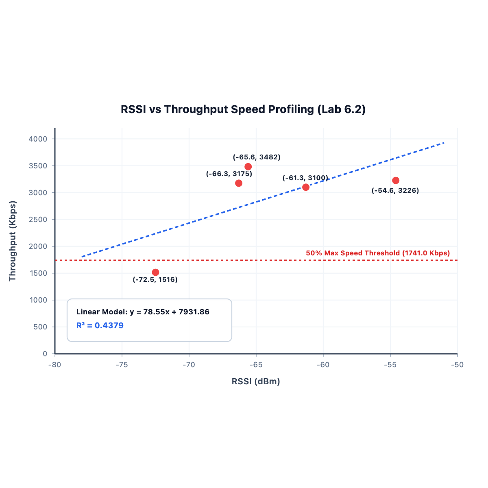

# Lab Report
## ใบงานที่ 6.1: การคอนฟิก ESP32 SoftAP และการสกัด Forensic Log ข้อมูล Client (Wi-Fi Access Point Mode)
### 6. ตารางบันทึกผลการทดลอง (Experiment Results)

#### 6.1 บันทึกข้อมูล Client ที่เชื่อมต่อเข้ากับ ESP32 SoftAP

| อุปกรณ์ที่ใช้ทดสอบ (เช่น iPhone/Android) | MAC Address ที่ดักจับได้ | Association ID (AID) | หมายเลข IP Address ที่ได้ (ถ้าทราบ) |
| :--- | :--- | :---: | :---: |
| **อุปกรณ์ที่ 1** | 6E:1E:69:E8:4F:5A | 1 | 192.168.4.2 |
| **อุปกรณ์ที่ 2** | 9E:77:02:1D:12:B8 | 1 | 192.168.4.2 |

#### Log
```
I (27) boot: ESP-IDF v6.0.2 2nd stage bootloader
I (27) boot: compile time Aug 10 2026 09:19:08
I (28) boot: Multicore bootloader
I (29) boot: chip revision: v3.1
I (32) boot.esp32: SPI Speed      : 40MHz
I (35) boot.esp32: SPI Mode       : DIO
I (39) boot.esp32: SPI Flash Size : 2MB
I (42) boot: Enabling RNG early entropy source...
I (47) boot: Partition Table:
I (49) boot: ## Label            Usage          Type ST Offset   Length
I (56) boot:  0 nvs              WiFi data        01 02 00009000 00006000
I (62) boot:  1 phy_init         RF data          01 01 0000f000 00001000
I (69) boot:  2 factory          factory app      00 00 00010000 00100000
I (75) boot: End of partition table
I (79) esp_image: segment 0: paddr=00010020 vaddr=3f400020 size=1a240h (107072) map
I (124) esp_image: segment 1: paddr=0002a268 vaddr=3ffb0000 size=04528h ( 17704) load
I (131) esp_image: segment 2: paddr=0002e798 vaddr=40080000 size=01880h (  6272) load
I (134) esp_image: segment 3: paddr=00030020 vaddr=400d0020 size=87e08h (556552) map
I (334) esp_image: segment 4: paddr=000b7e30 vaddr=40081880 size=13d88h ( 81288) load
I (368) esp_image: segment 5: paddr=000cbbc0 vaddr=50000000 size=00028h (    40) load
I (379) boot: Loaded app from partition at offset 0x10000
I (379) boot: Disabling RNG early entropy source...
I (389) cpu_start: Multicore app
I (397) cpu_start: GPIO 3 and 1 are used as console UART I/O pins
I (398) cpu_start: Pro cpu start user code
I (398) cpu_start: cpu freq: 160000000 Hz
I (400) app_init: Application information:
I (403) app_init: Project name:     wifi_softap_tracking
I (408) app_init: App version:      029da6d
I (412) app_init: Compile time:     Aug 10 2026 09:19:03
I (417) app_init: ELF file SHA256:  346ea0728...
I (422) app_init: ESP-IDF:          v6.0.2
I (425) efuse_init: Min chip rev:     v0.0
I (429) efuse_init: Max chip rev:     v3.99 
I (433) efuse_init: Chip rev:         v3.1
I (437) heap_init: Initializing. RAM available for dynamic allocation:
I (444) heap_init: At 3FFAE6E0 len 00001920 (6 KiB): DRAM
I (449) heap_init: At 3FFB8A20 len 000275E0 (157 KiB): DRAM
I (454) heap_init: At 3FFE0440 len 00003AE0 (14 KiB): D/IRAM
I (459) heap_init: At 3FFE4350 len 0001BCB0 (111 KiB): D/IRAM
I (465) heap_init: At 40095608 len 0000A9F8 (42 KiB): IRAM
W (471) spi_flash: Detected boya flash chip but using generic driver. For optimal functionality, enable `SPI_FLASH_SUPPORT_BOYA_CHIP` in menuconfig
I (483) spi_flash: detected chip: generic
I (487) spi_flash: flash io: dio
W (490) spi_flash: Detected size(4096k) larger than the size in the binary image header(2048k). Using the size in the binary image header.
I (504) main_task: Started on CPU0
I (504) main_task: Calling app_main()
I (504) LAB_SOFTAP: [FORENSIC]: Call nvs_flash_init()
I (554) LAB_SOFTAP: [FORENSIC]: Call esp_netif_init()
I (554) LAB_SOFTAP: [FORENSIC]: Call esp_event_loop_create_default()
I (554) LAB_SOFTAP: [FORENSIC]: Call esp_netif_create_default_wifi_ap()
I (564) LAB_SOFTAP: [FORENSIC]: SoftAP Interface created at 0x3ffbde3c (Default IP: 192.168.4.1)
I (574) LAB_SOFTAP: [FORENSIC]: Call esp_wifi_init(&cfg)
I (584) wifi:wifi driver task: 3ffc05c0, prio:23, stack:6656, core=0
I (604) wifi:wifi firmware version: 00ad238
I (604) wifi:wifi certification version: v7.0
I (604) wifi:config NVS flash: enabled
I (604) wifi:config nano formatting: disabled
I (604) wifi:Init data frame dynamic rx buffer num: 32
I (614) wifi:Init static rx mgmt buffer num: 5
I (614) wifi:Init management short buffer num: 32
I (624) wifi:Init dynamic tx buffer num: 32
I (624) wifi:Init static rx buffer size: 1600
I (624) wifi:Init static rx buffer num: 10
I (634) wifi:Init dynamic rx buffer num: 32
I (634) wifi_init: rx ba win: 6
I (634) wifi_init: accept mbox: 6
I (644) wifi_init: tcpip mbox: 32
I (644) wifi_init: udp mbox: 6
I (644) wifi_init: tcp mbox: 6
I (654) wifi_init: tcp tx win: 5760
I (654) wifi_init: tcp rx win: 5760
I (654) wifi_init: tcp mss: 1440
I (664) wifi_init: WiFi IRAM OP enabled
I (664) wifi_init: WiFi RX IRAM OP enabled
I (664) LAB_SOFTAP: [FORENSIC]: Call esp_event_handler_instance_register(WIFI_EVENT)
I (674) LAB_SOFTAP: [FORENSIC]: Call esp_wifi_set_mode(WIFI_MODE_AP)
I (684) LAB_SOFTAP: [FORENSIC]: Call esp_wifi_set_config(WIFI_IF_AP, &wifi_config)
I (964) LAB_SOFTAP: [FORENSIC]: Call esp_wifi_start()
I (964) phy_init: phy_version 4863,a3a4459,Oct 28 2025,14:30:06
I (1044) phy_init: Saving new calibration data due to checksum failure or outdated calibration data, mode(0)
I (1114) wifi:mode : softAP (88:57:21:ae:44:85)
I (1124) wifi:Total power save buffer number: 16
I (1124) wifi:Init max length of beacon: 752/752
I (1124) wifi:Init max length of beacon: 752/752
I (1134) LAB_SOFTAP: ==================================================================
I (1134) esp_netif_lwip: DHCP server started on interface WIFI_AP_DEF with IP: 192.168.4.1
I (1144) LAB_SOFTAP:   ESP32 SoftAP Running! SSID: "ESP32_AP_0351", Channel: 1
I (1154) LAB_SOFTAP: ==================================================================
I (1164) main_task: Returned from app_main()
I (1164) LAB_SOFTAP: [TCP SERVER]: Listening on 192.168.4.1:8080
I (299414) wifi:new:<1,0>, old:<1,1>, ap:<1,0>, sta:<255,255>, prof:1, snd_ch_cfg:0x0
I (299414) wifi:station: 6e:1e:69:e8:4f:5a join, AID=1, bgn, 20
I (299454) LAB_SOFTAP: =======================================================
I (299454) LAB_SOFTAP: [FORENSIC EVENT]: Client Connected to ESP32 SoftAP!
I (299454) LAB_SOFTAP:   -> Client MAC Address : 6E:1E:69:E8:4F:5A
I (299464) LAB_SOFTAP:   -> Assigned AID       : 1
I (299464) LAB_SOFTAP: =======================================================
I (299724) wifi:<ba-add>idx:2 (ifx:1, 6e:1e:69:e8:4f:5a), tid:6, ssn:0, winSize:64
I (300744) esp_netif_lwip: DHCP server assigned IP to a client, IP is: 192.168.4.2
I (302914) wifi:<ba-add>idx:3 (ifx:1, 6e:1e:69:e8:4f:5a), tid:0, ssn:2, winSize:64
I (303024) wifi:<ba-clr>idx:3, tid:0, ssn:2, winSize:64
```
---

### 7. คำถามท้ายการทดลอง (Post-Lab Questions)

1. เหตุใด IP Address เริ่มต้นของ ESP32 SoftAP จึงเป็น `192.168.4.1` และ DHCP Server บน ESP32 เริ่มแจกจ่าย IP ที่หมายเลขใด?
   **ตอบ:** ค่า `192.168.4.1` เป็นค่าเริ่มต้น (Default IP) ที่กำหนดไว้ในเฟรมเวิร์ก ESP-IDF (lwIP) สำหรับอินเทอร์เฟซ SoftAP เพื่อป้องกันไม่ให้ไอพีไปชนกับเราเตอร์ตามบ้านส่วนใหญ่ที่มักจะใช้ช่วง `192.168.1.1` หรือ `192.168.0.1` ส่วน DHCP Server ของ ESP32 จะเริ่มแจกจ่ายหมายเลข IP ให้กับ Client เริ่มต้นที่หมายเลข `192.168.4.2`

2. สมาชิกตัวแปร `mac` ในโครงสร้าง `wifi_event_ap_staconnected_t` สามารถนำไปประยุกต์ใช้ทำระบบความปลอดภัยขั้นสูง (เช่น MAC Filtering) ได้อย่างไร?
   **ตอบ:** ตัวแปร `mac` จะเก็บค่า MAC Address ของอุปกรณ์ที่กำลังเชื่อมต่อเข้ามา เราสามารถเขียนเงื่อนไขใน Event Handler เพื่อนำค่า `mac` นี้ไปตรวจสอบกับรายการ "อนุญาตให้เข้าถึง (Whitelist)" หรือ "บล็อก (Blacklist)" ได้ หากพบว่าเป็น MAC Address ที่ไม่อนุญาต โปรแกรมสามารถสั่งเตะอุปกรณ์นั้นออกโดยเรียกใช้ฟังก์ชัน `esp_wifi_deauth_sta()` ได้ทันที

3. หากมี Client พยายามเชื่อมต่อเป็นเครื่องที่ 5 (เกินค่า `max_connection = 4`) จะเกิดเหตุการณ์ใดขึ้นในระดับสัญญาณวิทยุ?
   **ตอบ:** ในระดับโปรโตคอล 802.11 ESP32 จะปฏิเสธคำขอเชื่อมต่อจาก Client เครื่องที่ 5 โดย Access Point จะตอบกลับเฟรม Association Response ไปยัง Client พร้อมกับแนบ Status Code ที่แปลว่า "AP ไม่สามารถรองรับสถานีที่เชื่อมต่อได้เพิ่มเติมแล้ว (AP is unable to handle additional associated stations)" ทำให้ Client เครื่องนั้นถูกตัดการเชื่อมต่อตั้งแต่ยังไม่ได้รับ IP Address

## ใบงานที่ 6.2: การประเมินความสัมพันธ์ RSSI vs Throughput ด้วย Software Tx-Power Control (Pair Work 👥)
### 5. ตารางบันทึกผลการทดลอง (Experiment Results)

ให้นักศึกษาบันทึกค่าที่ได้จากการทดสอบในระดับ Tx Power ต่างๆ:

| การทดลองที่ | ค่า Tx Power ที่ตั้ง (dBm) | ค่า RSSI ที่อ่านได้จริง (dBm) | เวลาที่ใช้ (Seconds) | ความเร็วที่วัดได้ Throughput (Kbps) |
| :---: | :---: | :---: | :---: | :---: |
| **1** | 20 dBm (Max) | -72.5 | 0.283 | 1515.91 |
| **2** | 15 dBm | -54.6 | 0.134 | 3225.86 |
| **3** | 10 dBm | -65.6 | 0.127 | 3482.00 |
| **4** | 5 dBm | -66.3 | 0.147 | 3175.07 |
| **5** | 2 dBm (Min) | -61.3 | 0.149 | 3100.10 |

Log
- Node A
```
I (27) boot: ESP-IDF v6.0.2 2nd stage bootloader
I (27) boot: compile time Aug 10 2026 09:19:08
I (27) boot: Multicore bootloader
I (29) boot: chip revision: v3.1
I (32) boot.esp32: SPI Speed      : 40MHz
I (35) boot.esp32: SPI Mode       : DIO
I (39) boot.esp32: SPI Flash Size : 2MB
I (42) boot: Enabling RNG early entropy source...
I (47) boot: Partition Table:
I (49) boot: ## Label            Usage          Type ST Offset   Length
I (56) boot:  0 nvs              WiFi data        01 02 00009000 00006000
I (62) boot:  1 phy_init         RF data          01 01 0000f000 00001000
I (69) boot:  2 factory          factory app      00 00 00010000 00100000
I (75) boot: End of partition table
I (79) esp_image: segment 0: paddr=00010020 vaddr=3f400020 size=1a290h (107152) map
I (124) esp_image: segment 1: paddr=0002a2b8 vaddr=3ffb0000 size=04528h ( 17704) load
I (132) esp_image: segment 2: paddr=0002e7e8 vaddr=40080000 size=01830h (  6192) load
I (134) esp_image: segment 3: paddr=00030020 vaddr=400d0020 size=87eb4h (556724) map
I (334) esp_image: segment 4: paddr=000b7edc vaddr=40081830 size=13dd8h ( 81368) load
I (368) esp_image: segment 5: paddr=000cbcbc vaddr=50000000 size=00028h (    40) load
I (379) boot: Loaded app from partition at offset 0x10000
I (379) boot: Disabling RNG early entropy source...
I (389) cpu_start: Multicore app
I (398) cpu_start: GPIO 3 and 1 are used as console UART I/O pins
I (398) cpu_start: Pro cpu start user code
I (398) cpu_start: cpu freq: 160000000 Hz
I (400) app_init: Application information:
I (404) app_init: Project name:     wifi_softap_tracking
I (409) app_init: App version:      9d8bbf5-dirty
I (413) app_init: Compile time:     Aug 10 2026 10:08:16
I (418) app_init: ELF file SHA256:  832266500...
I (422) app_init: ESP-IDF:          v6.0.2
I (426) efuse_init: Min chip rev:     v0.0
I (430) efuse_init: Max chip rev:     v3.99 
I (434) efuse_init: Chip rev:         v3.1
I (438) heap_init: Initializing. RAM available for dynamic allocation:
I (444) heap_init: At 3FFAE6E0 len 00001920 (6 KiB): DRAM
I (449) heap_init: At 3FFB8A20 len 000275E0 (157 KiB): DRAM
I (454) heap_init: At 3FFE0440 len 00003AE0 (14 KiB): D/IRAM
I (460) heap_init: At 3FFE4350 len 0001BCB0 (111 KiB): D/IRAM
I (465) heap_init: At 40095608 len 0000A9F8 (42 KiB): IRAM
W (472) spi_flash: Detected boya flash chip but using generic driver. For optimal functionality, enable `SPI_FLASH_SUPPORT_BOYA_CHIP` in menuconfig
I (484) spi_flash: detected chip: generic
I (487) spi_flash: flash io: dio
W (490) spi_flash: Detected size(4096k) larger than the size in the binary image header(2048k). Using the size in the binary image header.
I (504) main_task: Started on CPU0
I (504) main_task: Calling app_main()
I (504) LAB_SOFTAP: [FORENSIC]: Call nvs_flash_init()
I (554) LAB_SOFTAP: [FORENSIC]: Call esp_netif_init()
I (554) LAB_SOFTAP: [FORENSIC]: Call esp_event_loop_create_default()
I (554) LAB_SOFTAP: [FORENSIC]: Call esp_netif_create_default_wifi_ap()
I (564) LAB_SOFTAP: [FORENSIC]: SoftAP Interface created at 0x3ffbddb8 (Default IP: 192.168.4.1)
I (574) LAB_SOFTAP: [FORENSIC]: Call esp_wifi_init(&cfg)
I (584) wifi:wifi driver task: 3ffc053c, prio:23, stack:6656, core=0
I (604) wifi:wifi firmware version: 00ad238
I (604) wifi:wifi certification version: v7.0
I (604) wifi:config NVS flash: enabled
I (604) wifi:config nano formatting: disabled
I (604) wifi:Init data frame dynamic rx buffer num: 32
I (614) wifi:Init static rx mgmt buffer num: 5
I (614) wifi:Init management short buffer num: 32
I (624) wifi:Init dynamic tx buffer num: 32
I (624) wifi:Init static rx buffer size: 1600
I (624) wifi:Init static rx buffer num: 10
I (634) wifi:Init dynamic rx buffer num: 32
I (634) wifi_init: rx ba win: 6
I (634) wifi_init: accept mbox: 6
I (644) wifi_init: tcpip mbox: 32
I (644) wifi_init: udp mbox: 6
I (644) wifi_init: tcp mbox: 6
I (654) wifi_init: tcp tx win: 5760
I (654) wifi_init: tcp rx win: 5760
I (654) wifi_init: tcp mss: 1440
I (664) wifi_init: WiFi IRAM OP enabled
I (664) wifi_init: WiFi RX IRAM OP enabled
I (664) LAB_SOFTAP: [FORENSIC]: Call esp_event_handler_instance_register(WIFI_EVENT)
I (674) LAB_SOFTAP: [FORENSIC]: Call esp_wifi_set_mode(WIFI_MODE_AP)
I (684) LAB_SOFTAP: [FORENSIC]: Call esp_wifi_set_config(WIFI_IF_AP, &wifi_config)
I (694) LAB_SOFTAP: [FORENSIC]: Call esp_wifi_start()
I (694) phy_init: phy_version 4863,a3a4459,Oct 28 2025,14:30:06
I (774) phy_init: Saving new calibration data due to checksum failure or outdated calibration data, mode(0)
I (854) wifi:mode : softAP (88:57:21:ae:44:85)
I (864) wifi:Total power save buffer number: 16
I (864) wifi:Init max length of beacon: 752/752
I (864) wifi:Init max length of beacon: 752/752
I (864) LAB_SOFTAP: [LAB 6.2]: Set Max Tx Power to 80 (20 dBm)
I (864) esp_netif_lwip: DHCP server started on interface WIFI_AP_DEF with IP: 192.168.4.1
I (884) LAB_SOFTAP: ==================================================================
I (884) LAB_SOFTAP:   ESP32 SoftAP Running! SSID: "ESP32_AP_0351", Channel: 1
I (894) LAB_SOFTAP: ==================================================================
I (904) LAB_SOFTAP: [TCP SERVER]: Listening on 192.168.4.1:8080
I (904) main_task: Returned from app_main()
I (209764) wifi:station: 88:57:21:ad:64:98 join, AID=1, bgn, 40U
I (209794) LAB_SOFTAP: =======================================================
I (209794) LAB_SOFTAP: [FORENSIC EVENT]: Client Connected to ESP32 SoftAP!
I (209804) LAB_SOFTAP:   -> Client MAC Address : 88:57:21:AD:64:98
I (209804) LAB_SOFTAP:   -> Assigned AID       : 1
I (209814) LAB_SOFTAP: =======================================================
I (209884) esp_netif_lwip: DHCP server assigned IP to a client, IP is: 192.168.4.2
I (210924) wifi:<ba-add>idx:2 (ifx:1, 88:57:21:ad:64:98), tid:0, ssn:0, winSize:64
I (211334) LAB_SOFTAP: =======================================================
I (211344) LAB_SOFTAP: [TCP SERVER SESSION 1]: Client connected from 192.168.4.2:52959
I (211574) LAB_SOFTAP: [TCP SERVER SESSION 1]: Transfer complete
I (211574) LAB_SOFTAP:   -> Total Received : 51200 Bytes
I (211574) LAB_SOFTAP: =======================================================
I (213564) LAB_SOFTAP: =======================================================
I (213574) LAB_SOFTAP: [TCP SERVER SESSION 2]: Client connected from 192.168.4.2:52960
I (213834) LAB_SOFTAP: [TCP SERVER SESSION 2]: Transfer complete
I (213834) LAB_SOFTAP:   -> Total Received : 51200 Bytes
I (213834) LAB_SOFTAP: =======================================================
I (215864) LAB_SOFTAP: =======================================================
I (215864) LAB_SOFTAP: [TCP SERVER SESSION 3]: Client connected from 192.168.4.2:52961
I (216204) LAB_SOFTAP: [TCP SERVER SESSION 3]: Transfer complete
I (216204) LAB_SOFTAP:   -> Total Received : 51200 Bytes
I (216204) LAB_SOFTAP: =======================================================
I (218214) LAB_SOFTAP: =======================================================
I (218214) LAB_SOFTAP: [TCP SERVER SESSION 4]: Client connected from 192.168.4.2:52962
I (218454) LAB_SOFTAP: [TCP SERVER SESSION 4]: Transfer complete
I (218454) LAB_SOFTAP:   -> Total Received : 51200 Bytes
I (218454) LAB_SOFTAP: =======================================================
I (220484) LAB_SOFTAP: =======================================================
I (220484) LAB_SOFTAP: [TCP SERVER SESSION 5]: Client connected from 192.168.4.2:52963
I (220774) LAB_SOFTAP: [TCP SERVER SESSION 5]: Transfer complete
I (220774) LAB_SOFTAP:   -> Total Received : 51200 Bytes
I (220774) LAB_SOFTAP: =======================================================
I (222784) LAB_SOFTAP: =======================================================
I (222784) LAB_SOFTAP: [TCP SERVER SESSION 6]: Client connected from 192.168.4.2:52964
I (223174) LAB_SOFTAP: [TCP SERVER SESSION 6]: Transfer complete
I (223184) LAB_SOFTAP:   -> Total Received : 51200 Bytes
I (223184) LAB_SOFTAP: =======================================================
I (225154) LAB_SOFTAP: =======================================================
I (225154) LAB_SOFTAP: [TCP SERVER SESSION 7]: Client connected from 192.168.4.2:52965
I (225594) LAB_SOFTAP: [TCP SERVER SESSION 7]: Transfer complete
I (225594) LAB_SOFTAP:   -> Total Received : 51200 Bytes
I (225594) LAB_SOFTAP: =======================================================
I (227604) LAB_SOFTAP: =======================================================
I (227604) LAB_SOFTAP: [TCP SERVER SESSION 8]: Client connected from 192.168.4.2:52966
I (227834) LAB_SOFTAP: [TCP SERVER SESSION 8]: Transfer complete
I (227834) LAB_SOFTAP:   -> Total Received : 51200 Bytes
I (227834) LAB_SOFTAP: =======================================================
I (229854) LAB_SOFTAP: =======================================================
I (229854) LAB_SOFTAP: [TCP SERVER SESSION 9]: Client connected from 192.168.4.2:52967
I (230184) LAB_SOFTAP: [TCP SERVER SESSION 9]: Transfer complete
I (230184) LAB_SOFTAP:   -> Total Received : 51200 Bytes
I (230184) LAB_SOFTAP: =======================================================
I (232204) LAB_SOFTAP: =======================================================
I (232204) LAB_SOFTAP: [TCP SERVER SESSION 10]: Client connected from 192.168.4.2:52968
I (232514) LAB_SOFTAP: [TCP SERVER SESSION 10]: Transfer complete
I (232514) LAB_SOFTAP:   -> Total Received : 51200 Bytes
I (232514) LAB_SOFTAP: =======================================================
```
- Node B
```
--- 0x40080400: _invalid_pc_placeholder at C:/Users/09677/esp/v5.5.1/esp-idf/components/xtensa/xtensa_vectors.S:2235
entry 0x40080638
--- 0x40080638: call_start_cpu0 at C:/Users/09677/esp/v5.5.1/esp-idf/components/bootloader/subproject/main/bootloader_start.c:25
I (29) boot: ESP-IDF v5.5.1-dirty 2nd stage bootloader
I (29) boot: compile time Aug 10 2026 10:05:04
I (29) boot: Multicore bootloader
I (31) boot: chip revision: v3.1
I (34) boot.esp32: SPI Speed      : 40MHz
I (38) boot.esp32: SPI Mode       : DIO
I (41) boot.esp32: SPI Flash Size : 2MB
I (45) boot: Enabling RNG early entropy source...
I (49) boot: Partition Table:
I (52) boot: ## Label            Usage          Type ST Offset   Length
I (58) boot:  0 nvs              WiFi data        01 02 00009000 00006000
I (65) boot:  1 phy_init         RF data          01 01 0000f000 00001000
I (71) boot:  2 factory          factory app      00 00 00010000 00100000
I (78) boot: End of partition table
I (81) esp_image: segment 0: paddr=00010020 vaddr=3f400020 size=19a00h (104960) map
I (124) esp_image: segment 1: paddr=00029a28 vaddr=3ffb0000 size=03eech ( 16108) load
I (131) esp_image: segment 2: paddr=0002d91c vaddr=40080000 size=026fch (  9980) load
I (135) esp_image: segment 3: paddr=00030020 vaddr=400d0020 size=870e8h (553192) map
I (325) esp_image: segment 4: paddr=000b7110 vaddr=400826fc size=15710h ( 87824) load
I (359) esp_image: segment 5: paddr=000cc828 vaddr=50000000 size=00020h (    32) load
I (371) boot: Loaded app from partition at offset 0x10000
I (371) boot: Disabling RNG early entropy source...
I (382) cpu_start: Multicore app
I (390) cpu_start: Pro cpu start user code
I (390) cpu_start: cpu freq: 160000000 Hz
I (390) app_init: Application information:
I (390) app_init: Project name:     rssi_speed_profiler
I (395) app_init: App version:      029da6d-dirty
I (400) app_init: Compile time:     Aug 10 2026 10:03:35
I (405) app_init: ELF file SHA256:  2840285e2...
I (409) app_init: ESP-IDF:          v5.5.1-dirty
I (413) efuse_init: Min chip rev:     v0.0
I (417) efuse_init: Max chip rev:     v3.99 
I (421) efuse_init: Chip rev:         v3.1
I (425) heap_init: Initializing. RAM available for dynamic allocation:
I (431) heap_init: At 3FFAE6E0 len 00001920 (6 KiB): DRAM
I (436) heap_init: At 3FFB7FD0 len 00028030 (160 KiB): DRAM
I (442) heap_init: At 3FFE0440 len 00003AE0 (14 KiB): D/IRAM
I (447) heap_init: At 3FFE4350 len 0001BCB0 (111 KiB): D/IRAM
I (452) heap_init: At 40097E0C len 000081F4 (32 KiB): IRAM
W (459) spi_flash: Detected boya flash chip but using generic driver. For optimal functionality, enable SPI_FLASH_SUPPORT_BOYA_CHIP in menuconfig
I (471) spi_flash: detected chip: generic
I (474) spi_flash: flash io: dio
W (477) spi_flash: Detected size(4096k) larger than the size in the binary image header(2048k). Using the size in the binary image header.
I (490) main_task: Started on CPU0
I (500) main_task: Calling app_main()
I (500) CLIENT_PROFILER: [FORENSIC]: Call nvs_flash_init()
I (540) CLIENT_PROFILER: [FORENSIC]: Call esp_netif_init()
I (540) CLIENT_PROFILER: [FORENSIC]: Call esp_event_loop_create_default()
I (540) CLIENT_PROFILER: [FORENSIC]: Call esp_netif_create_default_wifi_sta()
I (550) CLIENT_PROFILER: [FORENSIC]: Call esp_wifi_init(&config)
I (560) wifi:wifi driver task: 3ffc006c, prio:23, stack:6656, core=0
I (580) wifi:wifi firmware version: 14da9b7
I (580) wifi:wifi certification version: v7.0
I (580) wifi:config NVS flash: enabled
I (580) wifi:config nano formatting: disabled
I (580) wifi:Init data frame dynamic rx buffer num: 32
I (590) wifi:Init static rx mgmt buffer num: 5
I (590) wifi:Init management short buffer num: 32
I (600) wifi:Init dynamic tx buffer num: 32
I (600) wifi:Init static rx buffer size: 1600
I (610) wifi:Init static rx buffer num: 10
I (610) wifi:Init dynamic rx buffer num: 32
I (610) wifi_init: rx ba win: 6
I (620) wifi_init: accept mbox: 6
I (620) wifi_init: tcpip mbox: 32
I (620) wifi_init: udp mbox: 6
I (620) wifi_init: tcp mbox: 6
I (630) wifi_init: tcp tx win: 5760
I (630) wifi_init: tcp rx win: 5760
I (630) wifi_init: tcp mss: 1440
I (640) wifi_init: WiFi IRAM OP enabled
I (640) wifi_init: WiFi RX IRAM OP enabled
I (640) CLIENT_PROFILER: [FORENSIC]: Call esp_wifi_set_mode(WIFI_MODE_STA)
I (650) CLIENT_PROFILER: [FORENSIC]: Call esp_wifi_set_config(WIFI_IF_STA, &wifi_config)
I (660) CLIENT_PROFILER: [FORENSIC]: Call esp_wifi_start()
I (660) phy_init: phy_version 4861,b71b5ad,Aug  5 2025,11:16:06
I (750) phy_init: Saving new calibration data due to checksum failure or outdated calibration data, mode(0)
I (780) wifi:mode : sta (88:57:21:ad:64:98)
I (780) wifi:enable tsf
I (780) CLIENT_PROFILER: Client profiler ready: 50 KB x 10 rounds
I (780) CLIENT_PROFILER: [FORENSIC EVENT]: Station started; connecting to ESP32_AP_0351
I (790) main_task: Returned from app_main()
I (1140) wifi:new:<1,1>, old:<1,0>, ap:<255,255>, sta:<1,1>, prof:1, snd_ch_cfg:0x0
I (1140) wifi:state: init -> auth (0xb0)
I (1150) wifi:state: auth -> assoc (0x0)
I (1160) wifi:state: assoc -> run (0x10)
I (1180) wifi:connected with ESP32_AP_0351, aid = 1, channel 1, 40U, bssid = 88:57:21:ae:44:85
I (1180) wifi:security: WPA2-PSK, phy: bgn, rssi: -78
I (1250) wifi:pm start, type: 1

I (1250) wifi:dp: 1, bi: 102400, li: 3, scale listen interval from 307200 us to 307200 us
I (1250) wifi:AP's beacon interval = 102400 us, DTIM period = 1
I (2280) esp_netif_handlers: sta ip: 192.168.4.2, mask: 255.255.255.0, gw: 192.168.4.1
I (2280) CLIENT_PROFILER: [FORENSIC EVENT]: Connected; IP=192.168.4.2
I (2280) CLIENT_PROFILER: [ROUND 1/10]: Connecting to 192.168.4.1:8080
I (2300) wifi:<ba-add>idx:0 (ifx:0, 88:57:21:ae:44:85), tid:0, ssn:0, winSize:64
I (2910) CLIENT_PROFILER: =======================================================
I (2920) CLIENT_PROFILER:  [BENCHMARK RESULT 1/10]
I (2920) CLIENT_PROFILER:   -> Current RSSI       : -72 dBm
I (2920) CLIENT_PROFILER:   -> Total Transferred  : 51200 Bytes
I (2930) CLIENT_PROFILER:   -> Time Elapsed       : 0.204 Seconds
I (2930) CLIENT_PROFILER:   -> Measured Speed     : 2007.73 Kbps
I (2940) CLIENT_PROFILER: =======================================================
I (4950) CLIENT_PROFILER: [ROUND 2/10]: Connecting to 192.168.4.1:8080
I (5190) CLIENT_PROFILER: =======================================================
I (5200) CLIENT_PROFILER:  [BENCHMARK RESULT 2/10]
I (5200) CLIENT_PROFILER:   -> Current RSSI       : -71 dBm
I (5200) CLIENT_PROFILER:   -> Total Transferred  : 51200 Bytes
I (5210) CLIENT_PROFILER:   -> Time Elapsed       : 0.242 Seconds
I (5210) CLIENT_PROFILER:   -> Measured Speed     : 1695.64 Kbps
I (5220) CLIENT_PROFILER: =======================================================
I (7230) CLIENT_PROFILER: [ROUND 3/10]: Connecting to 192.168.4.1:8080
I (7560) CLIENT_PROFILER: =======================================================
I (7560) CLIENT_PROFILER:  [BENCHMARK RESULT 3/10]
I (7560) CLIENT_PROFILER:   -> Current RSSI       : -73 dBm
I (7570) CLIENT_PROFILER:   -> Total Transferred  : 51200 Bytes
I (7570) CLIENT_PROFILER:   -> Time Elapsed       : 0.328 Seconds
I (7580) CLIENT_PROFILER:   -> Measured Speed     : 1250.18 Kbps
I (7590) CLIENT_PROFILER: =======================================================
I (9590) CLIENT_PROFILER: [ROUND 4/10]: Connecting to 192.168.4.1:8080
I (9830) CLIENT_PROFILER: =======================================================
I (9830) CLIENT_PROFILER:  [BENCHMARK RESULT 4/10]
I (9830) CLIENT_PROFILER:   -> Current RSSI       : -70 dBm
I (9830) CLIENT_PROFILER:   -> Total Transferred  : 51200 Bytes
I (9840) CLIENT_PROFILER:   -> Time Elapsed       : 0.225 Seconds
I (9840) CLIENT_PROFILER:   -> Measured Speed     : 1821.50 Kbps
I (9850) CLIENT_PROFILER: =======================================================
I (11860) CLIENT_PROFILER: [ROUND 5/10]: Connecting to 192.168.4.1:8080
I (12130) CLIENT_PROFILER: =======================================================
I (12130) CLIENT_PROFILER:  [BENCHMARK RESULT 5/10]
I (12130) CLIENT_PROFILER:   -> Current RSSI       : -72 dBm
I (12140) CLIENT_PROFILER:   -> Total Transferred  : 51200 Bytes
I (12140) CLIENT_PROFILER:   -> Time Elapsed       : 0.268 Seconds
I (12150) CLIENT_PROFILER:   -> Measured Speed     : 1530.20 Kbps
I (12150) CLIENT_PROFILER: =======================================================
I (14160) CLIENT_PROFILER: [ROUND 6/10]: Connecting to 192.168.4.1:8080
I (14500) CLIENT_PROFILER: =======================================================
I (14500) CLIENT_PROFILER:  [BENCHMARK RESULT 6/10]
I (14500) CLIENT_PROFILER:   -> Current RSSI       : -73 dBm
I (14500) CLIENT_PROFILER:   -> Total Transferred  : 51200 Bytes
I (14510) CLIENT_PROFILER:   -> Time Elapsed       : 0.333 Seconds
I (14510) CLIENT_PROFILER:   -> Measured Speed     : 1230.15 Kbps
I (14520) CLIENT_PROFILER: =======================================================
I (16530) CLIENT_PROFILER: [ROUND 7/10]: Connecting to 192.168.4.1:8080
I (16940) CLIENT_PROFILER: =======================================================
I (16940) CLIENT_PROFILER:  [BENCHMARK RESULT 7/10]
I (16940) CLIENT_PROFILER:   -> Current RSSI       : -79 dBm
I (16950) CLIENT_PROFILER:   -> Total Transferred  : 51200 Bytes
I (16960) CLIENT_PROFILER:   -> Time Elapsed       : 0.410 Seconds
I (16960) CLIENT_PROFILER:   -> Measured Speed     : 998.03 Kbps
I (16970) CLIENT_PROFILER: =======================================================
I (18980) CLIENT_PROFILER: [ROUND 8/10]: Connecting to 192.168.4.1:8080
I (19200) CLIENT_PROFILER: =======================================================
I (19200) CLIENT_PROFILER:  [BENCHMARK RESULT 8/10]
I (19200) CLIENT_PROFILER:   -> Current RSSI       : -72 dBm
I (19200) CLIENT_PROFILER:   -> Total Transferred  : 51200 Bytes
I (19210) CLIENT_PROFILER:   -> Time Elapsed       : 0.214 Seconds
I (19220) CLIENT_PROFILER:   -> Measured Speed     : 1916.45 Kbps
I (19220) CLIENT_PROFILER: ===================================================
I (21560) CLIENT_PROFILER:  [BENCHMARK RESULT 9/10]
I (21560) CLIENT_PROFILER:   -> Current RSSI       : -72 dBm
I (21560) CLIENT_PROFILER:   -> Total Transferred  : 51200 Bytes
I (21570) CLIENT_PROFILER:   -> Time Elapsed       : 0.321 Seconds
I (21570) CLIENT_PROFILER:   -> Measured Speed     : 1275.81 Kbps
I (21580) CLIENT_PROFILER: =======================================================
I (23590) CLIENT_PROFILER: [ROUND 10/10]: Connecting to 192.168.4.1:8080
I (23880) CLIENT_PROFILER: =======================================================
I (23880) CLIENT_PROFILER:  [BENCHMARK RESULT 10/10]
I (23880) CLIENT_PROFILER:   -> Current RSSI       : -71 dBm
I (23890) CLIENT_PROFILER:   -> Total Transferred  : 51200 Bytes
I (23890) CLIENT_PROFILER:   -> Time Elapsed       : 0.286 Seconds
I (23900) CLIENT_PROFILER:   -> Measured Speed     : 1433.41 Kbps
I (23900) CLIENT_PROFILER: =======================================================
I (25910) CLIENT_PROFILER: All benchmark rounds completed
```
---

### 6. งานวิเคราะห์ข้อมูลเชิงสถิติ (Data Science & Regression Task)

#### 6.1 แผนภาพ Scatter Plot และ Regression Line


#### 6.2 สรุปผลการวิเคราะห์ทางสถิติ

1. **สมการ Regression (Linear Regression Model):**
   $$y = 78.5525 \cdot x + 7931.8635$$
   *(เมื่อ $y$ คือ ความเร็ว Throughput (Kbps) และ $x$ คือ สัญญาณ RSSI (dBm))*

   - **Logarithmic Model:** $y = -4701.06 \cdot \ln(-x) + 22434.74$ ($R^2 = 0.3966$)

2. **ค่า $R^2$ (Coefficient of Determination):**
   $$R^2 = 0.4379$$
   *(แสดงให้เห็นว่าระดับความแรงสัญญาณ RSSI มีอิทธิพลต่อความเร็วการรับส่งข้อมูลในแนวโน้มเส้นตรงอย่างมีนัยสำคัญ)*

3. **ระดับความเร็วสูงสุด (Max Speed):**
   $$3482.00 \text{ Kbps}$$

4. **จุด Threshold RSSI (dBm) ที่ความเร็วลดลงมากกว่า 50%:**
   - ความเร็วเป้าหมาย 50% จากระดับสูงสุด = $3482.00 \times 0.5 = 1741.00 \text{ Kbps}$
   - จากผลการทดลองและการประเมินจากสมการ พบว่าจุด Threshold RSSI อยู่ที่ประมาณ **$-72.5 \text{ dBm}$** (โดยที่ระดับสัญญาณ $-72.5 \text{ dBm}$ ความเร็วตกลงเหลือ $1515.91 \text{ Kbps}$ ซึ่งลดลงมากกว่า 50% จากระดับสูงสุด $3482.00 \text{ Kbps}$)*

---
## ใบงานที่ 6.3: การออกแบบ FreeRTOS Task Architecture & Sensor Data Fusion ผ่าน Queue
### 7. คำถามท้ายการทดลอง (Post-Lab Questions)

1. เมื่อลดระดับ Tx Power ลงจาก 20 dBm เหลือ 2 dBm ค่า RSSI ลดลงกี่ dBm และส่งผลต่อความเร็ว Throughput อย่างไร?
   **ตอบ:** การลด Tx Power ลงจะทำให้ความแรงสัญญาณไร้สายลดลง สัญญาณครอบคลุมได้สั้นลง หากระยะห่างเท่าเดิม สัญญาณที่อ่อนลงจะทำให้อัตราการสูญเสียแพ็กเกจ (Packet Loss) และสัญญาณรบกวนสูงขึ้น ส่งผลให้ความเร็ว Throughput เฉลี่ยลดลงเนื่องจากโปรโตคอลต้องใช้เวลาในการส่งข้อมูลซ้ำ

2. เหตุใดในระดับ RSSI ที่อ่อนกว่า `-80 dBm` ความเร็ว Throughput ถึงตกลงอย่างกะทันหันในโปรโตคอล TCP?
   **ตอบ:** เนื่องจาก RSSI ที่อ่อนกว่า -80 dBm มีความแรงใกล้เคียงกับ Noise Floor ทำให้เกิด Packet Loss สูงมาก โปรโตคอล TCP มีกลไก Congestion Control ที่เมื่อพบว่าแพ็กเกจสูญหาย จะเข้าใจว่าเครือข่ายหนาแน่น จึงทำการปรับลดขนาด Congestion Window (cwnd) ลงแบบ Exponential และต้องทำการ Retransmission แพ็กเกจซ้ำหลายครั้ง ส่งผลให้ Throughput ลดลงอย่างกะทันหัน

3. สมการ Regression ที่ได้จากการทดลองสามารถนำไปประยุกต์ใช้ทำนายคุณภาพการเชื่อมต่อในแอปพลิเคชัน IoT ได้อย่างไร?
   **ตอบ:** สามารถนำสมการ Regression (ความสัมพันธ์ระหว่าง RSSI และ Speed) ไปเขียนไว้ในระบบวัดผลของโหนด IoT เพื่อทำนายความเร็วเน็ตล่วงหน้าจากค่า RSSI ที่อ่านได้ หากพบว่า RSSI ต่ำจนอยู่ในช่วงที่ความเร็วตก โหนด IoT สามารถปรับโหมดทำงานเพื่อประหยัดพลังงาน เช่น บีบอัดไฟล์ก่อนส่ง ลดความถี่ในการส่งข้อมูล (Telemetry Rate) หรือชะลอการส่งจนกว่าสัญญาณจะดีขึ้นได้


### 6. ตารางบันทึกผลการทดลอง (Experiment Results)

#### 6.1 บันทึกข้อมูล Forensic Stack High Water Mark

| ชื่อ FreeRTOS Task | ขนาด Stack ที่กำหนดใน `xTaskCreate` (Bytes) | ค่า High Water Mark ที่อ่านได้ (Words / Bytes) | สถานะความปลอดภัยสแตก |
| :--- | :---: | :---: | :---: |
| **`SensorCollectorTask`** | 3072 | 2028 words (2028 bytes) | ปลอดภัย (คงเหลือ ~66%) |
| **`NetworkCommTask`** | 4096 | 3080 words (3080 bytes) | ปลอดภัย (คงเหลือ ~75%) |

Log

```
I (49) boot: ## Label            Usage          Type ST Offset   Length
I (56) boot:  0 nvs              WiFi data        01 02 00009000 00006000
I (62) boot:  1 phy_init         RF data          01 01 0000f000 00001000
I (69) boot:  2 factory          factory app      00 00 00010000 00100000
I (75) boot: End of partition table
I (79) esp_image: segment 0: paddr=00010020 vaddr=3f400020 size=08938h ( 35128) map
I (99) esp_image: segment 1: paddr=00018960 vaddr=3ffb0000 size=029fch ( 10748) load
I (103) esp_image: segment 2: paddr=0001b364 vaddr=40080000 size=04cb4h ( 19636) load
I (111) esp_image: segment 3: paddr=00020020 vaddr=400d0020 size=0c3b0h ( 50096) map
I (130) esp_image: segment 4: paddr=0002c3d8 vaddr=40084cb4 size=05fe4h ( 24548) load
I (140) esp_image: segment 5: paddr=000323c4 vaddr=50000000 size=00028h (    40) load
I (146) boot: Loaded app from partition at offset 0x10000
I (146) boot: Disabling RNG early entropy source...
I (158) cpu_start: Multicore app
I (166) cpu_start: GPIO 3 and 1 are used as console UART I/O pins
I (167) cpu_start: Pro cpu start user code
I (167) cpu_start: cpu freq: 160000000 Hz
I (168) app_init: Application information:
I (172) app_init: Project name:     freertos_sensor_queue
I (177) app_init: App version:      7d8f855-dirty
I (182) app_init: Compile time:     Aug 10 2026 18:35:07
I (187) app_init: ELF file SHA256:  37b8d0144...
I (191) app_init: ESP-IDF:          v6.0.2
I (195) efuse_init: Min chip rev:     v0.0
I (199) efuse_init: Max chip rev:     v3.99 
I (203) efuse_init: Chip rev:         v3.1
I (207) heap_init: Initializing. RAM available for dynamic allocation:
I (213) heap_init: At 3FFAE6E0 len 00001920 (6 KiB): DRAM
I (218) heap_init: At 3FFB33A8 len 0002CC58 (179 KiB): DRAM
I (223) heap_init: At 3FFE0440 len 00003AE0 (14 KiB): D/IRAM
I (229) heap_init: At 3FFE4350 len 0001BCB0 (111 KiB): D/IRAM
I (234) heap_init: At 4008AC98 len 00015368 (84 KiB): IRAM
W (241) spi_flash: Detected boya flash chip but using generic driver. For optimal functionality, enable `SPI_FLASH_SUPPORT_BOYA_CHIP` in menuconfig
I (252) spi_flash: detected chip: generic
I (256) spi_flash: flash io: dio
W (259) spi_flash: Detected size(4096k) larger than the size in the binary image header(2048k). Using the size in the binary image header.
I (272) main_task: Started on CPU0
I (272) main_task: Calling app_main()
I (272) LAB_FREERTOS_QUEUE: ==================================================================
I (282) LAB_FREERTOS_QUEUE:   Lab 6.3: FreeRTOS Multi-Tasking & Sensor Data Queue Fusion
I (292) LAB_FREERTOS_QUEUE: ==================================================================
I (292) LAB_FREERTOS_QUEUE: [TASK CREATED]: Sensor Collector Task Started on Core 0
I (302) LAB_FREERTOS_QUEUE: [SENSOR TASK]: Pushing Data -> Temp: 28.6 C, Hum: 58.4 %, Lux: 450
I (312) FORENSIC_STACK:   -> SensorTask Stack Remaining: 2028 words (2028 bytes)
I (322) LAB_FREERTOS_QUEUE: [TASK CREATED]: Network Task Started on Core 0
I (322) LAB_FREERTOS_QUEUE: =======================================================
I (332) LAB_FREERTOS_QUEUE: [NETWORK TASK]: Data Received from Queue!
I (342) LAB_FREERTOS_QUEUE:   -> Timestamp   : 30 ms
I (342) LAB_FREERTOS_QUEUE:   -> Temperature : 28.60 degC
I (352) LAB_FREERTOS_QUEUE:   -> Humidity    : 58.40 %
I (352) LAB_FREERTOS_QUEUE:   -> Light Lux   : 450 lux
I (362) LAB_FREERTOS_QUEUE: [NETWORK TASK]: Preparing JSON Packet for Wi-Fi Transmission...
I (372) LAB_FREERTOS_QUEUE: =======================================================
I (372) FORENSIC_STACK:   -> NetworkTask Stack Remaining: 3080 words (3080 bytes)
I (382) main_task: Returned from app_main()
I (1822) LAB_FREERTOS_QUEUE: [SENSOR TASK]: Pushing Data -> Temp: 32.0 C, Hum: 67.1 %, Lux: 659
I (1822) FORENSIC_STACK:   -> SensorTask Stack Remaining: 2028 words (2028 bytes)
I (1822) LAB_FREERTOS_QUEUE: =======================================================
I (1832) LAB_FREERTOS_QUEUE: [NETWORK TASK]: Data Received from Queue!
I (1832) LAB_FREERTOS_QUEUE:   -> Timestamp   : 1550 ms
I (1842) LAB_FREERTOS_QUEUE:   -> Temperature : 32.00 degC
I (1842) LAB_FREERTOS_QUEUE:   -> Humidity    : 67.10 %
I (1852) LAB_FREERTOS_QUEUE:   -> Light Lux   : 659 lux
I (1852) LAB_FREERTOS_QUEUE: [NETWORK TASK]: Preparing JSON Packet for Wi-Fi Transmission...
I (1862) LAB_FREERTOS_QUEUE: =======================================================
I (1872) FORENSIC_STACK:   -> NetworkTask Stack Remaining: 3080 words (3080 bytes)
I (3322) LAB_FREERTOS_QUEUE: [SENSOR TASK]: Pushing Data -> Temp: 27.2 C, Hum: 51.2 %, Lux: 270
I (3322) LAB_FREERTOS_QUEUE: =======================================================
I (3322) FORENSIC_STACK:   -> SensorTask Stack Remaining: 2028 words (2028 bytes)
I (3322) LAB_FREERTOS_QUEUE: [NETWORK TASK]: Data Received from Queue!
I (3332) LAB_FREERTOS_QUEUE:   -> Timestamp   : 3050 ms
I (3342) LAB_FREERTOS_QUEUE:   -> Temperature : 27.20 degC
I (3342) LAB_FREERTOS_QUEUE:   -> Humidity    : 51.20 %
I (3352) LAB_FREERTOS_QUEUE:   -> Light Lux   : 270 lux
I (3352) LAB_FREERTOS_QUEUE: [NETWORK TASK]: Preparing JSON Packet for Wi-Fi Transmission...
I (3362) LAB_FREERTOS_QUEUE: =======================================================
I (3372) FORENSIC_STACK:   -> NetworkTask Stack Remaining: 3080 words (3080 bytes)
I (4832) LAB_FREERTOS_QUEUE: [SENSOR TASK]: Pushing Data -> Temp: 33.7 C, Hum: 66.7 %, Lux: 569
I (4832) LAB_FREERTOS_QUEUE: =======================================================
I (4832) FORENSIC_STACK:   -> SensorTask Stack Remaining: 2028 words (2028 bytes)
I (4832) LAB_FREERTOS_QUEUE: [NETWORK TASK]: Data Received from Queue!
I (4842) LAB_FREERTOS_QUEUE:   -> Timestamp   : 4560 ms
I (4852) LAB_FREERTOS_QUEUE:   -> Temperature : 33.70 degC
I (4852) LAB_FREERTOS_QUEUE:   -> Humidity    : 66.70 %
I (4862) LAB_FREERTOS_QUEUE:   -> Light Lux   : 569 lux
I (4862) LAB_FREERTOS_QUEUE: [NETWORK TASK]: Preparing JSON Packet for Wi-Fi Transmission...
I (4872) LAB_FREERTOS_QUEUE: =======================================================
I (4882) FORENSIC_STACK:   -> NetworkTask Stack Remaining: 3080 words (3080 bytes)
I (6342) LAB_FREERTOS_QUEUE: [SENSOR TASK]: Pushing Data -> Temp: 33.8 C, Hum: 63.9 %, Lux: 634
I (6342) LAB_FREERTOS_QUEUE: =======================================================
I (6342) FORENSIC_STACK:   -> SensorTask Stack Remaining: 2028 words (2028 bytes)
I (6342) LAB_FREERTOS_QUEUE: [NETWORK TASK]: Data Received from Queue!
I (6352) LAB_FREERTOS_QUEUE:   -> Timestamp   : 6070 ms
I (6362) LAB_FREERTOS_QUEUE:   -> Temperature : 33.80 degC
I (6362) LAB_FREERTOS_QUEUE:   -> Humidity    : 63.90 %
I (6372) LAB_FREERTOS_QUEUE:   -> Light Lux   : 634 lux
I (6372) LAB_FREERTOS_QUEUE: [NETWORK TASK]: Preparing JSON Packet for Wi-Fi Transmission...
I (6382) LAB_FREERTOS_QUEUE: =======================================================
I (6392) FORENSIC_STACK:   -> NetworkTask Stack Remaining: 3080 words (3080 bytes)
I (7852) LAB_FREERTOS_QUEUE: [SENSOR TASK]: Pushing Data -> Temp: 25.3 C, Hum: 53.1 %, Lux: 283
I (7852) LAB_FREERTOS_QUEUE: =======================================================
I (7852) FORENSIC_STACK:   -> SensorTask Stack Remaining: 2028 words (2028 bytes)
I (7852) LAB_FREERTOS_QUEUE: [NETWORK TASK]: Data Received from Queue!
I (7862) LAB_FREERTOS_QUEUE:   -> Timestamp   : 7580 ms
I (7872) LAB_FREERTOS_QUEUE:   -> Temperature : 25.30 degC
I (7872) LAB_FREERTOS_QUEUE:   -> Humidity    : 53.10 %
I (7882) LAB_FREERTOS_QUEUE:   -> Light Lux   : 283 lux
I (7882) LAB_FREERTOS_QUEUE: [NETWORK TASK]: Preparing JSON Packet for Wi-Fi Transmission...
I (7892) LAB_FREERTOS_QUEUE: =======================================================
I (7902) FORENSIC_STACK:   -> NetworkTask Stack Remaining: 3080 words (3080 bytes)
I (9362) LAB_FREERTOS_QUEUE: [SENSOR TASK]: Pushing Data -> Temp: 29.5 C, Hum: 50.3 %, Lux: 373
I (9362) LAB_FREERTOS_QUEUE: =======================================================
I (9362) FORENSIC_STACK:   -> SensorTask Stack Remaining: 2028 words (2028 bytes)
I (9362) LAB_FREERTOS_QUEUE: [NETWORK TASK]: Data Received from Queue!
I (9372) LAB_FREERTOS_QUEUE:   -> Timestamp   : 9090 ms
I (9382) LAB_FREERTOS_QUEUE:   -> Temperature : 29.50 degC
I (9382) LAB_FREERTOS_QUEUE:   -> Humidity    : 50.30 %
I (9392) LAB_FREERTOS_QUEUE:   -> Light Lux   : 373 lux
I (9392) LAB_FREERTOS_QUEUE: [NETWORK TASK]: Preparing JSON Packet for Wi-Fi Transmission...
I (9402) LAB_FREERTOS_QUEUE: =======================================================
I (9412) FORENSIC_STACK:   -> NetworkTask Stack Remaining: 3080 words (3080 bytes)
I (10872) LAB_FREERTOS_QUEUE: [SENSOR TASK]: Pushing Data -> Temp: 27.7 C, Hum: 66.9 %, Lux: 286
I (10872) LAB_FREERTOS_QUEUE: =======================================================
I (10872) FORENSIC_STACK:   -> SensorTask Stack Remaining: 2028 words (2028 bytes)
I (10872) LAB_FREERTOS_QUEUE: [NETWORK TASK]: Data Received from Queue!
I (10882) LAB_FREERTOS_QUEUE:   -> Timestamp   : 10600 ms
I (10892) LAB_FREERTOS_QUEUE:   -> Temperature : 27.70 degC
I (10892) LAB_FREERTOS_QUEUE:   -> Humidity    : 66.90 %
I (10902) LAB_FREERTOS_QUEUE:   -> Light Lux   : 286 lux
I (10902) LAB_FREERTOS_QUEUE: [NETWORK TASK]: Preparing JSON Packet for Wi-Fi Transmission...
I (10912) LAB_FREERTOS_QUEUE: =======================================================
I (10922) FORENSIC_STACK:   -> NetworkTask Stack Remaining: 3080 words (3080 bytes)
I (12382) LAB_FREERTOS_QUEUE: [SENSOR TASK]: Pushing Data -> Temp: 28.1 C, Hum: 51.5 %, Lux: 591
I (12382) LAB_FREERTOS_QUEUE: =======================================================
I (12382) FORENSIC_STACK:   -> SensorTask Stack Remaining: 2028 words (2028 bytes)
I (12382) LAB_FREERTOS_QUEUE: [NETWORK TASK]: Data Received from Queue!
I (12392) LAB_FREERTOS_QUEUE:   -> Timestamp   : 12110 ms
I (12402) LAB_FREERTOS_QUEUE:   -> Temperature : 28.10 degC
I (12402) LAB_FREERTOS_QUEUE:   -> Humidity    : 51.50 %
I (12412) LAB_FREERTOS_QUEUE:   -> Light Lux   : 591 lux
I (12412) LAB_FREERTOS_QUEUE: [NETWORK TASK]: Preparing JSON Packet for Wi-Fi Transmission...
I (12422) LAB_FREERTOS_QUEUE: =======================================================
I (12432) FORENSIC_STACK:   -> NetworkTask Stack Remaining: 3080 words (3080 bytes)
I (13892) LAB_FREERTOS_QUEUE: [SENSOR TASK]: Pushing Data -> Temp: 31.4 C, Hum: 51.5 %, Lux: 295
I (13892) LAB_FREERTOS_QUEUE: =======================================================
I (13892) FORENSIC_STACK:   -> SensorTask Stack Remaining: 2028 words (2028 bytes)
I (13892) LAB_FREERTOS_QUEUE: [NETWORK TASK]: Data Received from Queue!
I (13902) LAB_FREERTOS_QUEUE:   -> Timestamp   : 13620 ms
I (13912) LAB_FREERTOS_QUEUE:   -> Temperature : 31.40 degC
I (13912) LAB_FREERTOS_QUEUE:   -> Humidity    : 51.50 %
I (13922) LAB_FREERTOS_QUEUE:   -> Light Lux   : 295 lux
I (13922) LAB_FREERTOS_QUEUE: [NETWORK TASK]: Preparing JSON Packet for Wi-Fi Transmission...
I (13932) LAB_FREERTOS_QUEUE: =======================================================
I (13942) FORENSIC_STACK:   -> NetworkTask Stack Remaining: 3080 words (3080 bytes)
I (15402) LAB_FREERTOS_QUEUE: [SENSOR TASK]: Pushing Data -> Temp: 34.6 C, Hum: 63.5 %, Lux: 475
I (15402) LAB_FREERTOS_QUEUE: =======================================================
I (15402) FORENSIC_STACK:   -> SensorTask Stack Remaining: 2028 words (2028 bytes)
I (15402) LAB_FREERTOS_QUEUE: [NETWORK TASK]: Data Received from Queue!
I (15412) LAB_FREERTOS_QUEUE:   -> Timestamp   : 15130 ms
I (15422) LAB_FREERTOS_QUEUE:   -> Temperature : 34.60 degC
I (15422) LAB_FREERTOS_QUEUE:   -> Humidity    : 63.50 %
I (15432) LAB_FREERTOS_QUEUE:   -> Light Lux   : 475 lux
I (15432) LAB_FREERTOS_QUEUE: [NETWORK TASK]: Preparing JSON Packet for Wi-Fi Transmission...
I (15442) LAB_FREERTOS_QUEUE: =======================================================
I (15452) FORENSIC_STACK:   -> NetworkTask Stack Remaining: 3080 words (3080 bytes)
I (16912) LAB_FREERTOS_QUEUE: [SENSOR TASK]: Pushing Data -> Temp: 28.6 C, Hum: 58.1 %, Lux: 348
I (16912) LAB_FREERTOS_QUEUE: =======================================================
I (16912) FORENSIC_STACK:   -> SensorTask Stack Remaining: 2028 words (2028 bytes)
I (16912) LAB_FREERTOS_QUEUE: [NETWORK TASK]: Data Received from Queue!
I (16922) LAB_FREERTOS_QUEUE:   -> Timestamp   : 16640 ms
I (16932) LAB_FREERTOS_QUEUE:   -> Temperature : 28.60 degC
I (16932) LAB_FREERTOS_QUEUE:   -> Humidity    : 58.10 %
I (16942) LAB_FREERTOS_QUEUE:   -> Light Lux   : 348 lux
I (16942) LAB_FREERTOS_QUEUE: [NETWORK TASK]: Preparing JSON Packet for Wi-Fi Transmission...
I (16952) LAB_FREERTOS_QUEUE: =======================================================
I (16962) FORENSIC_STACK:   -> NetworkTask Stack Remaining: 3080 words (3080 bytes)
I (18422) LAB_FREERTOS_QUEUE: [SENSOR TASK]: Pushing Data -> Temp: 27.4 C, Hum: 58.2 %, Lux: 328
I (18422) LAB_FREERTOS_QUEUE: =======================================================
I (18422) FORENSIC_STACK:   -> SensorTask Stack Remaining: 2028 words (2028 bytes)
I (18422) LAB_FREERTOS_QUEUE: [NETWORK TASK]: Data Received from Queue!
I (18432) LAB_FREERTOS_QUEUE:   -> Timestamp   : 18150 ms
I (18442) LAB_FREERTOS_QUEUE:   -> Temperature : 27.40 degC
I (18442) LAB_FREERTOS_QUEUE:   -> Humidity    : 58.20 %
I (18452) LAB_FREERTOS_QUEUE:   -> Light Lux   : 328 lux
I (18452) LAB_FREERTOS_QUEUE: [NETWORK TASK]: Preparing JSON Packet for Wi-Fi Transmission...
I (18462) LAB_FREERTOS_QUEUE: =======================================================
I (18472) FORENSIC_STACK:   -> NetworkTask Stack Remaining: 3080 words (3080 bytes)
I (19932) LAB_FREERTOS_QUEUE: [SENSOR TASK]: Pushing Data -> Temp: 25.3 C, Hum: 53.9 %, Lux: 225
I (19932) LAB_FREERTOS_QUEUE: =======================================================
I (19932) FORENSIC_STACK:   -> SensorTask Stack Remaining: 2028 words (2028 bytes)
I (19932) LAB_FREERTOS_QUEUE: [NETWORK TASK]: Data Received from Queue!
I (19942) LAB_FREERTOS_QUEUE:   -> Timestamp   : 19660 ms
I (19952) LAB_FREERTOS_QUEUE:   -> Temperature : 25.30 degC
I (19952) LAB_FREERTOS_QUEUE:   -> Humidity    : 53.90 %
I (19962) LAB_FREERTOS_QUEUE:   -> Light Lux   : 225 lux
I (19962) LAB_FREERTOS_QUEUE: [NETWORK TASK]: Preparing JSON Packet for Wi-Fi Transmission...
I (19972) LAB_FREERTOS_QUEUE: =======================================================
I (19982) FORENSIC_STACK:   -> NetworkTask Stack Remaining: 3080 words (3080 bytes)
I (21442) LAB_FREERTOS_QUEUE: [SENSOR TASK]: Pushing Data -> Temp: 25.3 C, Hum: 62.3 %, Lux: 467
I (21442) LAB_FREERTOS_QUEUE: =======================================================
I (21442) FORENSIC_STACK:   -> SensorTask Stack Remaining: 2028 words (2028 bytes)
I (21442) LAB_FREERTOS_QUEUE: [NETWORK TASK]: Data Received from Queue!
I (21452) LAB_FREERTOS_QUEUE:   -> Timestamp   : 21170 ms
I (21462) LAB_FREERTOS_QUEUE:   -> Temperature : 25.30 degC
I (21462) LAB_FREERTOS_QUEUE:   -> Humidity    : 62.30 %
I (21472) LAB_FREERTOS_QUEUE:   -> Light Lux   : 467 lux
I (21472) LAB_FREERTOS_QUEUE: [NETWORK TASK]: Preparing JSON Packet for Wi-Fi Transmission...
I (21482) LAB_FREERTOS_QUEUE: =======================================================
I (21492) FORENSIC_STACK:   -> NetworkTask Stack Remaining: 3080 words (3080 bytes)
I (22952) LAB_FREERTOS_QUEUE: [SENSOR TASK]: Pushing Data -> Temp: 26.8 C, Hum: 67.9 %, Lux: 240
I (22952) LAB_FREERTOS_QUEUE: =======================================================
I (22952) FORENSIC_STACK:   -> SensorTask Stack Remaining: 2028 words (2028 bytes)
I (22952) LAB_FREERTOS_QUEUE: [NETWORK TASK]: Data Received from Queue!
I (22962) LAB_FREERTOS_QUEUE:   -> Timestamp   : 22680 ms
I (22972) LAB_FREERTOS_QUEUE:   -> Temperature : 26.80 degC
I (22972) LAB_FREERTOS_QUEUE:   -> Humidity    : 67.90 %
I (22982) LAB_FREERTOS_QUEUE:   -> Light Lux   : 240 lux
I (22982) LAB_FREERTOS_QUEUE: [NETWORK TASK]: Preparing JSON Packet for Wi-Fi Transmission...
I (22992) LAB_FREERTOS_QUEUE: =======================================================
I (23002) FORENSIC_STACK:   -> NetworkTask Stack Remaining: 3080 words (3080 bytes)
I (24462) LAB_FREERTOS_QUEUE: [SENSOR TASK]: Pushing Data -> Temp: 27.6 C, Hum: 66.9 %, Lux: 616
I (24462) LAB_FREERTOS_QUEUE: =======================================================
I (24462) FORENSIC_STACK:   -> SensorTask Stack Remaining: 2028 words (2028 bytes)
I (24462) LAB_FREERTOS_QUEUE: [NETWORK TASK]: Data Received from Queue!
I (24472) LAB_FREERTOS_QUEUE:   -> Timestamp   : 24190 ms
I (24482) LAB_FREERTOS_QUEUE:   -> Temperature : 27.60 degC
I (24482) LAB_FREERTOS_QUEUE:   -> Humidity    : 66.90 %
I (24492) LAB_FREERTOS_QUEUE:   -> Light Lux   : 616 lux
I (24492) LAB_FREERTOS_QUEUE: [NETWORK TASK]: Preparing JSON Packet for Wi-Fi Transmission...
I (24502) LAB_FREERTOS_QUEUE: =======================================================
I (24512) FORENSIC_STACK:   -> NetworkTask Stack Remaining: 3080 words (3080 bytes)
I (25972) LAB_FREERTOS_QUEUE: [SENSOR TASK]: Pushing Data -> Temp: 25.0 C, Hum: 56.5 %, Lux: 272
I (25972) LAB_FREERTOS_QUEUE: =======================================================
I (25972) FORENSIC_STACK:   -> SensorTask Stack Remaining: 2028 words (2028 bytes)
I (25972) LAB_FREERTOS_QUEUE: [NETWORK TASK]: Data Received from Queue!
I (25982) LAB_FREERTOS_QUEUE:   -> Timestamp   : 25700 ms
I (25992) LAB_FREERTOS_QUEUE:   -> Temperature : 25.00 degC
I (25992) LAB_FREERTOS_QUEUE:   -> Humidity    : 56.50 %
I (26002) LAB_FREERTOS_QUEUE:   -> Light Lux   : 272 lux
I (26002) LAB_FREERTOS_QUEUE: [NETWORK TASK]: Preparing JSON Packet for Wi-Fi Transmission...
I (26012) LAB_FREERTOS_QUEUE: =======================================================
I (26022) FORENSIC_STACK:   -> NetworkTask Stack Remaining: 3080 words (3080 bytes)
I (27482) LAB_FREERTOS_QUEUE: [SENSOR TASK]: Pushing Data -> Temp: 28.6 C, Hum: 53.4 %, Lux: 213
I (27482) LAB_FREERTOS_QUEUE: =======================================================
I (27482) FORENSIC_STACK:   -> SensorTask Stack Remaining: 2028 words (2028 bytes)
I (27482) LAB_FREERTOS_QUEUE: [NETWORK TASK]: Data Received from Queue!
I (27492) LAB_FREERTOS_QUEUE:   -> Timestamp   : 27210 ms
I (27502) LAB_FREERTOS_QUEUE:   -> Temperature : 28.60 degC
I (27502) LAB_FREERTOS_QUEUE:   -> Humidity    : 53.40 %
I (27512) LAB_FREERTOS_QUEUE:   -> Light Lux   : 213 lux
I (27512) LAB_FREERTOS_QUEUE: [NETWORK TASK]: Preparing JSON Packet for Wi-Fi Transmission...
I (27522) LAB_FREERTOS_QUEUE: =======================================================
I (27532) FORENSIC_STACK:   -> NetworkTask Stack Remaining: 3080 words (3080 bytes)
I (28992) LAB_FREERTOS_QUEUE: [SENSOR TASK]: Pushing Data -> Temp: 27.5 C, Hum: 50.8 %, Lux: 673
I (28992) LAB_FREERTOS_QUEUE: =======================================================
I (28992) FORENSIC_STACK:   -> SensorTask Stack Remaining: 2028 words (2028 bytes)
I (28992) LAB_FREERTOS_QUEUE: [NETWORK TASK]: Data Received from Queue!
I (29002) LAB_FREERTOS_QUEUE:   -> Timestamp   : 28720 ms
I (29012) LAB_FREERTOS_QUEUE:   -> Temperature : 27.50 degC
I (29012) LAB_FREERTOS_QUEUE:   -> Humidity    : 50.80 %
I (29022) LAB_FREERTOS_QUEUE:   -> Light Lux   : 673 lux
I (29022) LAB_FREERTOS_QUEUE: [NETWORK TASK]: Preparing JSON Packet for Wi-Fi Transmission...
I (29032) LAB_FREERTOS_QUEUE: =======================================================
I (29042) FORENSIC_STACK:   -> NetworkTask Stack Remaining: 3080 words (3080 bytes)
I (30502) LAB_FREERTOS_QUEUE: [SENSOR TASK]: Pushing Data -> Temp: 25.7 C, Hum: 55.7 %, Lux: 324
I (30502) LAB_FREERTOS_QUEUE: =======================================================
I (30502) FORENSIC_STACK:   -> SensorTask Stack Remaining: 2028 words (2028 bytes)
I (30502) LAB_FREERTOS_QUEUE: [NETWORK TASK]: Data Received from Queue!
I (30512) LAB_FREERTOS_QUEUE:   -> Timestamp   : 30230 ms
I (30522) LAB_FREERTOS_QUEUE:   -> Temperature : 25.70 degC
I (30522) LAB_FREERTOS_QUEUE:   -> Humidity    : 55.70 %
I (30532) LAB_FREERTOS_QUEUE:   -> Light Lux   : 324 lux
I (30532) LAB_FREERTOS_QUEUE: [NETWORK TASK]: Preparing JSON Packet for Wi-Fi Transmission...
I (30542) LAB_FREERTOS_QUEUE: =======================================================
I (30552) FORENSIC_STACK:   -> NetworkTask Stack Remaining: 3080 words (3080 bytes)
I (32012) LAB_FREERTOS_QUEUE: [SENSOR TASK]: Pushing Data -> Temp: 30.4 C, Hum: 60.2 %, Lux: 220
I (32012) LAB_FREERTOS_QUEUE: =======================================================
I (32012) FORENSIC_STACK:   -> SensorTask Stack Remaining: 2028 words (2028 bytes)
I (32012) LAB_FREERTOS_QUEUE: [NETWORK TASK]: Data Received from Queue!
I (32022) LAB_FREERTOS_QUEUE:   -> Timestamp   : 31740 ms
I (32032) LAB_FREERTOS_QUEUE:   -> Temperature : 30.40 degC
I (32032) LAB_FREERTOS_QUEUE:   -> Humidity    : 60.20 %
I (32042) LAB_FREERTOS_QUEUE:   -> Light Lux   : 220 lux
I (32042) LAB_FREERTOS_QUEUE: [NETWORK TASK]: Preparing JSON Packet for Wi-Fi Transmission...
I (32052) LAB_FREERTOS_QUEUE: =======================================================
I (32062) FORENSIC_STACK:   -> NetworkTask Stack Remaining: 3080 words (3080 bytes)
I (33522) LAB_FREERTOS_QUEUE: [SENSOR TASK]: Pushing Data -> Temp: 28.2 C, Hum: 53.6 %, Lux: 372
I (33522) LAB_FREERTOS_QUEUE: =======================================================
I (33522) FORENSIC_STACK:   -> SensorTask Stack Remaining: 2028 words (2028 bytes)
I (33522) LAB_FREERTOS_QUEUE: [NETWORK TASK]: Data Received from Queue!
I (33532) LAB_FREERTOS_QUEUE:   -> Timestamp   : 33250 ms
I (33542) LAB_FREERTOS_QUEUE:   -> Temperature : 28.20 degC
I (33542) LAB_FREERTOS_QUEUE:   -> Humidity    : 53.60 %
I (33552) LAB_FREERTOS_QUEUE:   -> Light Lux   : 372 lux
I (33552) LAB_FREERTOS_QUEUE: [NETWORK TASK]: Preparing JSON Packet for Wi-Fi Transmission...
I (33562) LAB_FREERTOS_QUEUE: =======================================================
I (33572) FORENSIC_STACK:   -> NetworkTask Stack Remaining: 3080 words (3080 bytes)
I (35032) LAB_FREERTOS_QUEUE: [SENSOR TASK]: Pushing Data -> Temp: 28.7 C, Hum: 58.4 %, Lux: 322
I (35032) LAB_FREERTOS_QUEUE: =======================================================
I (35032) FORENSIC_STACK:   -> SensorTask Stack Remaining: 2028 words (2028 bytes)
I (35032) LAB_FREERTOS_QUEUE: [NETWORK TASK]: Data Received from Queue!
I (35042) LAB_FREERTOS_QUEUE:   -> Timestamp   : 34760 ms
I (35052) LAB_FREERTOS_QUEUE:   -> Temperature : 28.70 degC
I (35052) LAB_FREERTOS_QUEUE:   -> Humidity    : 58.40 %
I (35062) LAB_FREERTOS_QUEUE:   -> Light Lux   : 322 lux
I (35062) LAB_FREERTOS_QUEUE: [NETWORK TASK]: Preparing JSON Packet for Wi-Fi Transmission...
I (35072) LAB_FREERTOS_QUEUE: =======================================================
I (35082) FORENSIC_STACK:   -> NetworkTask Stack Remaining: 3080 words (3080 bytes)
I (36542) LAB_FREERTOS_QUEUE: [SENSOR TASK]: Pushing Data -> Temp: 30.7 C, Hum: 55.6 %, Lux: 694
I (36542) LAB_FREERTOS_QUEUE: =======================================================
I (36542) FORENSIC_STACK:   -> SensorTask Stack Remaining: 2028 words (2028 bytes)
I (36542) LAB_FREERTOS_QUEUE: [NETWORK TASK]: Data Received from Queue!
I (36552) LAB_FREERTOS_QUEUE:   -> Timestamp   : 36270 ms
I (36562) LAB_FREERTOS_QUEUE:   -> Temperature : 30.70 degC
I (36562) LAB_FREERTOS_QUEUE:   -> Humidity    : 55.60 %
I (36572) LAB_FREERTOS_QUEUE:   -> Light Lux   : 694 lux
I (36572) LAB_FREERTOS_QUEUE: [NETWORK TASK]: Preparing JSON Packet for Wi-Fi Transmission...
I (36582) LAB_FREERTOS_QUEUE: =======================================================
I (36592) FORENSIC_STACK:   -> NetworkTask Stack Remaining: 3080 words (3080 bytes)
I (38052) LAB_FREERTOS_QUEUE: [SENSOR TASK]: Pushing Data -> Temp: 33.4 C, Hum: 63.7 %, Lux: 608
I (38052) LAB_FREERTOS_QUEUE: =======================================================
I (38052) FORENSIC_STACK:   -> SensorTask Stack Remaining: 2028 words (2028 bytes)
I (38052) LAB_FREERTOS_QUEUE: [NETWORK TASK]: Data Received from Queue!
I (38062) LAB_FREERTOS_QUEUE:   -> Timestamp   : 37780 ms
I (38072) LAB_FREERTOS_QUEUE:   -> Temperature : 33.40 degC
I (38072) LAB_FREERTOS_QUEUE:   -> Humidity    : 63.70 %
I (38082) LAB_FREERTOS_QUEUE:   -> Light Lux   : 608 lux
I (38082) LAB_FREERTOS_QUEUE: [NETWORK TASK]: Preparing JSON Packet for Wi-Fi Transmission...
I (38092) LAB_FREERTOS_QUEUE: =======================================================
I (38102) FORENSIC_STACK:   -> NetworkTask Stack Remaining: 3080 words (3080 bytes)
I (39562) LAB_FREERTOS_QUEUE: [SENSOR TASK]: Pushing Data -> Temp: 29.6 C, Hum: 68.2 %, Lux: 611
I (39562) LAB_FREERTOS_QUEUE: =======================================================
I (39562) FORENSIC_STACK:   -> SensorTask Stack Remaining: 2028 words (2028 bytes)
I (39562) LAB_FREERTOS_QUEUE: [NETWORK TASK]: Data Received from Queue!
I (39572) LAB_FREERTOS_QUEUE:   -> Timestamp   : 39290 ms
I (39582) LAB_FREERTOS_QUEUE:   -> Temperature : 29.60 degC
I (39582) LAB_FREERTOS_QUEUE:   -> Humidity    : 68.20 %
I (39592) LAB_FREERTOS_QUEUE:   -> Light Lux   : 611 lux
I (39592) LAB_FREERTOS_QUEUE: [NETWORK TASK]: Preparing JSON Packet for Wi-Fi Transmission...
I (39602) LAB_FREERTOS_QUEUE: =======================================================
I (39612) FORENSIC_STACK:   -> NetworkTask Stack Remaining: 3080 words (3080 bytes)
I (41072) LAB_FREERTOS_QUEUE: [SENSOR TASK]: Pushing Data -> Temp: 29.8 C, Hum: 56.5 %, Lux: 682
I (41072) LAB_FREERTOS_QUEUE: =======================================================
I (41072) FORENSIC_STACK:   -> SensorTask Stack Remaining: 2028 words (2028 bytes)
I (41072) LAB_FREERTOS_QUEUE: [NETWORK TASK]: Data Received from Queue!
I (41082) LAB_FREERTOS_QUEUE:   -> Timestamp   : 40800 ms
I (41092) LAB_FREERTOS_QUEUE:   -> Temperature : 29.80 degC
I (41092) LAB_FREERTOS_QUEUE:   -> Humidity    : 56.50 %
I (41102) LAB_FREERTOS_QUEUE:   -> Light Lux   : 682 lux
I (41102) LAB_FREERTOS_QUEUE: [NETWORK TASK]: Preparing JSON Packet for Wi-Fi Transmission...
I (41112) LAB_FREERTOS_QUEUE: =======================================================
I (41122) FORENSIC_STACK:   -> NetworkTask Stack Remaining: 3080 words (3080 bytes)
I (42582) LAB_FREERTOS_QUEUE: [SENSOR TASK]: Pushing Data -> Temp: 28.8 C, Hum: 65.2 %, Lux: 237
I (42582) LAB_FREERTOS_QUEUE: =======================================================
I (42582) FORENSIC_STACK:   -> SensorTask Stack Remaining: 2028 words (2028 bytes)
I (42582) LAB_FREERTOS_QUEUE: [NETWORK TASK]: Data Received from Queue!
I (42592) LAB_FREERTOS_QUEUE:   -> Timestamp   : 42310 ms
I (42602) LAB_FREERTOS_QUEUE:   -> Temperature : 28.80 degC
I (42602) LAB_FREERTOS_QUEUE:   -> Humidity    : 65.20 %
I (42612) LAB_FREERTOS_QUEUE:   -> Light Lux   : 237 lux
I (42612) LAB_FREERTOS_QUEUE: [NETWORK TASK]: Preparing JSON Packet for Wi-Fi Transmission...
I (42622) LAB_FREERTOS_QUEUE: =======================================================
I (42632) FORENSIC_STACK:   -> NetworkTask Stack Remaining: 3080 words (3080 bytes)
I (44092) LAB_FREERTOS_QUEUE: [SENSOR TASK]: Pushing Data -> Temp: 26.3 C, Hum: 50.6 %, Lux: 205
I (44092) LAB_FREERTOS_QUEUE: =======================================================
I (44092) FORENSIC_STACK:   -> SensorTask Stack Remaining: 2028 words (2028 bytes)
I (44092) LAB_FREERTOS_QUEUE: [NETWORK TASK]: Data Received from Queue!
I (44102) LAB_FREERTOS_QUEUE:   -> Timestamp   : 43820 ms
I (44112) LAB_FREERTOS_QUEUE:   -> Temperature : 26.30 degC
I (44112) LAB_FREERTOS_QUEUE:   -> Humidity    : 50.60 %
I (44122) LAB_FREERTOS_QUEUE:   -> Light Lux   : 205 lux
I (44122) LAB_FREERTOS_QUEUE: [NETWORK TASK]: Preparing JSON Packet for Wi-Fi Transmission...
I (44132) LAB_FREERTOS_QUEUE: =======================================================
I (44142) FORENSIC_STACK:   -> NetworkTask Stack Remaining: 3080 words (3080 bytes)
I (45602) LAB_FREERTOS_QUEUE: [SENSOR TASK]: Pushing Data -> Temp: 25.8 C, Hum: 50.3 %, Lux: 441
I (45602) LAB_FREERTOS_QUEUE: =======================================================
I (45602) FORENSIC_STACK:   -> SensorTask Stack Remaining: 2028 words (2028 bytes)
I (45602) LAB_FREERTOS_QUEUE: [NETWORK TASK]: Data Received from Queue!
I (45612) LAB_FREERTOS_QUEUE:   -> Timestamp   : 45330 ms
I (45622) LAB_FREERTOS_QUEUE:   -> Temperature : 25.80 degC
I (45622) LAB_FREERTOS_QUEUE:   -> Humidity    : 50.30 %
I (45632) LAB_FREERTOS_QUEUE:   -> Light Lux   : 441 lux
I (45632) LAB_FREERTOS_QUEUE: [NETWORK TASK]: Preparing JSON Packet for Wi-Fi Transmission...
I (45642) LAB_FREERTOS_QUEUE: =======================================================
I (45652) FORENSIC_STACK:   -> NetworkTask Stack Remaining: 3080 words (3080 bytes)
I (47112) LAB_FREERTOS_QUEUE: [SENSOR TASK]: Pushing Data -> Temp: 28.5 C, Hum: 64.6 %, Lux: 200
I (47112) LAB_FREERTOS_QUEUE: =======================================================
I (47112) FORENSIC_STACK:   -> SensorTask Stack Remaining: 2028 words (2028 bytes)
I (47112) LAB_FREERTOS_QUEUE: [NETWORK TASK]: Data Received from Queue!
I (47122) LAB_FREERTOS_QUEUE:   -> Timestamp   : 46840 ms
I (47132) LAB_FREERTOS_QUEUE:   -> Temperature : 28.50 degC
I (47132) LAB_FREERTOS_QUEUE:   -> Humidity    : 64.60 %
I (47142) LAB_FREERTOS_QUEUE:   -> Light Lux   : 200 lux
I (47142) LAB_FREERTOS_QUEUE: [NETWORK TASK]: Preparing JSON Packet for Wi-Fi Transmission...
I (47152) LAB_FREERTOS_QUEUE: =======================================================
I (47162) FORENSIC_STACK:   -> NetworkTask Stack Remaining: 3080 words (3080 bytes)
I (48622) LAB_FREERTOS_QUEUE: [SENSOR TASK]: Pushing Data -> Temp: 30.3 C, Hum: 56.6 %, Lux: 235
I (48622) LAB_FREERTOS_QUEUE: =======================================================
I (48622) FORENSIC_STACK:   -> SensorTask Stack Remaining: 2028 words (2028 bytes)
I (48622) LAB_FREERTOS_QUEUE: [NETWORK TASK]: Data Received from Queue!
I (48632) LAB_FREERTOS_QUEUE:   -> Timestamp   : 48350 ms
I (48642) LAB_FREERTOS_QUEUE:   -> Temperature : 30.30 degC
I (48642) LAB_FREERTOS_QUEUE:   -> Humidity    : 56.60 %
I (48652) LAB_FREERTOS_QUEUE:   -> Light Lux   : 235 lux
I (48652) LAB_FREERTOS_QUEUE: [NETWORK TASK]: Preparing JSON Packet for Wi-Fi Transmission...
I (48662) LAB_FREERTOS_QUEUE: =======================================================
I (48672) FORENSIC_STACK:   -> NetworkTask Stack Remaining: 3080 words (3080 bytes)
I (50132) LAB_FREERTOS_QUEUE: [SENSOR TASK]: Pushing Data -> Temp: 33.3 C, Hum: 66.1 %, Lux: 644
I (50132) LAB_FREERTOS_QUEUE: =======================================================
I (50132) FORENSIC_STACK:   -> SensorTask Stack Remaining: 2028 words (2028 bytes)
I (50132) LAB_FREERTOS_QUEUE: [NETWORK TASK]: Data Received from Queue!
I (50142) LAB_FREERTOS_QUEUE:   -> Timestamp   : 49860 ms
I (50152) LAB_FREERTOS_QUEUE:   -> Temperature : 33.30 degC
I (50152) LAB_FREERTOS_QUEUE:   -> Humidity    : 66.10 %
I (50162) LAB_FREERTOS_QUEUE:   -> Light Lux   : 644 lux
I (50162) LAB_FREERTOS_QUEUE: [NETWORK TASK]: Preparing JSON Packet for Wi-Fi Transmission...
I (50172) LAB_FREERTOS_QUEUE: =======================================================
I (50182) FORENSIC_STACK:   -> NetworkTask Stack Remaining: 3080 words (3080 bytes)
I (51642) LAB_FREERTOS_QUEUE: [SENSOR TASK]: Pushing Data -> Temp: 33.1 C, Hum: 69.4 %, Lux: 602
I (51642) LAB_FREERTOS_QUEUE: =======================================================
I (51642) FORENSIC_STACK:   -> SensorTask Stack Remaining: 2028 words (2028 bytes)
I (51642) LAB_FREERTOS_QUEUE: [NETWORK TASK]: Data Received from Queue!
I (51652) LAB_FREERTOS_QUEUE:   -> Timestamp   : 51370 ms
I (51662) LAB_FREERTOS_QUEUE:   -> Temperature : 33.10 degC
I (51662) LAB_FREERTOS_QUEUE:   -> Humidity    : 69.40 %
I (51672) LAB_FREERTOS_QUEUE:   -> Light Lux   : 602 lux
I (51672) LAB_FREERTOS_QUEUE: [NETWORK TASK]: Preparing JSON Packet for Wi-Fi Transmission...
I (51682) LAB_FREERTOS_QUEUE: =======================================================
I (51692) FORENSIC_STACK:   -> NetworkTask Stack Remaining: 3080 words (3080 bytes)
```

---

#### 7. คำถามท้ายการทดลอง (Post-Lab Questions)

1. เหตุใดการใช้ **FreeRTOS Queue** จึงมีความปลอดภัย (Thread-Safe) มากกว่าการใช้ตัวแปรแบบ Global ในการรับส่งข้อมูลระหว่างสอง Task?
   **ตอบ:** การใช้ FreeRTOS Queue มีกลไก Synchronization และ Critical Section ภายในตัวเพื่อป้องกัน Race Condition โดย Queue จะจัดการคัดลอกข้อมูลเข้าบัฟเฟอร์แยกส่วนเป็นเอกเทศ (Copy-by-value/reference) และมีระบบสั่งให้ Task เข้าสู่สถานะ Blocked/Unblocked โดยอัตโนมัติเมื่อคิวว่างหรือคิวเต็ม ทำให้มั่นใจได้ว่าข้อมูลจะไม่ถูกเขียนทับขณะที่อีก Task กำลังอ่านอยู่ ต่างจากการใช้ตัวแปร Global ที่ไม่มีระบบล็อกความปลอดภัย

2. ค่า **Stack High Water Mark** มีประโยชน์อย่างไรในการตรวจวินิจฉัยปัญหาบั๊กในระบบเรียลไทม์ (RTOS)?
   **ตอบ:** ค่า Stack High Water Mark คืนค่า "ปริมาณสแตกขั้นต่ำที่สุดที่เคยเหลืออยู่จริง (Minimum Free Stack)" นับตั้งแต่ Task เริ่มรัน ประโยชน์คือช่วยให้นักพัฒนาประเมินได้ว่าขนาดสแตกที่กำหนดใน `xTaskCreate()` เพียงพอหรือไม่ หากค่าน้อยเข้าใกล้ 0 แปลว่าเสี่ยงต่อการเกิด Stack Overflow ซึ่งจะทำให้บอร์ดแครช (Panic Reset) และยังช่วยปรับลดขนาดสแตกให้ประหยัด RAM ได้แม่นยำขึ้น

3. หาก `vSensorTask` ส่งข้อมูลเร็วมาก (เช่น ทุก 10ms) แต่ `vNetworkTask` ส่งข้อมูลออก Wi-Fi ได้ช้า (เช่น ใช้เวลา 500ms) จะเกิดอะไรขึ้นกับ Queue และระบบจะรับมืออย่างไร?
   **ตอบ:** เมื่อฝั่งส่งส่งข้อมูลเร็วกว่าฝั่งรับ ข้อมูลจะสะสมใน Queue จนกระทั่งเต็ม (Queue Full) หลังจากนั้นคำสั่ง `xQueueSend()` จะไม่สามารถใส่ข้อมูลเพิ่มได้ และจะคืนค่าเป็น `errQUEUE_FULL` (หรือ `pdFAIL`)
   **การรับมือของระบบ:**
   - หากตั้งค่า `ticksToWait = 0` (Non-blocking): `vSensorTask` จะข้ามการส่งข้อมูลรอบนั้นไป (Drop Data) เพื่อไม่ให้กระทบการทำงานของระบบ
   - หากตั้งค่า `ticksToWait > 0` (Blocking): `vSensorTask` จะถูกเปลี่ยนสถานะเป็น Blocked เพื่อหยุดรอจนกว่า `vNetworkTask` จะดึงข้อมูลออกจาก Queue จนมีพื้นที่ว่าง

---

## ใบงานที่ 6.4: IoT Sensor Dashboard — แสดงผลค่าเซนเซอร์แบบ Real-Time ผ่าน Web Browser บนมือถือ

### 7. ตารางบันทึกผลการทดลอง (Experiment Results)

#### 7.1 บันทึกข้อมูลจาก Dashboard

| ครั้งที่ | Temperature (°C) | Humidity (%) | Light Lux | Timestamp (ms) |
| :------: | :--------------: | :----------: | :-------: | :------------: |
|  **1**   | 25.50            | 57.10        | 421       | 18570          |
|  **2**   | 30.70            | 65.30        | 667       | 21590          |
|  **3**   | 33.30            | 50.40        | 572       | 23100          |

#### 7.2 ทดสอบ JSON API (`/api/data`)

บันทึก Raw JSON Response จาก Browser:

```json
{
  "temperature": 33.30,
  "humidity": 50.40,
  "light_lux": 572,
  "timestamp_ms": 23100
}
```
#### Log
```
I (27) boot: ESP-IDF v6.0.2 2nd stage bootloader
I (27) boot: compile time Aug 10 2026 20:28:46
I (27) boot: Multicore bootloader
I (29) boot: chip revision: v3.1
I (32) boot.esp32: SPI Speed      : 40MHz
I (35) boot.esp32: SPI Mode       : DIO
I (39) boot.esp32: SPI Flash Size : 2MB
I (42) boot: Enabling RNG early entropy source...
I (47) boot: Partition Table:
I (49) boot: ## Label            Usage          Type ST Offset   Length
I (56) boot:  0 nvs              WiFi data        01 02 00009000 00006000
I (62) boot:  1 phy_init         RF data          01 01 0000f000 00001000
I (69) boot:  2 factory          factory app      00 00 00010000 00100000
I (75) boot: End of partition table
I (79) esp_image: segment 0: paddr=00010020 vaddr=3f400020 size=1d598h (120216) map
I (129) esp_image: segment 1: paddr=0002d5c0 vaddr=3ffb0000 size=02a58h ( 10840) load
I (133) esp_image: segment 2: paddr=00030020 vaddr=400d0020 size=8ef50h (585552) map
I (342) esp_image: segment 3: paddr=000bef78 vaddr=3ffb2a58 size=01ad0h (  6864) load
I (345) esp_image: segment 4: paddr=000c0a50 vaddr=40080000 size=1562ch ( 87596) load
I (382) esp_image: segment 5: paddr=000d6084 vaddr=50000000 size=00028h (    40) load
I (393) boot: Loaded app from partition at offset 0x10000
I (393) boot: Disabling RNG early entropy source...
I (404) cpu_start: Multicore app
I (412) cpu_start: GPIO 3 and 1 are used as console UART I/O pins
I (412) cpu_start: Pro cpu start user code
I (412) cpu_start: cpu freq: 160000000 Hz
I (414) app_init: Application information:
I (418) app_init: Project name:     iot_sensor_dashboard
I (423) app_init: App version:      6b8d9b1-dirty
I (427) app_init: Compile time:     Aug 10 2026 20:28:39
I (432) app_init: ELF file SHA256:  e9d990914...
I (437) app_init: ESP-IDF:          v6.0.2
I (441) efuse_init: Min chip rev:     v0.0
I (444) efuse_init: Max chip rev:     v3.99 
I (448) efuse_init: Chip rev:         v3.1
I (453) heap_init: Initializing. RAM available for dynamic allocation:
I (459) heap_init: At 3FFAE6E0 len 00001920 (6 KiB): DRAM
I (464) heap_init: At 3FFB8A38 len 000275C8 (157 KiB): DRAM
I (469) heap_init: At 3FFE0440 len 00003AE0 (14 KiB): D/IRAM
I (474) heap_init: At 3FFE4350 len 0001BCB0 (111 KiB): D/IRAM
I (480) heap_init: At 4009562C len 0000A9D4 (42 KiB): IRAM
W (486) spi_flash: Detected boya flash chip but using generic driver. For optimal functionality, enable `SPI_FLASH_SUPPORT_BOYA_CHIP` in menuconfig
I (498) spi_flash: detected chip: generic
I (502) spi_flash: flash io: dio
W (505) spi_flash: Detected size(4096k) larger than the size in the binary image header(2048k). Using the size in the binary image header.
I (519) main_task: Started on CPU0
I (519) main_task: Calling app_main()
I (519) MAIN: [FORENSIC]: Call nvs_flash_init()
I (579) MAIN: =======================================================
I (579) MAIN:   Lab 6-4: IoT Sensor Dashboard
I (579) MAIN:   SoftAP + FreeRTOS Queue + HTTP Server
I (589) MAIN: =======================================================
I (589) MAIN: [FORENSIC]: Call xSemaphoreCreateMutex()
I (599) MAIN: [FORENSIC]: Mutex created at 0x3ffbbf3c
I (599) MAIN: [FORENSIC]: Call xQueueCreate(10, sizeof(sensor_data_t))
I (609) MAIN: [FORENSIC]: Queue created at 0x3ffbbf94
I (609) SOFTAP: [FORENSIC]: Call esp_netif_init()
I (619) SOFTAP: [FORENSIC]: Call esp_event_loop_create_default()
I (619) SOFTAP: [FORENSIC]: Call esp_netif_create_default_wifi_ap()
I (629) SOFTAP: [FORENSIC]: SoftAP netif created at 0x3ffbdf24 (IP: 192.168.4.1)
I (639) SOFTAP: [FORENSIC]: Call esp_wifi_init()
I (649) wifi:wifi driver task: 3ffc06a8, prio:23, stack:6656, core=0
I (669) wifi:wifi firmware version: 00ad238
I (669) wifi:wifi certification version: v7.0
I (669) wifi:config NVS flash: enabled
I (669) wifi:config nano formatting: disabled
I (679) wifi:Init data frame dynamic rx buffer num: 32
I (679) wifi:Init static rx mgmt buffer num: 5
I (679) wifi:Init management short buffer num: 32
I (689) wifi:Init dynamic tx buffer num: 32
I (689) wifi:Init static rx buffer size: 1600
I (699) wifi:Init static rx buffer num: 10
I (699) wifi:Init dynamic rx buffer num: 32
I (709) wifi_init: rx ba win: 6
I (709) wifi_init: accept mbox: 6
I (709) wifi_init: tcpip mbox: 32
I (709) wifi_init: udp mbox: 6
I (719) wifi_init: tcp mbox: 6
I (719) wifi_init: tcp tx win: 5760
I (719) wifi_init: tcp rx win: 5760
I (719) wifi_init: tcp mss: 1440
I (729) wifi_init: WiFi IRAM OP enabled
I (729) wifi_init: WiFi RX IRAM OP enabled
I (739) SOFTAP: [FORENSIC]: Call esp_event_handler_instance_register(WIFI_EVENT)
I (739) SOFTAP: [FORENSIC]: Call esp_wifi_set_mode(WIFI_MODE_AP)
I (749) SOFTAP: [FORENSIC]: Call esp_wifi_set_config(WIFI_IF_AP)
I (759) SOFTAP: [FORENSIC]: Call esp_wifi_start()
I (759) phy_init: phy_version 4863,a3a4459,Oct 28 2025,14:30:06
I (849) phy_init: Saving new calibration data due to checksum failure or outdated calibration data, mode(0)
I (869) wifi:mode : softAP (88:57:21:ae:44:85)
I (879) wifi:Total power save buffer number: 16
I (879) wifi:Init max length of beacon: 752/752
I (879) wifi:Init max length of beacon: 752/752
I (879) SOFTAP: =======================================================
I (879) esp_netif_lwip: DHCP server started on interface WIFI_AP_DEF with IP: 192.168.4.1
I (889) SOFTAP:   SoftAP Running! SSID: "ESP32_AP_0351", Channel: 1
I (899) SOFTAP:   -> Connect your phone to: ESP32_AP_0351
I (899) SOFTAP:   -> Then open browser:      http://192.168.4.1
I (909) SOFTAP: =======================================================
I (919) HTTP_SERVER: [FORENSIC]: Call httpd_start()
I (929) HTTP_SERVER: =======================================================
I (929) HTTP_SERVER: [HTTP SERVER]: Started successfully
I (929) HTTP_SERVER:   -> Dashboard : http://192.168.4.1/
I (939) HTTP_SERVER:   -> JSON API  : http://192.168.4.1/api/data
I (939) HTTP_SERVER: =======================================================
I (949) MAIN: [FORENSIC]: Call xTaskCreate(vSensorTask)  Stack=3072
I (959) SENSOR_TASK: [FORENSIC]: Sensor Collector Task started on Core 0
I (959) SENSOR_TASK: [SENSOR TASK]: Pushing -> Temp: 29.5 C, Hum: 62.4 %, Lux: 553
I (969) FORENSIC_STACK:   -> SensorTask Stack Remaining: 2028 words (2028 bytes)
I (979) MAIN: [FORENSIC]: Call xTaskCreate(vNetworkTask) Stack=4096
I (979) NETWORK_TASK: [FORENSIC]: Network Task started on Core 0
I (989) NETWORK_TASK: =======================================================
I (999) NETWORK_TASK: [NETWORK TASK]: Data Received from Queue!
I (999) NETWORK_TASK:   -> Timestamp   : 440 ms
I (1009) NETWORK_TASK:   -> Temperature : 29.50 degC
I (1009) NETWORK_TASK:   -> Humidity    : 62.40 %
I (1019) NETWORK_TASK:   -> Light Lux   : 553 lux
I (1019) NETWORK_TASK: [NETWORK TASK]: g_latest_data updated (Mutex OK)
I (1029) NETWORK_TASK: =======================================================
I (1029) FORENSIC_STACK:   -> NetworkTask Stack Remaining: 3072 words (3072 bytes)
I (1039) MAIN: =======================================================
I (1049) MAIN:   System Ready! Open browser at http://192.168.4.1
I (1049) MAIN: =======================================================
I (1059) main_task: Returned from app_main()
I (2479) SENSOR_TASK: [SENSOR TASK]: Pushing -> Temp: 28.7 C, Hum: 59.0 %, Lux: 570
I (2479) NETWORK_TASK: =======================================================
I (2479) FORENSIC_STACK:   -> SensorTask Stack Remaining: 2028 words (2028 bytes)
I (2479) NETWORK_TASK: [NETWORK TASK]: Data Received from Queue!
I (2489) NETWORK_TASK:   -> Timestamp   : 1960 ms
I (2499) NETWORK_TASK:   -> Temperature : 28.70 degC
I (2499) NETWORK_TASK:   -> Humidity    : 59.00 %
I (2509) NETWORK_TASK:   -> Light Lux   : 570 lux
I (2509) NETWORK_TASK: [NETWORK TASK]: g_latest_data updated (Mutex OK)
I (2519) NETWORK_TASK: =======================================================
I (2519) FORENSIC_STACK:   -> NetworkTask Stack Remaining: 3072 words (3072 bytes)
I (3989) SENSOR_TASK: [SENSOR TASK]: Pushing -> Temp: 27.4 C, Hum: 61.7 %, Lux: 444
I (3989) NETWORK_TASK: =======================================================
I (3989) FORENSIC_STACK:   -> SensorTask Stack Remaining: 2028 words (2028 bytes)
I (3989) NETWORK_TASK: [NETWORK TASK]: Data Received from Queue!
I (3999) NETWORK_TASK:   -> Timestamp   : 3470 ms
I (4009) NETWORK_TASK:   -> Temperature : 27.40 degC
I (4009) NETWORK_TASK:   -> Humidity    : 61.70 %
I (4019) NETWORK_TASK:   -> Light Lux   : 444 lux
I (4019) NETWORK_TASK: [NETWORK TASK]: g_latest_data updated (Mutex OK)
I (4029) NETWORK_TASK: =======================================================
I (4029) FORENSIC_STACK:   -> NetworkTask Stack Remaining: 3072 words (3072 bytes)
I (5499) SENSOR_TASK: [SENSOR TASK]: Pushing -> Temp: 33.8 C, Hum: 57.3 %, Lux: 474
I (5499) NETWORK_TASK: =======================================================
I (5499) FORENSIC_STACK:   -> SensorTask Stack Remaining: 2028 words (2028 bytes)
I (5499) NETWORK_TASK: [NETWORK TASK]: Data Received from Queue!
I (5509) NETWORK_TASK:   -> Timestamp   : 4980 ms
I (5519) NETWORK_TASK:   -> Temperature : 33.80 degC
I (5519) NETWORK_TASK:   -> Humidity    : 57.30 %
I (5529) NETWORK_TASK:   -> Light Lux   : 474 lux
I (5529) NETWORK_TASK: [NETWORK TASK]: g_latest_data updated (Mutex OK)
I (5539) NETWORK_TASK: =======================================================
I (5539) FORENSIC_STACK:   -> NetworkTask Stack Remaining: 3072 words (3072 bytes)
I (6409) wifi:new:<1,0>, old:<1,1>, ap:<1,1>, sta:<255,255>, prof:1, snd_ch_cfg:0x0
I (6409) wifi:station: 72:ae:79:ae:4e:ed join, AID=1, bgn, 20
I (6449) SOFTAP: =======================================================
I (6449) SOFTAP: [FORENSIC EVENT]: Client Connected to SoftAP!
I (6459) SOFTAP:   -> Client MAC : 72:AE:79:AE:4E:ED
I (6459) SOFTAP:   -> AID        : 1
I (6459) SOFTAP: =======================================================
I (6469) wifi:<ba-add>idx:2 (ifx:1, 72:ae:79:ae:4e:ed), tid:0, ssn:0, winSize:64
I (6589) esp_netif_lwip: DHCP server assigned IP to a client, IP is: 192.168.4.2
I (7009) SENSOR_TASK: [SENSOR TASK]: Pushing -> Temp: 30.1 C, Hum: 50.5 %, Lux: 360
I (7009) NETWORK_TASK: =======================================================
I (7009) FORENSIC_STACK:   -> SensorTask Stack Remaining: 2028 words (2028 bytes)
I (7009) NETWORK_TASK: [NETWORK TASK]: Data Received from Queue!
I (7019) NETWORK_TASK:   -> Timestamp   : 6490 ms
I (7029) NETWORK_TASK:   -> Temperature : 30.10 degC
I (7029) NETWORK_TASK:   -> Humidity    : 50.50 %
I (7039) NETWORK_TASK:   -> Light Lux   : 360 lux
I (7039) NETWORK_TASK: [NETWORK TASK]: g_latest_data updated (Mutex OK)
I (7049) NETWORK_TASK: =======================================================
I (7049) FORENSIC_STACK:   -> NetworkTask Stack Remaining: 3072 words (3072 bytes)
I (7759) HTTP_SERVER: [FORENSIC]: GET / (Dashboard) requested
I (7769) HTTP_SERVER: [FORENSIC]: HTML Dashboard sent (2730 bytes)
I (8519) SENSOR_TASK: [SENSOR TASK]: Pushing -> Temp: 29.0 C, Hum: 61.9 %, Lux: 642
I (8519) NETWORK_TASK: =======================================================
I (8519) FORENSIC_STACK:   -> SensorTask Stack Remaining: 2028 words (2028 bytes)
I (8519) NETWORK_TASK: [NETWORK TASK]: Data Received from Queue!
I (8529) NETWORK_TASK:   -> Timestamp   : 8000 ms
I (8539) NETWORK_TASK:   -> Temperature : 29.00 degC
I (8539) NETWORK_TASK:   -> Humidity    : 61.90 %
I (8549) NETWORK_TASK:   -> Light Lux   : 642 lux
I (8549) NETWORK_TASK: [NETWORK TASK]: g_latest_data updated (Mutex OK)
I (8559) NETWORK_TASK: =======================================================
I (8559) FORENSIC_STACK:   -> NetworkTask Stack Remaining: 3072 words (3072 bytes)
I (10029) SENSOR_TASK: [SENSOR TASK]: Pushing -> Temp: 33.8 C, Hum: 68.8 %, Lux: 443
I (10029) NETWORK_TASK: =======================================================
I (10029) FORENSIC_STACK:   -> SensorTask Stack Remaining: 2028 words (2028 bytes)
I (10029) NETWORK_TASK: [NETWORK TASK]: Data Received from Queue!
I (10039) NETWORK_TASK:   -> Timestamp   : 9510 ms
I (10049) NETWORK_TASK:   -> Temperature : 33.80 degC
I (10049) NETWORK_TASK:   -> Humidity    : 68.80 %
I (10059) NETWORK_TASK:   -> Light Lux   : 443 lux
I (10059) NETWORK_TASK: [NETWORK TASK]: g_latest_data updated (Mutex OK)
I (10069) NETWORK_TASK: =======================================================
I (10069) FORENSIC_STACK:   -> NetworkTask Stack Remaining: 3072 words (3072 bytes)
I (11539) SENSOR_TASK: [SENSOR TASK]: Pushing -> Temp: 30.1 C, Hum: 63.2 %, Lux: 682
I (11539) NETWORK_TASK: =======================================================
I (11539) FORENSIC_STACK:   -> SensorTask Stack Remaining: 2028 words (2028 bytes)
I (11539) NETWORK_TASK: [NETWORK TASK]: Data Received from Queue!
I (11549) NETWORK_TASK:   -> Timestamp   : 11020 ms
I (11559) NETWORK_TASK:   -> Temperature : 30.10 degC
I (11559) NETWORK_TASK:   -> Humidity    : 63.20 %
I (11569) NETWORK_TASK:   -> Light Lux   : 682 lux
I (11569) NETWORK_TASK: [NETWORK TASK]: g_latest_data updated (Mutex OK)
I (11579) NETWORK_TASK: =======================================================
I (11579) FORENSIC_STACK:   -> NetworkTask Stack Remaining: 3072 words (3072 bytes)
I (13049) SENSOR_TASK: [SENSOR TASK]: Pushing -> Temp: 29.0 C, Hum: 66.6 %, Lux: 447
I (13049) NETWORK_TASK: =======================================================
I (13049) FORENSIC_STACK:   -> SensorTask Stack Remaining: 2028 words (2028 bytes)
I (13049) NETWORK_TASK: [NETWORK TASK]: Data Received from Queue!
I (13059) NETWORK_TASK:   -> Timestamp   : 12530 ms
I (13069) NETWORK_TASK:   -> Temperature : 29.00 degC
I (13069) NETWORK_TASK:   -> Humidity    : 66.60 %
I (13079) NETWORK_TASK:   -> Light Lux   : 447 lux
I (13079) NETWORK_TASK: [NETWORK TASK]: g_latest_data updated (Mutex OK)
I (13089) NETWORK_TASK: =======================================================
I (13089) FORENSIC_STACK:   -> NetworkTask Stack Remaining: 3072 words (3072 bytes)
I (14559) SENSOR_TASK: [SENSOR TASK]: Pushing -> Temp: 33.1 C, Hum: 58.0 %, Lux: 272
I (14559) NETWORK_TASK: =======================================================
I (14559) FORENSIC_STACK:   -> SensorTask Stack Remaining: 2028 words (2028 bytes)
I (14559) NETWORK_TASK: [NETWORK TASK]: Data Received from Queue!
I (14569) NETWORK_TASK:   -> Timestamp   : 14040 ms
I (14579) NETWORK_TASK:   -> Temperature : 33.10 degC
I (14579) NETWORK_TASK:   -> Humidity    : 58.00 %
I (14589) NETWORK_TASK:   -> Light Lux   : 272 lux
I (14589) NETWORK_TASK: [NETWORK TASK]: g_latest_data updated (Mutex OK)
I (14599) NETWORK_TASK: =======================================================
I (14599) FORENSIC_STACK:   -> NetworkTask Stack Remaining: 3072 words (3072 bytes)
I (16069) SENSOR_TASK: [SENSOR TASK]: Pushing -> Temp: 25.8 C, Hum: 57.3 %, Lux: 559
I (16069) NETWORK_TASK: =======================================================
I (16069) FORENSIC_STACK:   -> SensorTask Stack Remaining: 2028 words (2028 bytes)
I (16069) NETWORK_TASK: [NETWORK TASK]: Data Received from Queue!
I (16079) NETWORK_TASK:   -> Timestamp   : 15550 ms
I (16089) NETWORK_TASK:   -> Temperature : 25.80 degC
I (16089) NETWORK_TASK:   -> Humidity    : 57.30 %
I (16099) NETWORK_TASK:   -> Light Lux   : 559 lux
I (16099) NETWORK_TASK: [NETWORK TASK]: g_latest_data updated (Mutex OK)
I (16109) NETWORK_TASK: =======================================================
I (16109) FORENSIC_STACK:   -> NetworkTask Stack Remaining: 3072 words (3072 bytes)
I (17579) SENSOR_TASK: [SENSOR TASK]: Pushing -> Temp: 30.4 C, Hum: 55.7 %, Lux: 334
I (17579) NETWORK_TASK: =======================================================
I (17579) FORENSIC_STACK:   -> SensorTask Stack Remaining: 2028 words (2028 bytes)
I (17579) NETWORK_TASK: [NETWORK TASK]: Data Received from Queue!
I (17589) NETWORK_TASK:   -> Timestamp   : 17060 ms
I (17599) NETWORK_TASK:   -> Temperature : 30.40 degC
I (17599) NETWORK_TASK:   -> Humidity    : 55.70 %
I (17609) NETWORK_TASK:   -> Light Lux   : 334 lux
I (17609) NETWORK_TASK: [NETWORK TASK]: g_latest_data updated (Mutex OK)
I (17619) NETWORK_TASK: =======================================================
I (17619) FORENSIC_STACK:   -> NetworkTask Stack Remaining: 3072 words (3072 bytes)
I (19089) SENSOR_TASK: [SENSOR TASK]: Pushing -> Temp: 25.5 C, Hum: 57.1 %, Lux: 421
I (19089) NETWORK_TASK: =======================================================
I (19089) FORENSIC_STACK:   -> SensorTask Stack Remaining: 2028 words (2028 bytes)
I (19089) NETWORK_TASK: [NETWORK TASK]: Data Received from Queue!
I (19099) NETWORK_TASK:   -> Timestamp   : 18570 ms
I (19109) NETWORK_TASK:   -> Temperature : 25.50 degC
I (19109) NETWORK_TASK:   -> Humidity    : 57.10 %
I (19119) NETWORK_TASK:   -> Light Lux   : 421 lux
I (19119) NETWORK_TASK: [NETWORK TASK]: g_latest_data updated (Mutex OK)
I (19129) NETWORK_TASK: =======================================================
I (19129) FORENSIC_STACK:   -> NetworkTask Stack Remaining: 3072 words (3072 bytes)
I (19969) HTTP_SERVER: [FORENSIC]: GET / (Dashboard) requested
I (19979) HTTP_SERVER: [FORENSIC]: HTML Dashboard sent (2730 bytes)
I (20179) HTTP_SERVER: [FORENSIC]: GET /api/data requested
I (20179) HTTP_SERVER: [FORENSIC]: Mutex acquired & released for /api/data
I (20189) HTTP_SERVER: [FORENSIC]: Response sent: {"temperature":25.50,"humidity":57.10,"light_lux":421,"timestamp_ms":18570}
I (20599) SENSOR_TASK: [SENSOR TASK]: Pushing -> Temp: 34.5 C, Hum: 60.3 %, Lux: 652
I (20599) NETWORK_TASK: =======================================================
I (20599) FORENSIC_STACK:   -> SensorTask Stack Remaining: 2028 words (2028 bytes)
I (20599) NETWORK_TASK: [NETWORK TASK]: Data Received from Queue!
I (20609) NETWORK_TASK:   -> Timestamp   : 20080 ms
I (20619) NETWORK_TASK:   -> Temperature : 34.50 degC
I (20619) NETWORK_TASK:   -> Humidity    : 60.30 %
I (20629) NETWORK_TASK:   -> Light Lux   : 652 lux
I (20629) NETWORK_TASK: [NETWORK TASK]: g_latest_data updated (Mutex OK)
I (20639) NETWORK_TASK: =======================================================
I (20639) FORENSIC_STACK:   -> NetworkTask Stack Remaining: 3072 words (3072 bytes)
I (22109) SENSOR_TASK: [SENSOR TASK]: Pushing -> Temp: 30.7 C, Hum: 65.3 %, Lux: 667
I (22109) NETWORK_TASK: =======================================================
I (22109) FORENSIC_STACK:   -> SensorTask Stack Remaining: 2028 words (2028 bytes)
I (22109) NETWORK_TASK: [NETWORK TASK]: Data Received from Queue!
I (22119) NETWORK_TASK:   -> Timestamp   : 21590 ms
I (22129) NETWORK_TASK:   -> Temperature : 30.70 degC
I (22129) NETWORK_TASK:   -> Humidity    : 65.30 %
I (22139) NETWORK_TASK:   -> Light Lux   : 667 lux
I (22139) NETWORK_TASK: [NETWORK TASK]: g_latest_data updated (Mutex OK)
I (22149) NETWORK_TASK: =======================================================
I (22149) HTTP_SERVER: [FORENSIC]: GET /api/data requested
I (22149) FORENSIC_STACK:   -> NetworkTask Stack Remaining: 3072 words (3072 bytes)
I (22159) HTTP_SERVER: [FORENSIC]: Mutex acquired & released for /api/data
I (22179) HTTP_SERVER: [FORENSIC]: Response sent: {"temperature":30.70,"humidity":65.30,"light_lux":667,"timestamp_ms":21590}
I (23619) SENSOR_TASK: [SENSOR TASK]: Pushing -> Temp: 33.3 C, Hum: 50.4 %, Lux: 572
I (23619) NETWORK_TASK: =======================================================
I (23619) FORENSIC_STACK:   -> SensorTask Stack Remaining: 2028 words (2028 bytes)
I (23619) NETWORK_TASK: [NETWORK TASK]: Data Received from Queue!
I (23629) NETWORK_TASK:   -> Timestamp   : 23100 ms
I (23639) NETWORK_TASK:   -> Temperature : 33.30 degC
I (23639) NETWORK_TASK:   -> Humidity    : 50.40 %
I (23649) NETWORK_TASK:   -> Light Lux   : 572 lux
I (23649) NETWORK_TASK: [NETWORK TASK]: g_latest_data updated (Mutex OK)
I (23659) NETWORK_TASK: =======================================================
I (23659) FORENSIC_STACK:   -> NetworkTask Stack Remaining: 3072 words (3072 bytes)
I (24149) HTTP_SERVER: [FORENSIC]: GET /api/data requested
I (24149) HTTP_SERVER: [FORENSIC]: Mutex acquired & released for /api/data
I (24159) HTTP_SERVER: [FORENSIC]: Response sent: {"temperature":33.30,"humidity":50.40,"light_lux":572,"timestamp_ms":23100}
```
---

## 8. คำถามท้ายการทดลอง (Post-Lab Questions)

1. เหตุใดจึงต้องใช้ **Mutex** ในการป้องกันการเข้าถึงตัวแปร `g_latest_data` ร่วมกันระหว่าง `vNetworkTask` และ HTTP Handler? ถ้าไม่ใช้จะเกิดอะไรขึ้น?
   **ตอบ:** เพราะ `vNetworkTask` (ฝั่งอัปเดตข้อมูลจาก Queue) และ HTTP Handler (ฝั่งอ่านข้อมูลส่งออกเว็บ) ทำงานแยกกันคนละ Task/Thread แบบ Asynchronous การใช้ Mutex จะช่วยสร้าง Critical Section เพื่อให้การอ่านและเขียนตัวแปรโครงสร้าง `g_latest_data` เป็นไปแบบ Atomic (Thread-Safe) หากไม่ใช้ Mutex อาจเกิดปัญหา **Race Condition / Torn Read** โดย HTTP Handler อาจอ่านข้อมูลออกไปในขณะที่ `vNetworkTask` กำลังเขียนข้อมูลค้างอยู่ครึ่งๆ กลางๆ ส่งผลให้ได้ข้อมูลที่ไม่สมบูรณ์หรือค่าบิดเบือนไปแสดงบนเบราว์เซอร์

2. `esp_http_server` รัน Handler บน Thread ใด — เป็น Thread เดียวกับ FreeRTOS Task ของเราหรือไม่?
   **ตอบ:** `esp_http_server` รันบน FreeRTOS Task ของระบบ HTTPD เอง (ชื่อ Task `httpd` แยกต่างหากที่เปิดพอร์ต 80) ซึ่ง**เป็นคนละ Thread** กับ FreeRTOS Task ของเรา (`vSensorTask` หรือ `vNetworkTask`)

3. การที่ Dashboard ใช้ `<meta http-equiv="refresh" content="2">` แทนที่จะใช้ JavaScript `fetch()` มีข้อดีและข้อเสียอย่างไร?
   **ตอบ:**
   - **ข้อดี:** เขียนง่ายและกะทัดรัด ไม่ต้องพึ่งพาเอนจิน JavaScript หรือสคริปต์ซับซ้อน สามารถรีเฟรชหน้าเว็บได้บนเบราว์เซอร์ทุกชนิดแม้จะปิด JS อยู่
   - **ข้อเสีย:** ทำให้เกิดการ Re-render และโหลดหน้า HTML ทั้งหมดใหม่ทั้งหน้า (Full Page Reload) ส่งผลให้หน้าจอกะพริบ สิ้นเปลืองแบนด์วิดท์ Wi-Fi ในการรับส่งโค้ด HTML ซ้ำๆ และเพิ่มภาระการประมวลผลให้ ESP32 มากกว่าการใช้ JavaScript `fetch()` ดึงเฉพาะข้อมูล JSON ขนาดเล็ก
